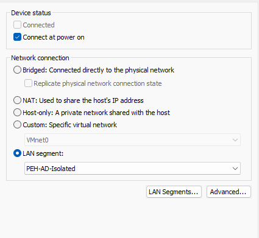
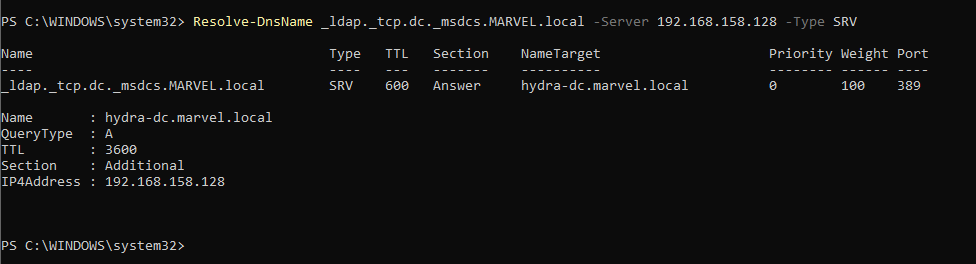
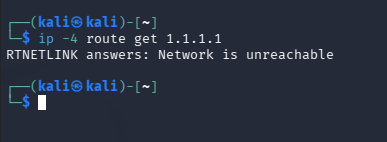

# PEH Active Directory Penetration Testing Lab

A hands-on Active Directory security-assessment portfolio project based on TCM Security's **Practical Ethical Hacking (PEH)** course, taught by Heath Adams.

> **Status — reviewed 21 November 2026:** Lab configuration and baseline enumeration are documented. **No initial attack, credential compromise or post-compromise technique has been demonstrated in this repository.** Course progress is not independent evidence of technical execution.

## Overview

This repository documents the design, administration and authorised assessment of a small Windows Active Directory training environment. It separates **screenshot-verified observations**, **user-confirmed actions**, **historical configurations** and **planned work**. The dated [assessment journal](docs/03-assessment-journal.md) preserves the sequence of changes.

## Current lab configuration

The four guests were **reported migrated** from an earlier VMware NAT configuration to the dedicated LAN segment `PEH-AD-Isolated` on **20 November 2026**. Guest address and connectivity evidence supports the resulting local lab configuration. The all-VM, single-adapter VMware audit was **user-confirmed**, not independently screenshot-verified for every guest.

| Guest | Role / domain | Current observed IPv4 | Current settings / evidence |
| --- | --- | --- | --- |
| **HYDRA-DC** | AD domain controller and Global Catalog; `MARVEL.local` | `192.168.158.128/24` | Static IP; no gateway; DNS loopback. AD role confirmed through `Get-ADDomainController`. |
| **SPIDERMAN** | Windows client; locally reports membership in `MARVEL.local` | `192.168.158.129/24` | Static IP; DNS `.128`; no gateway. TCP 389, DNS A/SRV and forced DC Locator tested. **Computer secure-channel check remains unresolved.** |
| **THEPUNISHER** | Windows client; locally reports membership in `MARVEL.local` | `192.168.158.130/24` | Static IP; DNS `.128`; no gateway. TCP 389 tested. |
| **Kali Linux** | Authorised lab tester | `192.168.158.131/24` | Static IPv4; DNS `.128`; no default IPv4/IPv6 route shown. ICMP to HYDRA-DC succeeded. |

The original **NAT/VMnet8**, DHCP and gateway observations are retained as historical evidence in [network architecture](docs/02-network-architecture.md). They **must not** be read as the current guest configuration. Verified local paths and the absence of a default route on Kali support containment, but **do not prove absolute isolation of the host or hypervisor**.

## Progress snapshot

| Area | Status | What the evidence establishes |
| --- | --- | --- |
| VMware and Windows/AD inventory | Baseline documented | HYDRA-DC role and configured domain membership of both Windows clients; OS editions and individual services require separate checks |
| Isolated LAN migration | User-confirmed, with supporting screenshots | Four guest IP configurations, Kali routes and selected connectivity tests |
| Network and AD discovery | Verified for specified tests | Kali → HYDRA-DC ICMP; both clients → HYDRA-DC TCP/389; SPIDERMAN AD DNS A/SRV and DC Locator |
| Active Directory structure | Partially enumerated | Two OUs; 20 direct groups in `OU=Groups`; three direct members of `Domain Admins` |
| Intentionally vulnerable service account | Prerequisite verified; attack **not** executed | `SQLService` is a direct `Domain Admins` member with SPN `HYDRA-DC/SQLService.MARVEL.local:60111` |
| SPIDERMAN machine trust | **Unresolved** | Repeated `Test-ComputerSecureChannel=False`; `nltest /sc_query` previously reported last-used success. Track in [issue #1](https://github.com/ObitoX86/PEH-active-directory-lab/issues/1) |
| Initial attacks and post-compromise testing | **Not yet verified** | No attack results or recovered credentials documented |
| Defensive validation and final report | Planned | Findings require individually observed outcomes and evidence |

**Important distinction:** Reaching TCP/389 and locating the domain controller do **not** establish a successful authenticated LDAP bind, domain logon, or healthy computer secure channel.

## Repository guide

- [ROADMAP.md](ROADMAP.md) — completed milestones, outstanding tasks and PEH learning phases.
- [docs/01-lab-overview.md](docs/01-lab-overview.md) — current scope, verified hosts and historical baseline.
- [docs/02-network-architecture.md](docs/02-network-architecture.md) — **current** topology, historical NAT diagram and migration evidence.
- [docs/03-assessment-journal.md](docs/03-assessment-journal.md) — chronological evidence-backed lab journal; older statements are historical.
- [docs/04-finding-template.md](docs/04-finding-template.md) — template for an independently verified security finding.
- [docs/05-mitigation-mapping.md](docs/05-mitigation-mapping.md) — PEH study topics and defence hypotheses, not claims of attacks completed.
- [docs/06-active-directory-structure.md](docs/06-active-directory-structure.md) — OU, group, privileged membership and SPN evidence.
- [evidence/INDEX.md](evidence/INDEX.md) — **40 uploaded PNGs** with an inline gallery.
- [evidence/README.md](evidence/README.md) — evidence handling and publication checks.
- [evidence/UPLOAD-PLAN-2026-11-20.md](evidence/UPLOAD-PLAN-2026-11-20.md) — completed batch-2 upload manifest (historical).

## Selected evidence

| Lab configuration | Discovery | Containment check |
| --- | --- | --- |
|  |  |  |

For all screenshots and their limitations, see the [evidence index](evidence/INDEX.md). Image presence does not certify that every screenshot has been checked for disclosure risk.

## Scope, ethics and evidence standards

Testing is restricted to owned or expressly authorised lab machines and services. Never direct poisoning, credential capture or intrusive assessments at NAT, bridged, third-party or production networks. Preserve snapshots and confirm network scope before active work.

For each exercise record the **objective, authorised targets, method, output, interpretation, limitations, defensive controls and evidence**. Distinguish screenshots from user confirmations. Do not publish passwords, hashes, tickets, tokens or real personal data.

**Publication note:** GitHub currently reports this repository as **public**. Check screenshots and Git history for information that should not be published; a `.gitignore` does not remove data already committed.

## Next milestone

Continue with a **non-invasive Responder help/readiness check** and passive observation in the authorised lab before considering any active demonstration. Keep [SPIDERMAN's secure-channel issue](https://github.com/ObitoX86/PEH-active-directory-lab/issues/1) open until independently resolved. Any new security finding must be supported by its own reproduction and redacted evidence.
