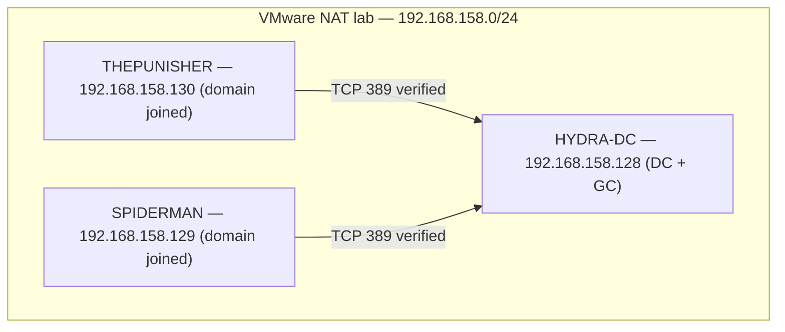

# Network Architecture

## Observed machines

The VMware Workstation inventory screenshot (2026-11-20) contains three display names:

```text
VMware Workstation — My Computer
  - Windows Server 2022
  - THEPUNISHER
  - SPIDERMAN
```

The displayed names alone do not prove host roles, domain membership or network links.

## Verified server network configuration — `ipconfig /all` screenshot, 2026-11-20

| Field | Observed value |
| --- | --- |
| VMware display name | Windows Server 2022 |
| Windows host name | `HYDRA-DC` |
| Primary DNS suffix | `MARVEL.local` |
| Ethernet adapter description | Intel(R) 82574L Gigabit Network Connection |
| IPv4 address | `192.168.158.128` (preferred) |
| Subnet mask | `255.255.255.0` (`/24`) |
| IPv4 network | `192.168.158.0/24` (calculated from mask) |
| DHCP enabled | No |
| Default gateway | None shown |
| DNS servers | `::1` and `127.0.0.1` (loopback) |
| IP routing enabled | No |

**Interpretation:** DHCP is disabled; an IPv4 address is configured. The DNS servers are loopback addresses. An additional successful `Get-ADDomainController` query verifies the server is identified as an AD domain controller and Global Catalog; it does not independently test DNS availability or every AD service. The server's VMware adapter mode was subsequently verified as **NAT** by screenshot; the user confirmed **NAT** for both client adapters without providing separate Settings screenshots. Both clients have addresses in the same IPv4 subnet.

**Prior observation caveat:** An earlier troubleshooting session used a direct UNC path to `192.168.10.10`, whereas the current screenshot reports `192.168.158.128` for `HYDRA-DC`. Do not assume these are the same host/interface or that the network was changed without confirming the configuration.

## Verified VMware adapter mode — HYDRA-DC (VMware Settings screenshot, 2026-11-20)

| Property | Verified setting |
| --- | --- |
| VM display name | Windows Server 2022 (guest: `HYDRA-DC`) |
| VMware Network Adapter | **NAT: Used to share the host's IP address** |
| Connected | Checked |
| Connect at power on | Checked |

**Interpretation:** NAT normally allows the guest to share the host's network connection and may permit outbound connectivity. This does **not** guarantee an isolated or offline assessment environment. The user has also confirmed that THEPUNISHER and SPIDERMAN are configured for NAT; this is user-reported rather than screenshot-verified. The inactive `VMnet0` field in the screenshot is not evidence that the selected NAT adapter uses that virtual network.

**Assessment safety:** Before running intrusive or noisy training exercises, confirm all participating VMs' adapter modes and intended connectivity. Avoid changing the working network before documenting the configuration and assessing the impact on DNS, DHCP and the lab domain.

## Verified AD domain controller identity — PowerShell screenshot, 2026-11-20

```powershell
Get-ADDomainController -Identity HYDRA-DC |
    Select-Object HostName, Domain, IPv4Address, IsGlobalCatalog
```

| Returned property | Value |
| --- | --- |
| HostName | `HYDRA-DC.MARVEL.local` |
| Domain | `MARVEL.local` |
| IPv4Address | `192.168.158.128` |
| IsGlobalCatalog | `True` |

**Interpretation:** The successful query establishes that Active Directory recognises `HYDRA-DC` as a domain controller with the Global Catalog flag enabled. It is not a substitute for client DNS, logon or service-health testing. Evidence screenshot remains in the chat pending redacted upload.

## Verified client network configuration — THEPUNISHER (`ipconfig /all` screenshot, 2026-11-20)

| Field | Observed value |
| --- | --- |
| VMware display name / host name | `THEPUNISHER` |
| Primary DNS suffix | `MARVEL.local` |
| Connection-specific DNS suffix | `localdomain` |
| IPv4 address | `192.168.158.130` (preferred) |
| Subnet mask | `255.255.255.0` (`/24`) |
| DHCP enabled | Yes |
| Default gateway | `192.168.158.2` |
| DHCP server | `192.168.158.254` |
| DNS server | `192.168.158.128` |
| Primary WINS server | `192.168.158.2` |
| NetBIOS over TCP/IP | Enabled |

**Comparison:** The client and HYDRA-DC (`192.168.158.128/24`) are configured in the same IPv4 subnet (`192.168.158.0/24`). The client's configured DNS address matches the domain controller's IPv4 address. This establishes intended DNS configuration, **not** a successful DNS lookup or end-to-end network connectivity. Domain membership was later verified separately with a local Windows CIM query. DHCP service is configured at a separate address (`192.168.158.254`). VMware NAT mode has been confirmed for the server (screenshot) and both clients (user report).

## Verified THEPUNISHER domain membership — PowerShell screenshot, 2026-11-20

```powershell
Get-CimInstance Win32_ComputerSystem |
    Select-Object Name, Domain, PartOfDomain
```

| Property | Value |
| --- | --- |
| Name | `THEPUNISHER` |
| Domain | `MARVEL.local` |
| PartOfDomain | `True` |

**Interpretation:** The client computer reports that it is joined to the `MARVEL.local` domain. This verifies configured domain membership; active communication with the domain controller, live authentication and current Group Policy operation require further testing.

## Verified SPIDERMAN network configuration — `ipconfig /all` screenshot, 2026-11-20

| Field | Observed value |
| --- | --- |
| VMware display name / host name | `SPIDERMAN` |
| Primary DNS suffix | `MARVEL.local` |
| Connection-specific DNS suffix | `localdomain` |
| IPv4 address | `192.168.158.129` (preferred) |
| Subnet mask | `255.255.255.0` (`/24`) |
| DHCP enabled | Yes |
| Default gateway | `192.168.158.2` |
| DHCP server | `192.168.158.254` |
| DNS server | `192.168.158.128` |
| Primary WINS server | `192.168.158.2` |
| NetBIOS over TCP/IP | Enabled |

**Comparison:** SPIDERMAN is configured within `192.168.158.0/24` alongside HYDRA-DC and THEPUNISHER. Its configured DNS server matches HYDRA-DC's IPv4 address. DHCP assigns the client configuration from `192.168.158.254`. This proves the observed settings, **not** working DNS or network reachability. Domain membership was verified separately using a CIM query.

## Verified SPIDERMAN domain membership — PowerShell screenshot, 2026-11-20

```powershell
Get-CimInstance Win32_ComputerSystem |
    Select-Object Name, Domain, PartOfDomain
```

| Property | Value |
| --- | --- |
| Name | `SPIDERMAN` |
| Domain | `MARVEL.local` |
| PartOfDomain | `True` |

**Interpretation:** The local Windows computer reports that SPIDERMAN is joined to the `MARVEL.local` domain. This demonstrates configured membership, not a fresh successful domain authentication. Screenshot was supplied in the project conversation, not committed as an image.

## Verified DNS name resolution from THEPUNISHER — PowerShell screenshot, 2026-11-20

**Command executed on THEPUNISHER:**

```powershell
Resolve-DnsName HYDRA-DC.MARVEL.local
```

**Observed answer:**

| Property | Value |
| --- | --- |
| Name | `HYDRA-DC.MARVEL.local` |
| Type | `A` |
| Section | `Answer` |
| TTL | `3600` seconds |
| IPAddress | `192.168.158.128` |

**Interpretation:** The client successfully resolved HYDRA-DC's fully qualified hostname to the domain controller's previously recorded IPv4 address. The client was configured to use `192.168.158.128` as DNS in the earlier `ipconfig /all` output. This demonstrates successful name resolution for this record but does not independently verify Kerberos/LDAP operation, current domain authentication, or connectivity to every server service. The screenshot was provided in the conversation; an image copy has not been committed.

## Verified TCP connectivity to LDAP port — THEPUNISHER (PowerShell screenshot, 2026-11-20)

**Command run on THEPUNISHER:**

```powershell
Test-NetConnection HYDRA-DC.MARVEL.local -Port 389
```

**Observed output:**

```text
ComputerName     : HYDRA-DC.MARVEL.local
RemoteAddress    : 192.168.158.128
RemotePort       : 389
InterfaceAlias   : Ethernet0
SourceAddress    : 192.168.158.130
TcpTestSucceeded : True
```

**Interpretation:** TCP connection from `192.168.158.130` to `192.168.158.128:389` succeeded. Port 389 is commonly associated with LDAP. This confirms reachability to a TCP listener on that port, but does not prove an LDAP bind, directory query, user authentication, or the health of every Active Directory service. Evidence is currently in the conversation; no screenshot file has been uploaded to the repository.

**Next check:** Compare the TCP result against SPIDERMAN, then verify domain controller discovery and authentication independently.

## Verified TCP connectivity to LDAP port — SPIDERMAN (PowerShell screenshot, 2026-11-20)

**Command run on SPIDERMAN:**

```powershell
Test-NetConnection HYDRA-DC.MARVEL.local -Port 389
```

**Observed output:**

```text
ComputerName     : HYDRA-DC.MARVEL.local
RemoteAddress    : 192.168.158.128
RemotePort       : 389
InterfaceAlias   : Ethernet0
SourceAddress    : 192.168.158.129
TcpTestSucceeded : True
```

**Interpretation:** A TCP connection from SPIDERMAN (`192.168.158.129`) to HYDRA-DC (`192.168.158.128`) port 389 succeeded. This is the same outcome already observed from THEPUNISHER. The hostname was resolved as part of the connection test, but a standalone SPIDERMAN DNS query has not been recorded. Neither test is evidence of a successful LDAP bind, Kerberos authentication or domain logon. The screenshot remains in the conversation; it is not yet stored in the repository.

## Verified domain controller discovery — SPIDERMAN (`nltest` screenshot, 2026-11-20)

**Command executed on SPIDERMAN:**

```powershell
nltest /dsgetdc:MARVEL.local
```

**Observed results:**

| Field | Returned value |
| --- | --- |
| DC | `\\\\HYDRA-DC.MARVEL.local` |
| Address | `\\\\192.168.158.128` |
| Domain / forest | `MARVEL.local` |
| DC site / client site | `Default-First-Site-Name` |
| Status | `The command completed successfully` |
| Selected flags | `PDC`, `GC`, `DS`, `LDAP`, `KDC`, `WRITABLE`, `DNS_DC`, `DNS_DOMAIN`, `DNS_FOREST`, `TIMESERV` |

**Interpretation:** From SPIDERMAN, Windows successfully located a domain controller for `MARVEL.local`, returning the expected hostname and IPv4 address. Flags describe advertised domain-controller roles and capabilities, including Global Catalog, Kerberos KDC, LDAP and PDC emulator. A successful `nltest /dsgetdc` lookup does **not** verify a computer secure channel, a fresh authenticated user session or every advertised service.

**Evidence:** Screenshot provided in the conversation on 2026-11-20; no screenshot image has been committed to GitHub. The domain GUID is omitted from this public-facing record because it is not necessary to explain the result.

**Next verification:** SPIDERMAN ran the non-repairing `Test-ComputerSecureChannel -Verbose` command; it reported `False` (see diagnostic entry below).

## SPIDERMAN domain secure-channel check — failed (PowerShell screenshot, 2026-11-20)

**Command run on SPIDERMAN:**

```powershell
Test-ComputerSecureChannel -Verbose
```

**Observed output:**

```text
VERBOSE: Performing the operation "Test-ComputerSecureChannel" on target "SPIDERMAN".
False
VERBOSE: The secure channel between the local computer and the domain MARVEL.local is broken.
```

**Status:** Failed diagnostic check; **cause not yet established**. The screenshot doesn't establish whether PowerShell was elevated. Microsoft's documentation instructs running this cmdlet as administrator on supported Windows client systems.

**Interpretation:** Even though SPIDERMAN is configured as a domain member, discovers HYDRA-DC, and can establish TCP 389, its computer-domain secure-channel test returned `False`. Domain discovery and a reachable LDAP port do not prove the computer's account trust works. Possible explanations require further investigation; do not label a specific root cause or a security vulnerability from this output alone.

**Next step:** Open PowerShell **as Administrator** on SPIDERMAN and run `nltest /sc_query:MARVEL.local` to inspect the secure channel's last reported state and status codes. This query does not repair or reset the secure channel. Note that Microsoft's `nltest` documentation describes `/sc_query` as reporting the channel state the last time it was used.

**Evidence:** Screenshot supplied in the conversation; no image uploaded to GitHub.

## Verified connection from earlier troubleshooting

A Windows client referred to as **Punisher** accessed a lab Windows server using a direct UNC path by private IP. This is evidence of that specific connection; it does not verify all three VMware entries, the domain setup, or network discovery settings. The exact relationship between the previously reported client and **THEPUNISHER** is to be confirmed.

## Configuration diagram (IP/DNS/domain from screenshots; NAT for clients user-confirmed)

```text
          [HYDRA-DC]                    AD domain controller + GC; VMware adapter: NAT
          192.168.158.128/24             Domain: MARVEL.local
                 ^
                 | Configured as DNS server by both clients
          +------+----------------------+
          |                             |
   [THEPUNISHER]                   [SPIDERMAN]
   192.168.158.130/24              192.168.158.129/24
   Domain joined: YES              Domain joined: YES
   DHCP enabled                    DHCP enabled
   Gateway: 192.168.158.2          Gateway: 192.168.158.2

   All three IPv4 settings fall within 192.168.158.0/24.
   Diagram reflects configuration plus one successful DNS lookup.
   TCP 389 connections from THEPUNISHER and SPIDERMAN to HYDRA-DC: SUCCESS.
   SPIDERMAN domain-controller discovery: SUCCESS (nltest /dsgetdc).
   Authenticated LDAP binding and user logon remain untested.
   SPIDERMAN secure-channel test: FALSE — diagnostic investigation pending.
   All three VMs: NAT (server screenshot; clients user report).
   NAT switch identity not independently verified; TCP 389 paths tested.
```

### Portfolio topology (Mermaid)

The arrows below reflect **only the tested TCP 389 paths**; other network paths are not implied.



Both clients are configured to use HYDRA-DC for DNS; THEPUNISHER also has a separate successful DNS A-record lookup. DHCP for both clients is reported as `192.168.158.254`, and the configured default gateway is `192.168.158.2`. These network services are not drawn as independently verified infrastructure machines.

## Details to confirm

1. Installed operating systems and purposes for each of the three VMs.
2. Which additional domain controller services are functioning (AD controller identity is verified).
3. Additional domain configuration and DNS health (domain identified as `MARVEL.local`; publish only if safe).
4. Screenshot evidence for client NAT configuration if needed (their NAT settings are user-confirmed).
5. Validate other services and authenticated domain operations (both clients succeeded on TCP 389; THEPUNISHER also succeeded in a separate DNS lookup).
6. Diagnose SPIDERMAN secure-channel check failure (returned False); confirm elevation and inspect read-only nltest channel query. Authenticated domain operations remain untested.
7. Redacted screenshot evidence for architecture and configuration.

This diagram is grounded in supplied settings and successful TCP tests. Expand it only when subsequent tests verify additional paths.
