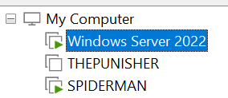
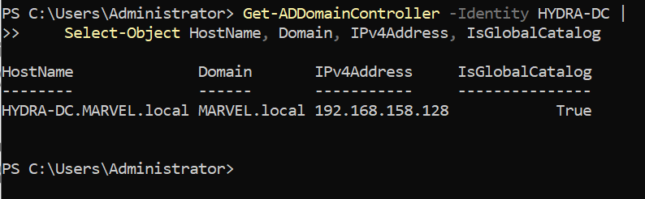
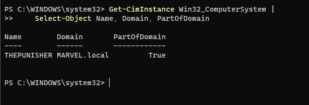
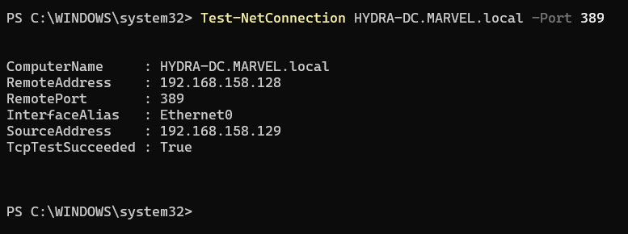
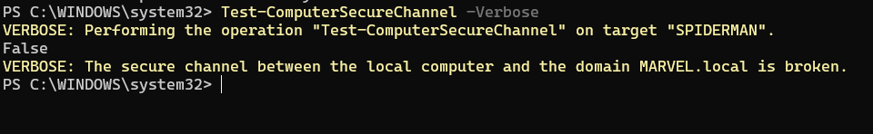
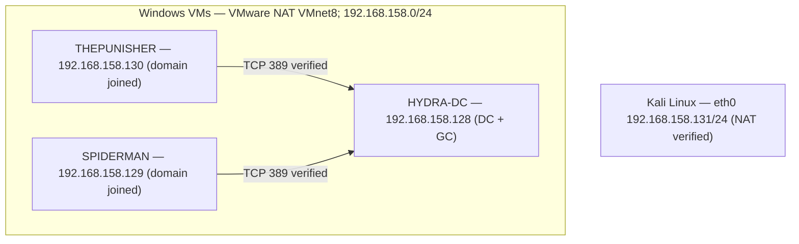

# Network Architecture

## Observed machines

**Screenshot evidence:**



The VMware Workstation inventory screenshot (2026-11-20) contains three display names:

```text
VMware Workstation — My Computer
  - Windows Server 2022
  - THEPUNISHER
  - SPIDERMAN
```

The displayed names alone do not prove host roles, domain membership or network links.

## Verified server network configuration — `ipconfig /all` screenshot, 2026-11-20

**Screenshot evidence:**


| Field | Observed value |
| --- | --- |
| VMware display name | Windows Server 2022 |
| Windows host name | `HYDRA-DC` |
| Primary DNS suffix | `MARVEL.local` |
| Ethernet adapter description | Intel(R) 82574L Gigabit Network Connection |
| IPv4 address | `192.168.158.128` (preferred) |
| Subnet mask | `255.255.255.0` (`/24`) |
| IPv4 network | `192.168.158.0/24` (calculated from mask) |
| DHCP enabled | No |
| Default gateway | None shown |
| DNS servers | `::1` and `127.0.0.1` (loopback) |
| IP routing enabled | No |

**Interpretation:** DHCP is disabled; an IPv4 address is configured. The DNS servers are loopback addresses. An additional successful `Get-ADDomainController` query verifies the server is identified as an AD domain controller and Global Catalog; it does not independently test DNS availability or every AD service. The server's VMware adapter mode was subsequently verified as **NAT** by screenshot; the user confirmed **NAT** for both client adapters without providing separate Settings screenshots. Both clients have addresses in the same IPv4 subnet.

**Prior observation caveat:** An earlier troubleshooting session used a direct UNC path to `192.168.10.10`, whereas the current screenshot reports `192.168.158.128` for `HYDRA-DC`. Do not assume these are the same host/interface or that the network was changed without confirming the configuration.

## Verified VMware adapter mode — HYDRA-DC (VMware Settings screenshot, 2026-11-20)

**Screenshot evidence:**


| Property | Verified setting |
| --- | --- |
| VM display name | Windows Server 2022 (guest: `HYDRA-DC`) |
| VMware Network Adapter | **NAT: Used to share the host's IP address** |
| Connected | Checked |
| Connect at power on | Checked |

**Interpretation:** NAT normally allows the guest to share the host's network connection and may permit outbound connectivity. This does **not** guarantee an isolated or offline assessment environment. The user has also confirmed that THEPUNISHER and SPIDERMAN are configured for NAT; this is user-reported rather than screenshot-verified. The inactive `VMnet0` field in the screenshot is not evidence that the selected NAT adapter uses that virtual network.

**Assessment safety:** Before running intrusive or noisy training exercises, confirm all participating VMs' adapter modes and intended connectivity. Avoid changing the working network before documenting the configuration and assessing the impact on DNS, DHCP and the lab domain.

## Verified AD domain controller identity — PowerShell screenshot, 2026-11-20

**Screenshot evidence:**



```powershell
Get-ADDomainController -Identity HYDRA-DC |
    Select-Object HostName, Domain, IPv4Address, IsGlobalCatalog
```

| Returned property | Value |
| --- | --- |
| HostName | `HYDRA-DC.MARVEL.local` |
| Domain | `MARVEL.local` |
| IPv4Address | `192.168.158.128` |
| IsGlobalCatalog | `True` |

**Interpretation:** The successful query establishes that Active Directory recognises `HYDRA-DC` as a domain controller with the Global Catalog flag enabled. It is not a substitute for client DNS, logon or service-health testing. The evidence screenshot is linked above.

## Verified client network configuration — THEPUNISHER (`ipconfig /all` screenshot, 2026-11-20)

**Screenshot evidence:**


| Field | Observed value |
| --- | --- |
| VMware display name / host name | `THEPUNISHER` |
| Primary DNS suffix | `MARVEL.local` |
| Connection-specific DNS suffix | `localdomain` |
| IPv4 address | `192.168.158.130` (preferred) |
| Subnet mask | `255.255.255.0` (`/24`) |
| DHCP enabled | Yes |
| Default gateway | `192.168.158.2` |
| DHCP server | `192.168.158.254` |
| DNS server | `192.168.158.128` |
| Primary WINS server | `192.168.158.2` |
| NetBIOS over TCP/IP | Enabled |

**Comparison:** The client and HYDRA-DC (`192.168.158.128/24`) are configured in the same IPv4 subnet (`192.168.158.0/24`). The client's configured DNS address matches the domain controller's IPv4 address. This establishes intended DNS configuration, **not** a successful DNS lookup or end-to-end network connectivity. Domain membership was later verified separately with a local Windows CIM query. DHCP service is configured at a separate address (`192.168.158.254`). VMware NAT mode has been confirmed for the server (screenshot) and both clients (user report).

## Verified THEPUNISHER domain membership — PowerShell screenshot, 2026-11-20

**Screenshot evidence:**



```powershell
Get-CimInstance Win32_ComputerSystem |
    Select-Object Name, Domain, PartOfDomain
```

| Property | Value |
| --- | --- |
| Name | `THEPUNISHER` |
| Domain | `MARVEL.local` |
| PartOfDomain | `True` |

**Interpretation:** The client computer reports that it is joined to the `MARVEL.local` domain. This verifies configured domain membership; active communication with the domain controller, live authentication and current Group Policy operation require further testing.

## Verified SPIDERMAN network configuration — `ipconfig /all` screenshot, 2026-11-20

**Screenshot evidence:**


| Field | Observed value |
| --- | --- |
| VMware display name / host name | `SPIDERMAN` |
| Primary DNS suffix | `MARVEL.local` |
| Connection-specific DNS suffix | `localdomain` |
| IPv4 address | `192.168.158.129` (preferred) |
| Subnet mask | `255.255.255.0` (`/24`) |
| DHCP enabled | Yes |
| Default gateway | `192.168.158.2` |
| DHCP server | `192.168.158.254` |
| DNS server | `192.168.158.128` |
| Primary WINS server | `192.168.158.2` |
| NetBIOS over TCP/IP | Enabled |

**Comparison:** SPIDERMAN is configured within `192.168.158.0/24` alongside HYDRA-DC and THEPUNISHER. Its configured DNS server matches HYDRA-DC's IPv4 address. DHCP assigns the client configuration from `192.168.158.254`. This proves the observed settings, **not** working DNS or network reachability. Domain membership was verified separately using a CIM query.

## Verified SPIDERMAN domain membership — PowerShell screenshot, 2026-11-20

**Screenshot evidence:**


```powershell
Get-CimInstance Win32_ComputerSystem |
    Select-Object Name, Domain, PartOfDomain
```

| Property | Value |
| --- | --- |
| Name | `SPIDERMAN` |
| Domain | `MARVEL.local` |
| PartOfDomain | `True` |

**Interpretation:** The local Windows computer reports that SPIDERMAN is joined to the `MARVEL.local` domain. This demonstrates configured membership, not a fresh successful domain authentication. The screenshot is linked above.

## Verified DNS name resolution from THEPUNISHER — PowerShell screenshot, 2026-11-20

**Screenshot evidence:**


**Command executed on THEPUNISHER:**

```powershell
Resolve-DnsName HYDRA-DC.MARVEL.local
```

**Observed answer:**

| Property | Value |
| --- | --- |
| Name | `HYDRA-DC.MARVEL.local` |
| Type | `A` |
| Section | `Answer` |
| TTL | `3600` seconds |
| IPAddress | `192.168.158.128` |

**Interpretation:** The client successfully resolved HYDRA-DC's fully qualified hostname to the domain controller's previously recorded IPv4 address. The client was configured to use `192.168.158.128` as DNS in the earlier `ipconfig /all` output. This demonstrates successful name resolution for this record but does not independently verify Kerberos/LDAP operation, current domain authentication, or connectivity to every server service. The screenshot is linked above.

## Verified TCP connectivity to LDAP port — THEPUNISHER (PowerShell screenshot, 2026-11-20)

**Screenshot evidence:**


**Command run on THEPUNISHER:**

```powershell
Test-NetConnection HYDRA-DC.MARVEL.local -Port 389
```

**Observed output:**

```text
ComputerName     : HYDRA-DC.MARVEL.local
RemoteAddress    : 192.168.158.128
RemotePort       : 389
InterfaceAlias   : Ethernet0
SourceAddress    : 192.168.158.130
TcpTestSucceeded : True
```

**Interpretation:** TCP connection from `192.168.158.130` to `192.168.158.128:389` succeeded. Port 389 is commonly associated with LDAP. This confirms reachability to a TCP listener on that port, but does not prove an LDAP bind, directory query, user authentication, or the health of every Active Directory service. The screenshot is linked above.

**Next check:** Compare the TCP result against SPIDERMAN, then verify domain controller discovery and authentication independently.

## Verified TCP connectivity to LDAP port — SPIDERMAN (PowerShell screenshot, 2026-11-20)

**Screenshot evidence:**



**Command run on SPIDERMAN:**

```powershell
Test-NetConnection HYDRA-DC.MARVEL.local -Port 389
```

**Observed output:**

```text
ComputerName     : HYDRA-DC.MARVEL.local
RemoteAddress    : 192.168.158.128
RemotePort       : 389
InterfaceAlias   : Ethernet0
SourceAddress    : 192.168.158.129
TcpTestSucceeded : True
```

**Interpretation:** A TCP connection from SPIDERMAN (`192.168.158.129`) to HYDRA-DC (`192.168.158.128`) port 389 succeeded. This is the same outcome already observed from THEPUNISHER. The hostname was resolved as part of the connection test, but a standalone SPIDERMAN DNS query has not been recorded. Neither test is evidence of a successful LDAP bind, Kerberos authentication or domain logon. The screenshot is linked above.

## Verified domain controller discovery — SPIDERMAN (`nltest` screenshot, 2026-11-20)

**Screenshot evidence:**


**Command executed on SPIDERMAN:**

```powershell
nltest /dsgetdc:MARVEL.local
```

**Observed results:**

| Field | Returned value |
| --- | --- |
| DC | `\\\\HYDRA-DC.MARVEL.local` |
| Address | `\\\\192.168.158.128` |
| Domain / forest | `MARVEL.local` |
| DC site / client site | `Default-First-Site-Name` |
| Status | `The command completed successfully` |
| Selected flags | `PDC`, `GC`, `DS`, `LDAP`, `KDC`, `WRITABLE`, `DNS_DC`, `DNS_DOMAIN`, `DNS_FOREST`, `TIMESERV` |

**Interpretation:** From SPIDERMAN, Windows successfully located a domain controller for `MARVEL.local`, returning the expected hostname and IPv4 address. Flags describe advertised domain-controller roles and capabilities, including Global Catalog, Kerberos KDC, LDAP and PDC emulator. A successful `nltest /dsgetdc` lookup does **not** verify a computer secure channel, a fresh authenticated user session or every advertised service.

**Evidence:** Screenshot linked above and indexed in the evidence register. The domain GUID is omitted from this public-facing record because it is not necessary to explain the result.

**Next verification:** SPIDERMAN ran the non-repairing `Test-ComputerSecureChannel -Verbose` command; it reported `False` (see diagnostic entry below).

## SPIDERMAN domain secure-channel check — failed (PowerShell screenshot, 2026-11-20)

**Screenshot evidence:**



**Command run on SPIDERMAN:**

```powershell
Test-ComputerSecureChannel -Verbose
```

**Observed output:**

```text
VERBOSE: Performing the operation "Test-ComputerSecureChannel" on target "SPIDERMAN".
False
VERBOSE: The secure channel between the local computer and the domain MARVEL.local is broken.
```

**Status:** Failed diagnostic check; **cause not yet established**. The screenshot doesn't establish whether PowerShell was elevated. Microsoft's documentation instructs running this cmdlet as administrator on supported Windows client systems.

**Interpretation:** Even though SPIDERMAN is configured as a domain member, discovers HYDRA-DC, and can establish TCP 389, its computer-domain secure-channel test returned `False`. Domain discovery and a reachable LDAP port do not prove the computer's account trust works. Possible explanations require further investigation; do not label a specific root cause or a security vulnerability from this output alone.

**Next step:** The user ran `nltest /sc_query:MARVEL.local`, which returned `NERR_Success` (see below). Because `/sc_query` reports last-used secure-channel status rather than necessarily performing a fresh verification, rerun `Test-ComputerSecureChannel -Verbose` in an elevated PowerShell session before interpreting the discrepancy.

**Evidence:** Screenshot linked above.

## SPIDERMAN Netlogon secure-channel status query — success (screenshot, 2026-11-20)

**Screenshot evidence:**


**Command run on SPIDERMAN:**

```powershell
nltest /sc_query:MARVEL.local
```

**Observed output:**

```text
Flags: 30 HAS_IP  HAS_TIMESERV Authentication Service: Netlogon
Trusted DC Name \\HYDRA-DC.MARVEL.local
Trusted DC Connection Status Status = 0 0x0 NERR_Success
The command completed successfully
```

**Interpretation:** The Netlogon query reports `0x0 NERR_Success` for the last-used secure-channel state with `HYDRA-DC.MARVEL.local`. However, the earlier `Test-ComputerSecureChannel -Verbose` returned `False`. The two observations should **both** be retained; success from a last-used-state query does not conclusively override a failed direct test. Whether the earlier PowerShell session was elevated is unknown. No repair has been performed.

**Follow-up result:** The user reported rerunning `Test-ComputerSecureChannel -Verbose` as Administrator on SPIDERMAN; it **still returned `False`**. Root cause remains unverified. Repair is deferred while the course continues. See [tracking issue #1](https://github.com/ObitoX86/PEH-active-directory-lab/issues/1). The repeated output was reported in chat, not screenshot-submitted.

**Evidence:** Screenshot linked above; this entry includes only the relevant observations.

## Verified connection from earlier troubleshooting

A Windows client referred to as **Punisher** accessed a lab Windows server using a direct UNC path by private IP. This is evidence of that specific connection; it does not verify all three VMware entries, the domain setup, or network discovery settings. The exact relationship between the previously reported client and **THEPUNISHER** is to be confirmed.

## Kali Linux testing VM — interface inventory (2026-11-20)

A terminal screenshot from Kali shows the read-only command:

```bash
ip -br addr
```

```text
lo     UNKNOWN  127.0.0.1/8  ::1/128
eth0   UP       192.168.158.131/24  fe80::5e29:65cd:2a93:70b9/64
```

**Interpretation:** Kali's `eth0` interface is UP and has `192.168.158.131/24`. This is within the `192.168.158.0/24` IPv4 subnet already recorded for HYDRA-DC, THEPUNISHER and SPIDERMAN. Same-subnet addressing alone does not prove the Kali guest is connected to the same VMware virtual switch, has a working route to the Windows systems, or is isolated from unintended targets.

### Kali VMware adapter mode verified (Settings screenshot, 2026-11-20)

| Setting | Observed |
| --- | --- |
| Network connection | NAT selected |
| Device status | Connected checked |
| Connect at power on | Checked |
| Allocated RAM | 8 GB |
| Virtual processors | 4 |

**Interpretation:** All four lab machines now have NAT recorded: screenshot evidence for HYDRA-DC and Kali, and user confirmation for the two Windows clients. This does **not** establish that all four occupy the exact same VMware virtual network, nor that the segment is safe for LLMNR/NBT-NS poisoning. The `VMnet0` field visible below the inactive Custom option is not the selected NAT network.

**Next safety verification:** Virtual Network Editor subsequently identified VMnet8 as the NAT subnet (see section below). Verify which other VMs and host adapters can reach VMnet8 and whether its NAT connection provides outbound access. Consider a dedicated non-routed/host-only or LAN-segment environment for traffic-poisoning exercises after preserving the current working configuration and confirming necessary DHCP/DNS arrangements. Take snapshots before network changes or active tests.

**Evidence:** User-supplied terminal screenshot dated 2026-11-20; PNG not yet uploaded to the repository.

## Verified VMware virtual networks — Virtual Network Editor (2026-11-20)

The VMware Virtual Network Editor screenshot shows:

| Network | Type | External connection | Host connection | DHCP | Subnet address |
| --- | --- | --- | --- | --- | --- |
| `VMnet1` | Host-only | None shown (`-`) | Connected | Enabled | `192.168.125.0` |
| `VMnet8` | NAT | NAT | Connected | Enabled | `192.168.158.0` |

**Interpretation:** The NAT network is **VMnet8** with subnet address `192.168.158.0`, consistent with the four guests' `192.168.158.x/24` addresses and their NAT adapter settings. This is strong evidence that the guests are configured for VMware's same NAT subnet, but does not itself show full end-to-end connectivity or prove no other guests have access. The subnet mask `255.255.255.0` shown at the bottom of the editor belongs to the **selected VMnet1**, not necessarily to VMnet8; the guests' `/24` masks were established separately from their network commands.

VMnet1 is an available **host-only** network using `192.168.125.0`. Switching the lab directly to it would change the addressing environment and may disrupt static domain-controller IP settings, DHCP, DNS and domain clients. **No configuration changes were made.**

**Security boundary:** VMnet8 has NAT enabled, and NAT does **not** provide a fully offline or fully isolated network. Before LLMNR/NBT-NS poisoning and SMB relay, plan a dedicated contained test segment, check other connected guests, and take verified VM snapshots. The host is connected to both VMnet1 and VMnet8 in this editor; no trust or route isolation should be presumed.

**Evidence:** VMware Virtual Network Editor screenshot provided in conversation on 2026-11-20. Redacted PNG not yet uploaded to GitHub.

## Historical NAT-baseline configuration diagram (before isolated-LAN migration)

```text
          [HYDRA-DC]                    AD domain controller + GC; VMware adapter: NAT
          192.168.158.128/24             Domain: MARVEL.local
                 ^
                 | Configured as DNS server by both clients
          +------+----------------------+
          |                             |
   [THEPUNISHER]                   [SPIDERMAN]
   192.168.158.130/24              192.168.158.129/24
   Domain joined: YES              Domain joined: YES
   DHCP enabled                    DHCP enabled
   Gateway: 192.168.158.2          Gateway: 192.168.158.2

   Kali Linux: eth0=192.168.158.131/24, interface UP.
   All four observed IPv4 settings fall within 192.168.158.0/24.
   Diagram reflects configuration plus one successful DNS lookup.
   TCP 389 connections from THEPUNISHER and SPIDERMAN to HYDRA-DC: SUCCESS.
   SPIDERMAN domain-controller discovery: SUCCESS (nltest /dsgetdc).
   Authenticated LDAP binding and user logon remain untested.
   SPIDERMAN secure-channel test: FALSE.
   SPIDERMAN nltest /sc_query last-used channel status: NERR_Success.
   Elevated repetition of Test-ComputerSecureChannel: FALSE (user-reported).
   Discrepancy unresolved; no repair performed.
   All four VMs: NAT (server + Kali screenshots; client modes user-reported).
   Kali VMware network mode: NAT (VMware Settings screenshot, 2026-11-20).
   VMware NAT VMnet8: 192.168.158.0 (Virtual Network Editor screenshot).
   Kali-to-Windows reachability and containment still untested.
```

### Historical NAT-baseline topology (Mermaid; not current attachment state)

The arrows below reflect **only the tested TCP 389 paths**; other network paths are not implied.



Kali is deliberately shown without a connection arrow because no Kali-to-Windows connectivity test has yet been completed. All four guests have NAT recorded, but whether they share one specific virtual switch and are adequately isolated is not yet verified.

Both clients are configured to use HYDRA-DC for DNS; THEPUNISHER also has a separate successful DNS A-record lookup. DHCP for both clients is reported as `192.168.158.254`, and the configured default gateway is `192.168.158.2`. These network services are not drawn as independently verified infrastructure machines.

## Planned isolated PEH LAN segment (user-confirmed creation, 2026-11-20)

The user reports having created a separate VMware LAN segment named `PEH-AD-Isolated`. Its creation has not been confirmed from a screenshot and no VM network adapter has yet been verified as moved.

**Planned addressing (not observed on the LAN segment yet):**

| Machine | Existing / planned IPv4 | Planned method | DNS and gateway |
| --- | --- | --- | --- |
| HYDRA-DC | `192.168.158.128/24` | Retain existing static IPv4 | Existing DNS loopback; no default gateway |
| SPIDERMAN | `192.168.158.129/24` | Set static after disconnection from NAT DHCP | DNS HYDRA-DC `.128`; no gateway |
| THEPUNISHER | `192.168.158.130/24` | Set static after disconnection from NAT DHCP | DNS HYDRA-DC `.128`; no gateway |
| Kali | `192.168.158.131/24` | Configure static on LAN segment | DNS `.128` when AD resolution needed; no gateway |

VMware LAN segments do not provide DHCP automatically; the existing NAT DHCP lease behaviour cannot be relied upon after migration. The `192.168.158.0/24` address range may be reused on a **separate isolated network** because the original NICs should be moved, not connected to both networks simultaneously. Until migration and reachability checks complete, this is only a proposal—not proof of IP retention or isolation.

**Sequence:** With backups in place, move the powered-off HYDRA-DC VM first because its IPv4 was already static; boot to check `.128`. Then move and configure Kali and clients individually with matching static addresses and DNS, test lab-only connectivity and verify no NAT bridge/extra NIC remains. Client-to-server connectivity can be interrupted during partial migration.

## Current migration status — HYDRA-DC addressing preserved (2026-11-20)

The user followed the instructions to move **HYDRA-DC** to LAN segment `PEH-AD-Isolated`, and supplied a screenshot of `ipconfig /all` on the powered-on server afterward.

| Observed field | Screenshot value |
| --- | --- |
| Hostname and DNS suffix | `HYDRA-DC`, `MARVEL.local` |
| Network interface | `Ethernet0` |
| IPv4 and subnet mask | `192.168.158.128`, `255.255.255.0` |
| DHCP | No (static) |
| Default gateway | Empty |
| DNS servers | `::1`, `127.0.0.1` |

**Interpretation:** The server's static IPv4, absence of gateway and loopback DNS resolver settings are preserved. A command run inside the guest does not independently show the VMware network adapter's selected segment. The migration is therefore **user-reported with post-migration guest IP evidence**, not direct VMware adapter-setting screenshot evidence. Do not infer working connections or isolation based solely on the IP configuration.

**Topology status:** The earlier NAT diagram above is now **historical baseline evidence** and does not represent all guests' current attachments. HYDRA-DC is reported on the isolated segment; Kali, THEPUNISHER and SPIDERMAN have not yet been confirmed migrated and may still be configured for NAT. This mixed state explains expected temporary loss of communication between guests.

**Subsequent Kali profile check (2026-11-20):** Running `nmcli -f NAME,DEVICE connection show --active` returned `Wired connection 1` on `eth0` and `lo` on `lo`. The active NetworkManager profile is now identified; IPv4 settings have not yet been changed or confirmed. **Planned next:** Save persistent static `192.168.158.131/24` and DNS `192.168.158.128` with no default gateway, verify the profile, migrate the powered-off Kali adapter, then test only the lab controller. Continue the clients afterward.

**Evidence:** `ipconfig /all` screenshot supplied on 2026-11-20; image not yet committed to `evidence/`.

## Details to confirm

1. Installed operating systems and purposes for each of the three VMs.
2. Which additional domain controller services are functioning (AD controller identity is verified).
3. Additional domain configuration and DNS health (domain identified as `MARVEL.local`; publish only if safe).
4. VMnet8 has been identified as NAT with subnet address 192.168.158.0. Verify actual Kali-to-Windows connectivity, NAT egress/containment and other attached systems before active network-interception exercises.
5. Validate other services and authenticated domain operations (both clients succeeded on TCP 389; THEPUNISHER also succeeded in a separate DNS lookup).
6. SPIDERMAN elevated secure-channel check repeated and still False; root cause and impact on computer-authenticated exercises remain unresolved. See issue #1; do not assume authenticated domain operations are healthy.
7. Redacted screenshot evidence for architecture and configuration.

This diagram is grounded in supplied settings and successful TCP tests. Expand it only when subsequent tests verify additional paths.
