# Network Architecture

## Current topology — after isolated-LAN migration (20 November 2026)

> **Read this section for the latest documented configuration.** The sections below retain earlier NAT, migration-plan and intermediate-state evidence in chronological order. Language such as “not yet migrated” and “next step” in those older sections applies **only at that stage** and is superseded by subsequent results.

All four guests were **user-reported** attached to the VMware LAN segment `PEH-AD-Isolated`, each with one NIC. Post-migration guest IP/configuration evidence and selected local connectivity tests were recorded. Kali's VMware LAN selection was photographed; the all-four-VM adapter audit was user-confirmed rather than separately screenshot-verified for every guest. No default IPv4/IPv6 route was shown on Kali; complete host/hypervisor isolation has not been independently proven.

| Guest | IPv4 | Post-migration network configuration | Verified test or limitation |
| --- | --- | --- | --- |
| HYDRA-DC | `192.168.158.128/24` | Static; DNS loopback; **no gateway** | Directory reports DC + GC; received Kali ICMP, client TCP/389 |
| SPIDERMAN | `192.168.158.129/24` | Static; DNS `.128`; **no gateway** | TCP/389, DNS A/SRV, forced DC Locator succeeded; secure-channel check unresolved |
| THEPUNISHER | `192.168.158.130/24` | Static; DNS `.128`; **no gateway** | TCP/389 succeeded; authenticated LDAP not tested |
| Kali Linux | `192.168.158.131/24` | Static; saved DNS `.128`; **no default route shown** | ICMP 4/4 to DC; external IPv4 route lookup unreachable |

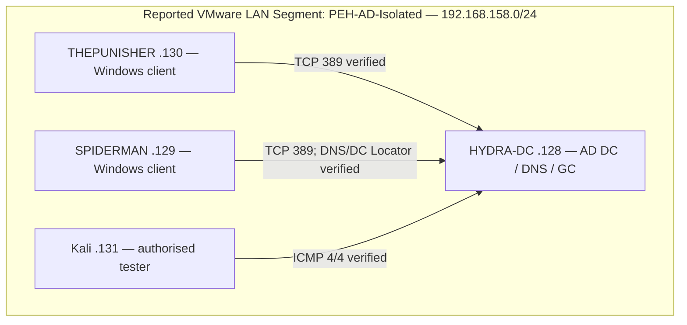

Arrows show **only** tested paths, not Kerberos/LDAP authentication or complete isolation. The previous VMware **NAT VMnet8** topology, DHCP servers and gateway `192.168.158.2` appear further down strictly as **historical baseline records**. See [post-migration Kali routes](../evidence/2026-11-20_39-kali-isolated-ipv4-ipv6-routes.png), [SPIDERMAN DNS SRV result](../evidence/2026-11-20_37-spiderman-isolated-dns-srv.png), and the [40-image evidence index](../evidence/INDEX.md).

## Historical observations and migration journal

## Observed machines

**Screenshot evidence:**


The VMware Workstation inventory screenshot (2026-11-20) contains three display names:

```text
VMware Workstation — My Computer
  - Windows Server 2022
  - THEPUNISHER
  - SPIDERMAN
```

The displayed names alone do not prove host roles, domain membership or network links.

## Verified server network configuration — `ipconfig /all` screenshot, 2026-11-20

**Screenshot evidence:**

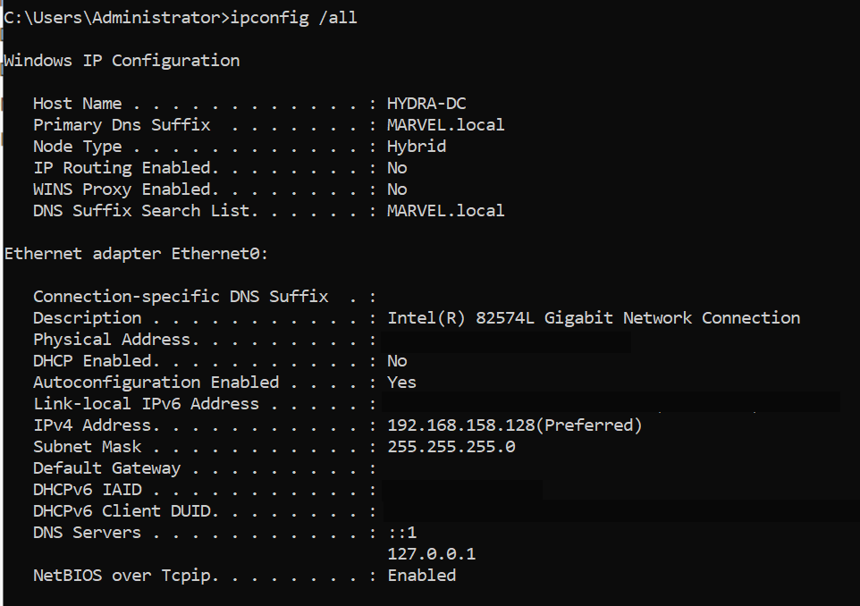

| Field | Observed value |
| --- | --- |
| VMware display name | Windows Server 2022 |
| Windows host name | `HYDRA-DC` |
| Primary DNS suffix | `MARVEL.local` |
| Ethernet adapter description | Intel(R) 82574L Gigabit Network Connection |
| IPv4 address | `192.168.158.128` (preferred) |
| Subnet mask | `255.255.255.0` (`/24`) |
| IPv4 network | `192.168.158.0/24` (calculated from mask) |
| DHCP enabled | No |
| Default gateway | None shown |
| DNS servers | `::1` and `127.0.0.1` (loopback) |
| IP routing enabled | No |

**Interpretation:** DHCP is disabled; an IPv4 address is configured. The DNS servers are loopback addresses. An additional successful `Get-ADDomainController` query verifies the server is identified as an AD domain controller and Global Catalog; it does not independently test DNS availability or every AD service. The server's VMware adapter mode was subsequently verified as **NAT** by screenshot; the user confirmed **NAT** for both client adapters without providing separate Settings screenshots. Both clients have addresses in the same IPv4 subnet.

**Prior observation caveat:** An earlier troubleshooting session used a direct UNC path to `192.168.10.10`, whereas the current screenshot reports `192.168.158.128` for `HYDRA-DC`. Do not assume these are the same host/interface or that the network was changed without confirming the configuration.

## Verified VMware adapter mode — HYDRA-DC (VMware Settings screenshot, 2026-11-20)

**Screenshot evidence:**

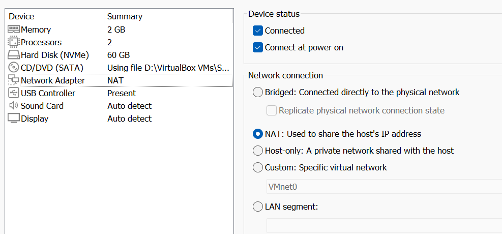

| Property | Verified setting |
| --- | --- |
| VM display name | Windows Server 2022 (guest: `HYDRA-DC`) |
| VMware Network Adapter | **NAT: Used to share the host's IP address** |
| Connected | Checked |
| Connect at power on | Checked |

**Interpretation:** NAT normally allows the guest to share the host's network connection and may permit outbound connectivity. This does **not** guarantee an isolated or offline assessment environment. The user has also confirmed that THEPUNISHER and SPIDERMAN are configured for NAT; this is user-reported rather than screenshot-verified. The inactive `VMnet0` field in the screenshot is not evidence that the selected NAT adapter uses that virtual network.

**Assessment safety:** Before running intrusive or noisy training exercises, confirm all participating VMs' adapter modes and intended connectivity. Avoid changing the working network before documenting the configuration and assessing the impact on DNS, DHCP and the lab domain.

## Verified AD domain controller identity — PowerShell screenshot, 2026-11-20

**Screenshot evidence:**


```powershell
Get-ADDomainController -Identity HYDRA-DC |
    Select-Object HostName, Domain, IPv4Address, IsGlobalCatalog
```

| Returned property | Value |
| --- | --- |
| HostName | `HYDRA-DC.MARVEL.local` |
| Domain | `MARVEL.local` |
| IPv4Address | `192.168.158.128` |
| IsGlobalCatalog | `True` |

**Interpretation:** The successful query establishes that Active Directory recognises `HYDRA-DC` as a domain controller with the Global Catalog flag enabled. It is not a substitute for client DNS, logon or service-health testing. The evidence screenshot is linked above.

## Verified client network configuration — THEPUNISHER (`ipconfig /all` screenshot, 2026-11-20)

**Screenshot evidence:**

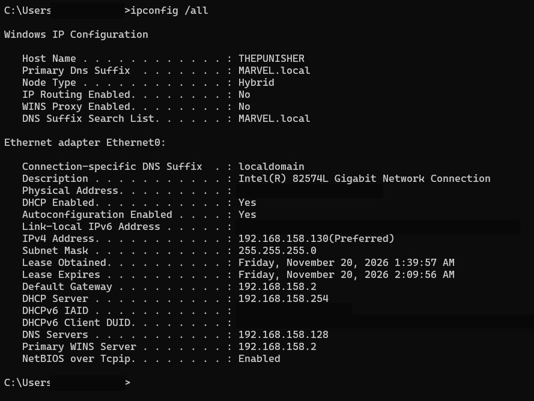

| Field | Observed value |
| --- | --- |
| VMware display name / host name | `THEPUNISHER` |
| Primary DNS suffix | `MARVEL.local` |
| Connection-specific DNS suffix | `localdomain` |
| IPv4 address | `192.168.158.130` (preferred) |
| Subnet mask | `255.255.255.0` (`/24`) |
| DHCP enabled | Yes |
| Default gateway | `192.168.158.2` |
| DHCP server | `192.168.158.254` |
| DNS server | `192.168.158.128` |
| Primary WINS server | `192.168.158.2` |
| NetBIOS over TCP/IP | Enabled |

**Comparison:** The client and HYDRA-DC (`192.168.158.128/24`) are configured in the same IPv4 subnet (`192.168.158.0/24`). The client's configured DNS address matches the domain controller's IPv4 address. This establishes intended DNS configuration, **not** a successful DNS lookup or end-to-end network connectivity. Domain membership was later verified separately with a local Windows CIM query. DHCP service is configured at a separate address (`192.168.158.254`). VMware NAT mode has been confirmed for the server (screenshot) and both clients (user report).

## Verified THEPUNISHER domain membership — PowerShell screenshot, 2026-11-20

**Screenshot evidence:**


```powershell
Get-CimInstance Win32_ComputerSystem |
    Select-Object Name, Domain, PartOfDomain
```

| Property | Value |
| --- | --- |
| Name | `THEPUNISHER` |
| Domain | `MARVEL.local` |
| PartOfDomain | `True` |

**Interpretation:** The client computer reports that it is joined to the `MARVEL.local` domain. This verifies configured domain membership; active communication with the domain controller, live authentication and current Group Policy operation require further testing.

## Verified SPIDERMAN network configuration — `ipconfig /all` screenshot, 2026-11-20

**Screenshot evidence:**


| Field | Observed value |
| --- | --- |
| VMware display name / host name | `SPIDERMAN` |
| Primary DNS suffix | `MARVEL.local` |
| Connection-specific DNS suffix | `localdomain` |
| IPv4 address | `192.168.158.129` (preferred) |
| Subnet mask | `255.255.255.0` (`/24`) |
| DHCP enabled | Yes |
| Default gateway | `192.168.158.2` |
| DHCP server | `192.168.158.254` |
| DNS server | `192.168.158.128` |
| Primary WINS server | `192.168.158.2` |
| NetBIOS over TCP/IP | Enabled |

**Comparison:** SPIDERMAN is configured within `192.168.158.0/24` alongside HYDRA-DC and THEPUNISHER. Its configured DNS server matches HYDRA-DC's IPv4 address. DHCP assigns the client configuration from `192.168.158.254`. This proves the observed settings, **not** working DNS or network reachability. Domain membership was verified separately using a CIM query.

## Verified SPIDERMAN domain membership — PowerShell screenshot, 2026-11-20

**Screenshot evidence:**

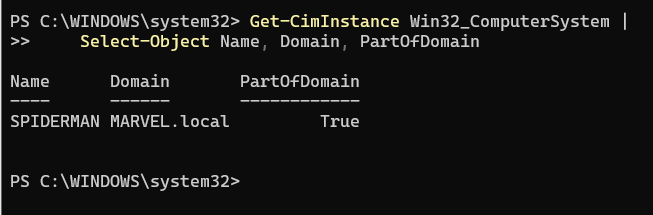

```powershell
Get-CimInstance Win32_ComputerSystem |
    Select-Object Name, Domain, PartOfDomain
```

| Property | Value |
| --- | --- |
| Name | `SPIDERMAN` |
| Domain | `MARVEL.local` |
| PartOfDomain | `True` |

**Interpretation:** The local Windows computer reports that SPIDERMAN is joined to the `MARVEL.local` domain. This demonstrates configured membership, not a fresh successful domain authentication. The screenshot is linked above.

## Verified DNS name resolution from THEPUNISHER — PowerShell screenshot, 2026-11-20

**Screenshot evidence:**

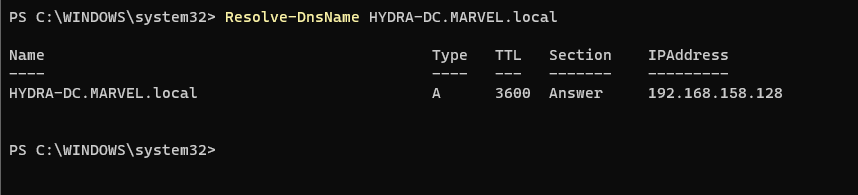

**Command executed on THEPUNISHER:**

```powershell
Resolve-DnsName HYDRA-DC.MARVEL.local
```

**Observed answer:**

| Property | Value |
| --- | --- |
| Name | `HYDRA-DC.MARVEL.local` |
| Type | `A` |
| Section | `Answer` |
| TTL | `3600` seconds |
| IPAddress | `192.168.158.128` |

**Interpretation:** The client successfully resolved HYDRA-DC's fully qualified hostname to the domain controller's previously recorded IPv4 address. The client was configured to use `192.168.158.128` as DNS in the earlier `ipconfig /all` output. This demonstrates successful name resolution for this record but does not independently verify Kerberos/LDAP operation, current domain authentication, or connectivity to every server service. The screenshot is linked above.

## Verified TCP connectivity to LDAP port — THEPUNISHER (PowerShell screenshot, 2026-11-20)

**Screenshot evidence:**

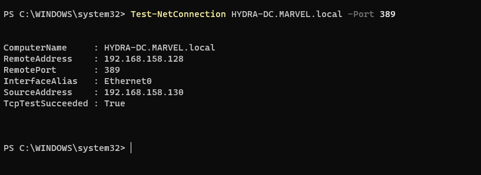

**Command run on THEPUNISHER:**

```powershell
Test-NetConnection HYDRA-DC.MARVEL.local -Port 389
```

**Observed output:**

```text
ComputerName     : HYDRA-DC.MARVEL.local
RemoteAddress    : 192.168.158.128
RemotePort       : 389
InterfaceAlias   : Ethernet0
SourceAddress    : 192.168.158.130
TcpTestSucceeded : True
```

**Interpretation:** TCP connection from `192.168.158.130` to `192.168.158.128:389` succeeded. Port 389 is commonly associated with LDAP. This confirms reachability to a TCP listener on that port, but does not prove an LDAP bind, directory query, user authentication, or the health of every Active Directory service. The screenshot is linked above.

**Next check:** Compare the TCP result against SPIDERMAN, then verify domain controller discovery and authentication independently.

## Verified TCP connectivity to LDAP port — SPIDERMAN (PowerShell screenshot, 2026-11-20)

**Screenshot evidence:**


**Command run on SPIDERMAN:**

```powershell
Test-NetConnection HYDRA-DC.MARVEL.local -Port 389
```

**Observed output:**

```text
ComputerName     : HYDRA-DC.MARVEL.local
RemoteAddress    : 192.168.158.128
RemotePort       : 389
InterfaceAlias   : Ethernet0
SourceAddress    : 192.168.158.129
TcpTestSucceeded : True
```

**Interpretation:** A TCP connection from SPIDERMAN (`192.168.158.129`) to HYDRA-DC (`192.168.158.128`) port 389 succeeded. This is the same outcome already observed from THEPUNISHER. The hostname was resolved as part of the connection test, but a standalone SPIDERMAN DNS query has not been recorded. Neither test is evidence of a successful LDAP bind, Kerberos authentication or domain logon. The screenshot is linked above.

## Verified domain controller discovery — SPIDERMAN (`nltest` screenshot, 2026-11-20)

**Screenshot evidence:**

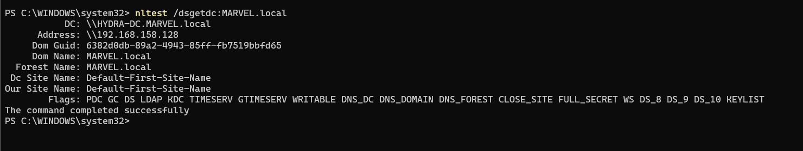

**Command executed on SPIDERMAN:**

```powershell
nltest /dsgetdc:MARVEL.local
```

**Observed results:**

| Field | Returned value |
| --- | --- |
| DC | `\\\\HYDRA-DC.MARVEL.local` |
| Address | `\\\\192.168.158.128` |
| Domain / forest | `MARVEL.local` |
| DC site / client site | `Default-First-Site-Name` |
| Status | `The command completed successfully` |
| Selected flags | `PDC`, `GC`, `DS`, `LDAP`, `KDC`, `WRITABLE`, `DNS_DC`, `DNS_DOMAIN`, `DNS_FOREST`, `TIMESERV` |

**Interpretation:** From SPIDERMAN, Windows successfully located a domain controller for `MARVEL.local`, returning the expected hostname and IPv4 address. Flags describe advertised domain-controller roles and capabilities, including Global Catalog, Kerberos KDC, LDAP and PDC emulator. A successful `nltest /dsgetdc` lookup does **not** verify a computer secure channel, a fresh authenticated user session or every advertised service.

**Evidence:** Screenshot linked above and indexed in the evidence register. The domain GUID is omitted from this public-facing record because it is not necessary to explain the result.

**Next verification:** SPIDERMAN ran the non-repairing `Test-ComputerSecureChannel -Verbose` command; it reported `False` (see diagnostic entry below).

## SPIDERMAN domain secure-channel check — failed (PowerShell screenshot, 2026-11-20)

**Screenshot evidence:**


**Command run on SPIDERMAN:**

```powershell
Test-ComputerSecureChannel -Verbose
```

**Observed output:**

```text
VERBOSE: Performing the operation "Test-ComputerSecureChannel" on target "SPIDERMAN".
False
VERBOSE: The secure channel between the local computer and the domain MARVEL.local is broken.
```

**Status:** Failed diagnostic check; **cause not yet established**. The screenshot doesn't establish whether PowerShell was elevated. Microsoft's documentation instructs running this cmdlet as administrator on supported Windows client systems.

**Interpretation:** Even though SPIDERMAN is configured as a domain member, discovers HYDRA-DC, and can establish TCP 389, its computer-domain secure-channel test returned `False`. Domain discovery and a reachable LDAP port do not prove the computer's account trust works. Possible explanations require further investigation; do not label a specific root cause or a security vulnerability from this output alone.

**Next step:** The user ran `nltest /sc_query:MARVEL.local`, which returned `NERR_Success` (see below). Because `/sc_query` reports last-used secure-channel status rather than necessarily performing a fresh verification, rerun `Test-ComputerSecureChannel -Verbose` in an elevated PowerShell session before interpreting the discrepancy.

**Evidence:** Screenshot linked above.

## SPIDERMAN Netlogon secure-channel status query — success (screenshot, 2026-11-20)

**Screenshot evidence:**

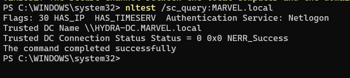

**Command run on SPIDERMAN:**

```powershell
nltest /sc_query:MARVEL.local
```

**Observed output:**

```text
Flags: 30 HAS_IP  HAS_TIMESERV Authentication Service: Netlogon
Trusted DC Name \\HYDRA-DC.MARVEL.local
Trusted DC Connection Status Status = 0 0x0 NERR_Success
The command completed successfully
```

**Interpretation:** The Netlogon query reports `0x0 NERR_Success` for the last-used secure-channel state with `HYDRA-DC.MARVEL.local`. However, the earlier `Test-ComputerSecureChannel -Verbose` returned `False`. The two observations should **both** be retained; success from a last-used-state query does not conclusively override a failed direct test. Whether the earlier PowerShell session was elevated is unknown. No repair has been performed.

**Follow-up result:** The user reported rerunning `Test-ComputerSecureChannel -Verbose` as Administrator on SPIDERMAN; it **still returned `False`**. Root cause remains unverified. Repair is deferred while the course continues. See [tracking issue #1](https://github.com/ObitoX86/PEH-active-directory-lab/issues/1). The repeated output was reported in chat, not screenshot-submitted.

**Evidence:** Screenshot linked above; this entry includes only the relevant observations.

## Verified connection from earlier troubleshooting

A Windows client referred to as **Punisher** accessed a lab Windows server using a direct UNC path by private IP. This is evidence of that specific connection; it does not verify all three VMware entries, the domain setup, or network discovery settings. The exact relationship between the previously reported client and **THEPUNISHER** is to be confirmed.

## Kali Linux testing VM — interface inventory (2026-11-20)

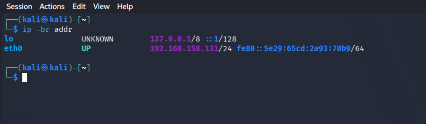

A terminal screenshot from Kali shows the read-only command:

```bash
ip -br addr
```

```text
lo     UNKNOWN  127.0.0.1/8  ::1/128
eth0   UP       192.168.158.131/24  fe80::5e29:65cd:2a93:70b9/64
```

**Interpretation:** Kali's `eth0` interface is UP and has `192.168.158.131/24`. This is within the `192.168.158.0/24` IPv4 subnet already recorded for HYDRA-DC, THEPUNISHER and SPIDERMAN. Same-subnet addressing alone does not prove the Kali guest is connected to the same VMware virtual switch, has a working route to the Windows systems, or is isolated from unintended targets.

### Kali VMware adapter mode verified (Settings screenshot, 2026-11-20)

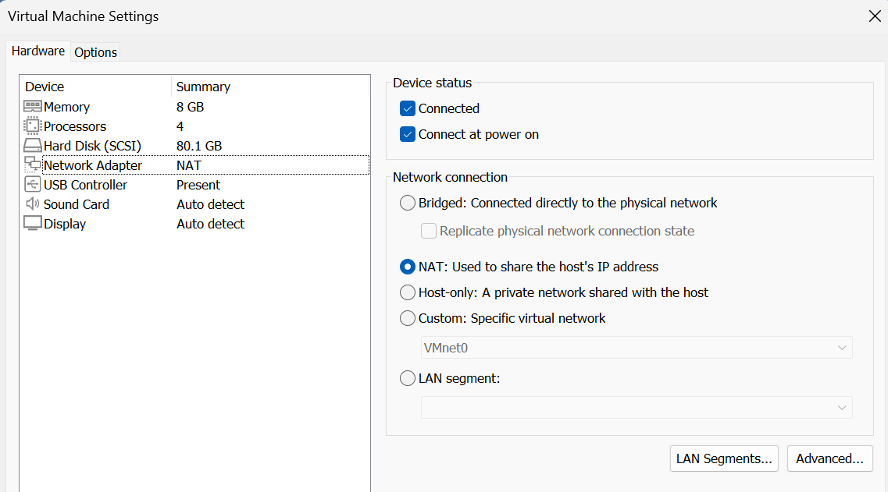

| Setting | Observed |
| --- | --- |
| Network connection | NAT selected |
| Device status | Connected checked |
| Connect at power on | Checked |
| Allocated RAM | 8 GB |
| Virtual processors | 4 |

**Interpretation:** All four lab machines now have NAT recorded: screenshot evidence for HYDRA-DC and Kali, and user confirmation for the two Windows clients. This does **not** establish that all four occupy the exact same VMware virtual network, nor that the segment is safe for LLMNR/NBT-NS poisoning. The `VMnet0` field visible below the inactive Custom option is not the selected NAT network.

**Next safety verification:** Virtual Network Editor subsequently identified VMnet8 as the NAT subnet (see section below). Verify which other VMs and host adapters can reach VMnet8 and whether its NAT connection provides outbound access. Consider a dedicated non-routed/host-only or LAN-segment environment for traffic-poisoning exercises after preserving the current working configuration and confirming necessary DHCP/DNS arrangements. Take snapshots before network changes or active tests.

**Evidence:** GitHub PNG `2026-11-20_19-kali-initial-ip.png` is uploaded and embedded in this document.

## Verified VMware virtual networks — Virtual Network Editor (2026-11-20)

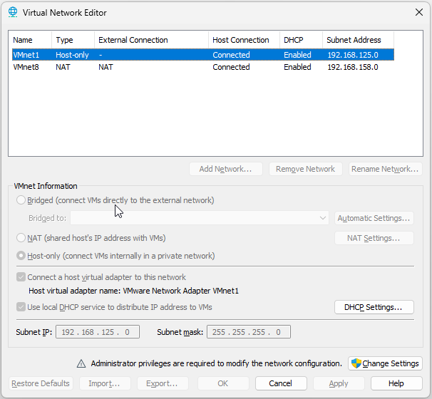

The VMware Virtual Network Editor screenshot shows:

| Network | Type | External connection | Host connection | DHCP | Subnet address |
| --- | --- | --- | --- | --- | --- |
| `VMnet1` | Host-only | None shown (`-`) | Connected | Enabled | `192.168.125.0` |
| `VMnet8` | NAT | NAT | Connected | Enabled | `192.168.158.0` |

**Interpretation:** The NAT network is **VMnet8** with subnet address `192.168.158.0`, consistent with the four guests' `192.168.158.x/24` addresses and their NAT adapter settings. This is strong evidence that the guests are configured for VMware's same NAT subnet, but does not itself show full end-to-end connectivity or prove no other guests have access. The subnet mask `255.255.255.0` shown at the bottom of the editor belongs to the **selected VMnet1**, not necessarily to VMnet8; the guests' `/24` masks were established separately from their network commands.

VMnet1 is an available **host-only** network using `192.168.125.0`. Switching the lab directly to it would change the addressing environment and may disrupt static domain-controller IP settings, DHCP, DNS and domain clients. **No configuration changes were made.**

**Security boundary:** VMnet8 has NAT enabled, and NAT does **not** provide a fully offline or fully isolated network. Before LLMNR/NBT-NS poisoning and SMB relay, plan a dedicated contained test segment, check other connected guests, and take verified VM snapshots. The host is connected to both VMnet1 and VMnet8 in this editor; no trust or route isolation should be presumed.

**Evidence:** GitHub PNG `2026-11-20_21-vmware-virtual-network-editor.png` is uploaded and embedded above.

## Historical NAT-baseline configuration diagram (before isolated-LAN migration)

```text
          [HYDRA-DC]                    AD domain controller + GC; VMware adapter: NAT
          192.168.158.128/24             Domain: MARVEL.local
                 ^
                 | Configured as DNS server by both clients
          +------+----------------------+
          |                             |
   [THEPUNISHER]                   [SPIDERMAN]
   192.168.158.130/24              192.168.158.129/24
   Domain joined: YES              Domain joined: YES
   DHCP enabled                    DHCP enabled
   Gateway: 192.168.158.2          Gateway: 192.168.158.2

   Kali Linux: eth0=192.168.158.131/24, interface UP.
   All four observed IPv4 settings fall within 192.168.158.0/24.
   Diagram reflects configuration plus one successful DNS lookup.
   TCP 389 connections from THEPUNISHER and SPIDERMAN to HYDRA-DC: SUCCESS.
   SPIDERMAN domain-controller discovery: SUCCESS (nltest /dsgetdc).
   Authenticated LDAP binding and user logon remain untested.
   SPIDERMAN secure-channel test: FALSE.
   SPIDERMAN nltest /sc_query last-used channel status: NERR_Success.
   Elevated repetition of Test-ComputerSecureChannel: FALSE (user-reported).
   Discrepancy unresolved; no repair performed.
   All four VMs: NAT (server + Kali screenshots; client modes user-reported).
   Kali VMware network mode: NAT (VMware Settings screenshot, 2026-11-20).
   VMware NAT VMnet8: 192.168.158.0 (Virtual Network Editor screenshot).
   Kali-to-Windows reachability and containment still untested.
```

### Historical NAT-baseline topology (Mermaid; not current attachment state)

The arrows below reflect **only the tested TCP 389 paths**; other network paths are not implied.

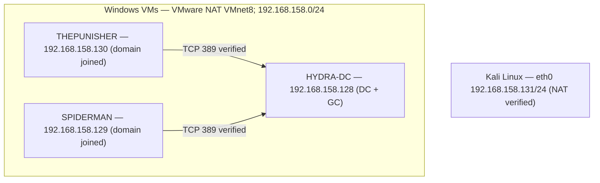

Kali is deliberately shown without a connection arrow because no Kali-to-Windows connectivity test has yet been completed. All four guests have NAT recorded, but whether they share one specific virtual switch and are adequately isolated is not yet verified.

Both clients are configured to use HYDRA-DC for DNS; THEPUNISHER also has a separate successful DNS A-record lookup. DHCP for both clients is reported as `192.168.158.254`, and the configured default gateway is `192.168.158.2`. These network services are not drawn as independently verified infrastructure machines.

## Original isolated-LAN migration plan (historical; subsequently completed)

At this stage, the user had just reported creating the VMware LAN segment `PEH-AD-Isolated`. Creation was not yet screenshot-verified, and adapter migration was **not yet complete at this point in the journal**. Subsequent entries document the reported four-guest migration and post-change checks.

**Original planned addressing (subsequently observed after migration):**

| Machine | Existing / planned IPv4 | Planned method | DNS and gateway |
| --- | --- | --- | --- |
| HYDRA-DC | `192.168.158.128/24` | Retain existing static IPv4 | Existing DNS loopback; no default gateway |
| SPIDERMAN | `192.168.158.129/24` | Set static after disconnection from NAT DHCP | DNS HYDRA-DC `.128`; no gateway |
| THEPUNISHER | `192.168.158.130/24` | Set static after disconnection from NAT DHCP | DNS HYDRA-DC `.128`; no gateway |
| Kali | `192.168.158.131/24` | Configure static on LAN segment | DNS `.128` when AD resolution needed; no gateway |

VMware LAN segments do not provide DHCP automatically; the existing NAT DHCP lease behaviour cannot be relied upon after migration. The `192.168.158.0/24` address range may be reused on a **separate isolated network** because the original NICs should be moved, not connected to both networks simultaneously. At this point this was only a proposal. Later entries document IP retention and selected tested local paths after the reported migration; they do not prove full isolation.

**Sequence:** With backups in place, move the powered-off HYDRA-DC VM first because its IPv4 was already static; boot to check `.128`. Then move and configure Kali and clients individually with matching static addresses and DNS, test lab-only connectivity and verify no NAT bridge/extra NIC remains. Client-to-server connectivity can be interrupted during partial migration.

### Kali preparation — NetworkManager connection and static settings

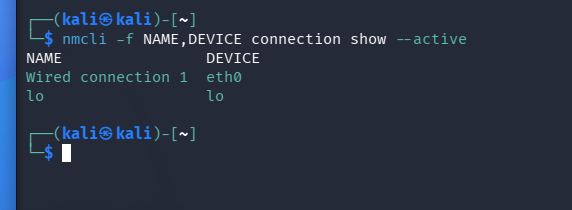

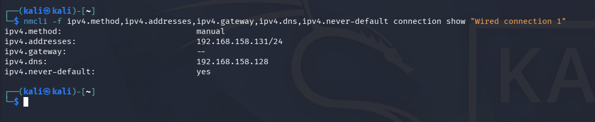

These screenshots support the identified `Wired connection 1` profile and its saved `192.168.158.131/24`, DNS `192.168.158.128`, no-gateway configuration before Kali's isolated-LAN migration.

## Migration checkpoint — HYDRA-DC addressing preserved (historical intermediate state)

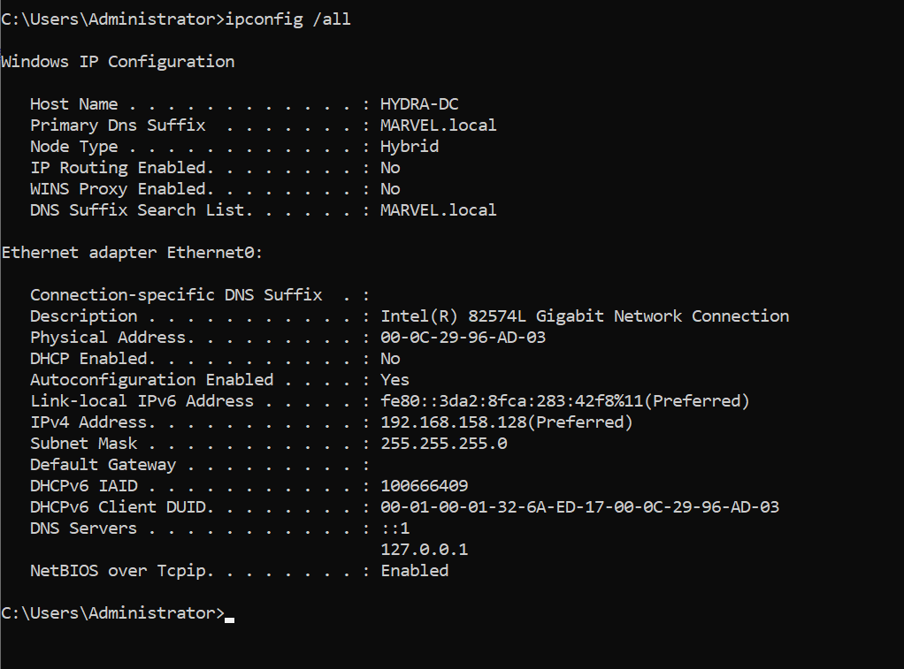

The user followed the instructions to move **HYDRA-DC** to LAN segment `PEH-AD-Isolated`, and supplied a screenshot of `ipconfig /all` on the powered-on server afterward.

| Observed field | Screenshot value |
| --- | --- |
| Hostname and DNS suffix | `HYDRA-DC`, `MARVEL.local` |
| Network interface | `Ethernet0` |
| IPv4 and subnet mask | `192.168.158.128`, `255.255.255.0` |
| DHCP | No (static) |
| Default gateway | Empty |
| DNS servers | `::1`, `127.0.0.1` |

**Interpretation:** The server's static IPv4, absence of gateway and loopback DNS resolver settings are preserved. A command run inside the guest does not independently show the VMware network adapter's selected segment. The migration is therefore **user-reported with post-migration guest IP evidence**, not direct VMware adapter-setting screenshot evidence. Do not infer working connections or isolation based solely on the IP configuration.

**Topology at this checkpoint:** HYDRA-DC had been reported moved, while the other guests' moves were **not yet confirmed at that time**. Later sections document their subsequent migration. The preceding NAT diagram is historical and not the current topology.

**Subsequent Kali profile check (2026-11-20):** Running `nmcli -f NAME,DEVICE connection show --active` returned `Wired connection 1` on `eth0` and `lo` on `lo`. The active NetworkManager profile is identified. The user subsequently confirmed running `nmcli connection modify` to save manual IPv4 `192.168.158.131/24`, DNS `192.168.158.128` and no default gateway, and a subsequent screenshot **verified the saved profile** with `ipv4.method=manual`, `ipv4.addresses=192.168.158.131/24`, empty gateway, `ipv4.dns=192.168.158.128`, and `ipv4.never-default=yes`. These are saved settings, not evidence of current activation or movement to the private segment. **Planned next at this checkpoint:** Move Kali to `PEH-AD-Isolated`, verify IP/routes and connectivity, then migrate clients. The subsequent sections document completion of these steps.

**Evidence:** GitHub PNG `2026-11-20_22-hydra-dc-isolated-ipconfig.png` is uploaded and embedded above.

## Kali isolated LAN attachment — live IP and routing verified (2026-11-20)

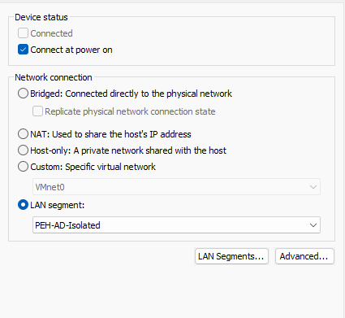

The user selected VMware **LAN Segment: `PEH-AD-Isolated`** for the Kali adapter, kept `Connect at power on` checked, started Kali and supplied the following command output:

```bash
ip -br addr && ip route
```

```text
lo       UNKNOWN  127.0.0.1/8  ::1/128
eth0     UP       192.168.158.131/24  fe80::5e29:65cd:2a93:70b9/64
192.168.158.0/24 dev eth0 proto kernel scope link src 192.168.158.131 metric 100
```

**Verified:** Kali's `eth0` is UP and retains its static `192.168.158.131/24` IPv4 address after reboot; it has a directly connected route to the lab subnet and no IPv4 default route in the `ip route` output. The VMware segment selection was shown before boot. The route table does **not** prove HYDRA-DC is reachable or establish total absence of other possible IPv6 network paths. The Windows clients have not been migrated yet.

### Kali → HYDRA-DC ICMP connectivity verified (2026-11-20)

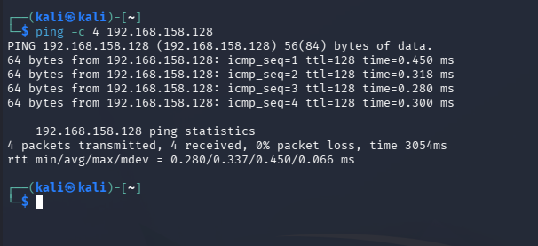

**Command from Kali:** `ping -c 4 192.168.158.128`

**Observed:** **4 sent, 4 replies, 0% packet loss**, RTT min/avg/max `0.280/0.337/0.450 ms`. Every reply came from `192.168.158.128` with TTL 128.

**Conclusion:** Kali (`.131`) successfully reaches the domain controller (`.128`) using ICMP after the user-reported/screenshot-supported isolated-LAN migration. These results validate one network path, **not** DNS, LDAP authentication, Kerberos, complete network isolation, or external connectivity restrictions.

**Evidence:** Kali terminal screenshot from 2026-11-20 is now uploaded and linked above.

**THEPUNISHER NIC identified (2026-11-20):** The user ran `Get-NetAdapter | Select-Object Name, Status, InterfaceDescription`, returning `Ethernet0` / `Up` / `Intel(R) 82574L Gigabit Network Connection`. This identifies the intended interface for its forthcoming DHCP-to-static change; the next screenshot verifies its new static IP configuration, but **LAN segment attachment is not yet verified**. **Static IPv4 baseline verified:** The user supplied post-change `ipconfig /all` on THEPUNISHER showing hostname `THEPUNISHER`, primary suffix `MARVEL.local`, adapter `Ethernet0`, `DHCP Enabled: No`, `192.168.158.130/24`, blank default gateway and DNS `192.168.158.128`. This preserves its IPv4 and DNS settings without a further DNS change. **Next at this checkpoint (since completed):** Move THEPUNISHER to `PEH-AD-Isolated`, boot, and validate guest settings and DC connectivity; see the post-migration section below.

### Kali post-migration live IP and route

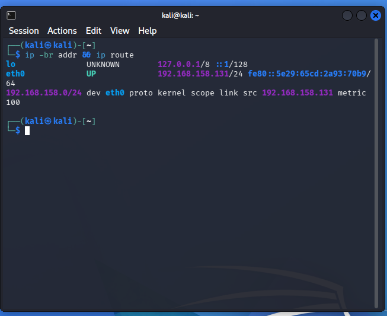

This provides the live `eth0` and connected route output following the VMware adapter change.

### THEPUNISHER pre-migration NIC and static settings

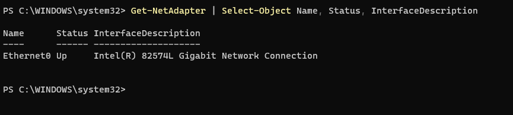

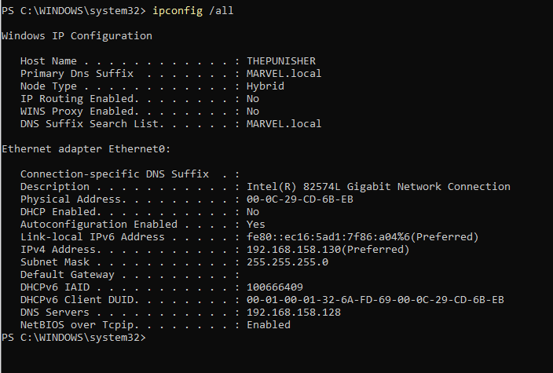

These screenshots establish that `Ethernet0` was the intended adapter and that static `192.168.158.130/24` with DNS `192.168.158.128` was verified before the switch.

## THEPUNISHER after isolated LAN migration — IP retained (2026-11-20)

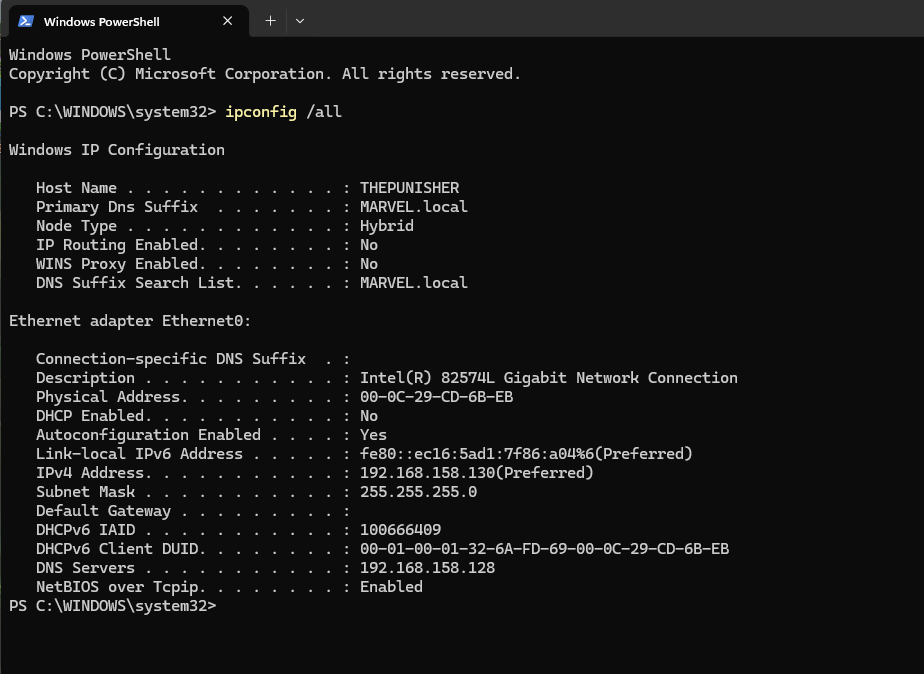

The user reports moving THEPUNISHER's VMware adapter to `PEH-AD-Isolated` and restarting the VM. Its **fresh post-boot** `ipconfig /all` screenshot confirms:

| Item | Value |
| --- | --- |
| Hostname / DNS suffix | `THEPUNISHER` / `MARVEL.local` |
| Interface | `Ethernet0` |
| IPv4 | `192.168.158.130/24` |
| DHCP | Disabled |
| Default gateway | Blank |
| DNS server | `192.168.158.128` |

**Result:** The intended guest network configuration is preserved after the reported segment change. The screenshot cannot itself show VMware's selected segment or verify TCP connectivity, DNS resolution, Kerberos, domain logon or isolation. Kali has confirmed ICMP connectivity to HYDRA-DC on the separate LAN, but Windows-client connectivity after migration is not yet tested.

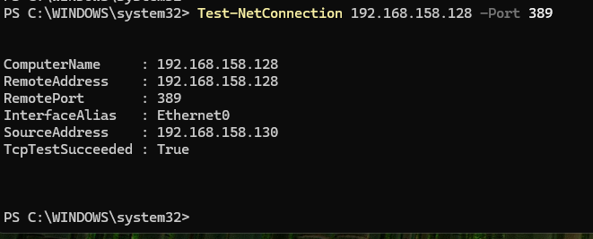

**Post-migration TCP connectivity verified on THEPUNISHER (2026-11-20):** The user ran `Test-NetConnection 192.168.158.128 -Port 389` and supplied a screenshot showing `RemoteAddress=192.168.158.128`, `RemotePort=389`, `InterfaceAlias=Ethernet0`, `SourceAddress=192.168.158.130` and `TcpTestSucceeded=True`. This confirms a successful TCP connection to the domain controller's LDAP port from the isolated Windows client, not successful LDAP authentication or full network containment.

**SPIDERMAN NIC identified (2026-11-20):** Its PowerShell `Get-NetAdapter | Select-Object Name, Status, InterfaceDescription` screenshot confirms `Ethernet0` is `Up` and uses `Intel(R) 82574L Gigabit Network Connection`. **SPIDERMAN static IPv4 now verified before migration:** A subsequent `ipconfig /all` screenshot confirms hostname `SPIDERMAN`, DNS suffix `MARVEL.local`, `Ethernet0` at `192.168.158.129/24`, DHCP disabled, empty default gateway and DNS `192.168.158.128`. SPIDERMAN's subsequent migration was user-reported and a post-boot screenshot now independently confirms its static IP/DNS persisted (see section below); no post-migration connectivity test has yet been supplied. **Next:** Check TCP 389 transport connectivity. The earlier NAT topology diagram remains historical only.

**Evidence:** Relevant SPIDERMAN PowerShell screenshots are uploaded and embedded above; see the 40-image [evidence gallery](../evidence/INDEX.md).

### SPIDERMAN pre-migration NIC and static settings

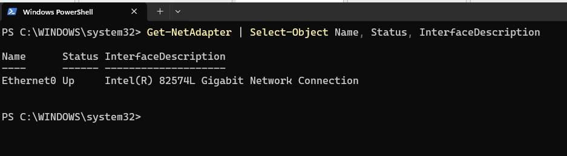

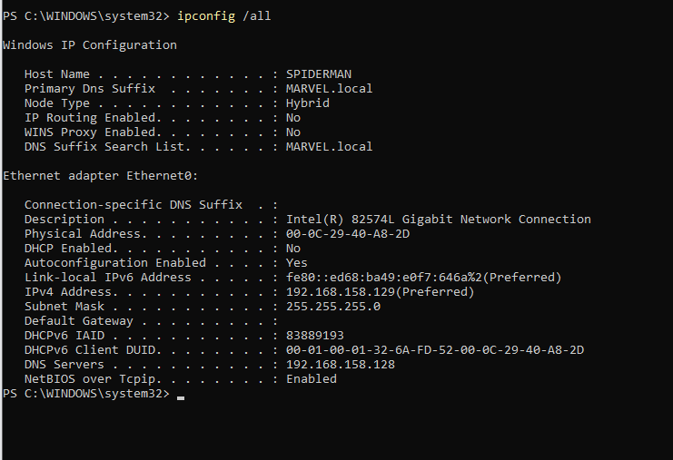

These screenshots identify `Ethernet0` and confirm static `192.168.158.129/24`, DNS `192.168.158.128`, and no default gateway before moving the adapter.

## SPIDERMAN post-migration network settings — IPv4 preserved (2026-11-20)

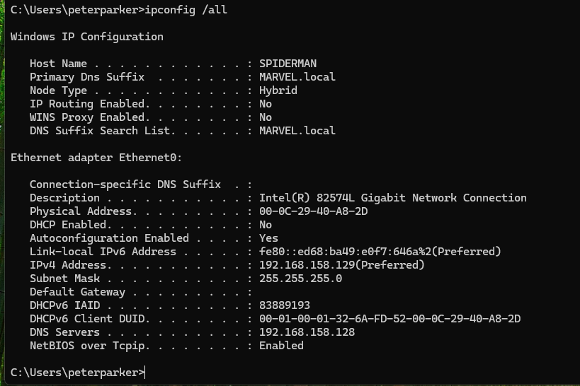

The user reported switching SPIDERMAN's VMware adapter to the dedicated `PEH-AD-Isolated` LAN segment and rebooting Windows. Its fresh `ipconfig /all` screenshot shows:

| Property | Post-boot value |
| --- | --- |
| Host name / primary DNS suffix | `SPIDERMAN` / `MARVEL.local` |
| Adapter | `Ethernet0` |
| IPv4 address / mask | `192.168.158.129` / `255.255.255.0` |
| DHCP | No |
| Default gateway | Blank |
| DNS server | `192.168.158.128` |

**Verified:** Guest addressing and DNS remain as planned after the reported migration. The migration of all four intended VMs is now **user-confirmed**, with address configurations observed afterward. The screenshot itself does not prove VMware's selected segment or current connectivity between SPIDERMAN and HYDRA-DC, and does not resolve the pre-existing computer secure-channel failure. The prior NAT diagram is historical and should not be presented as the current topology.

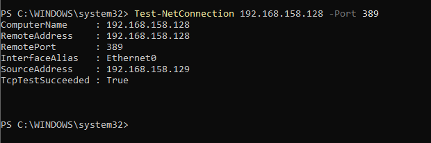

**Post-migration connectivity result (2026-11-20):** A new SPIDERMAN PowerShell screenshot for `Test-NetConnection 192.168.158.128 -Port 389` shows `SourceAddress=192.168.158.129`, `InterfaceAlias=Ethernet0`, `RemoteAddress=192.168.158.128`, `RemotePort=389` and `TcpTestSucceeded=True`. This independently verifies a TCP connection from SPIDERMAN to HYDRA-DC's LDAP port after the reported migration, but **not** an authenticated LDAP bind or the restoration of the client's existing broken computer trust relationship.

**Network milestone:** All four intended guests retain their originally documented IPv4 addresses after user-reported migration. Kali to HYDRA-DC ICMP passed (4/4); both Windows clients to HYDRA-DC TCP 389 passed. These successful paths do not prove complete network isolation, DNS health, Kerberos authentication or a healthy secure channel.

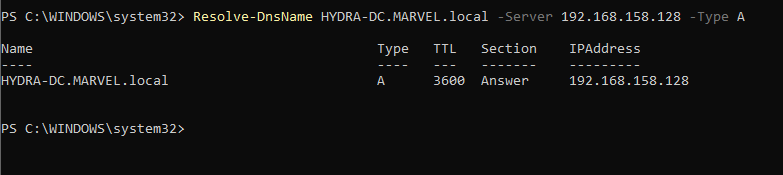

**Post-migration DNS A-record verified (2026-11-20):** SPIDERMAN ran `Resolve-DnsName HYDRA-DC.MARVEL.local -Server 192.168.158.128 -Type A`. The supplied screenshot shows `HYDRA-DC.MARVEL.local`, record type `A`, TTL `3600`, section `Answer`, and IPv4 `192.168.158.128`. This establishes correct DNS A-record lookup directly against HYDRA-DC's DNS service. It does not yet establish SRV records, Kerberos authentication, secure-channel repair or complete isolation.

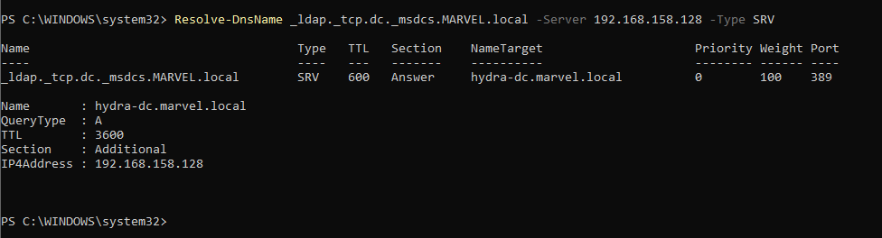

**AD LDAP SRV DNS service-discovery verified (2026-11-20):** The SPIDERMAN screenshot from `Resolve-DnsName _ldap._tcp.dc._msdcs.MARVEL.local -Server 192.168.158.128 -Type SRV` shows an Answer record pointing to `hydra-dc.marvel.local` on TCP port `389` with priority `0`, weight `100`, TTL `600`. The Additional A record maps `hydra-dc.marvel.local` to `192.168.158.128` with TTL `3600`. Thus both direct host resolution and this AD service-location record function over the user-reported isolated LAN.

**Important limitation:** DNS SRV and A answers do not establish an authenticated LDAP bind, healthy machine trust, Kerberos service or complete LAN containment.

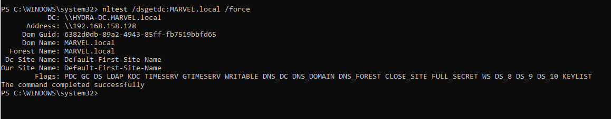

**Windows DC Locator verified (2026-11-20):** SPIDERMAN ran `nltest /dsgetdc:MARVEL.local /force`. The supplied screenshot reports DC `\\HYDRA-DC.MARVEL.local`, address `\\192.168.158.128`, domain and forest `MARVEL.local`, DC and client site `Default-First-Site-Name`, and `The command completed successfully`. Flags include `PDC`, `GC`, `DS`, `LDAP`, `KDC`, `TIMESERV`, `WRITABLE`, `DNS_DC` and others.

**Interpretation:** Forced DC discovery works from SPIDERMAN after migration. Advertised capabilities do not prove authentication, application service health, healthy secure channel or complete network isolation. The prior `Test-ComputerSecureChannel` failure remains a separate issue.

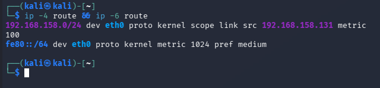

**Kali route-table containment check verified (2026-11-20):** The user ran `ip -4 route && ip -6 route` from the isolated Kali guest. Screenshot output contained only:
```text
192.168.158.0/24 dev eth0 proto kernel scope link src 192.168.158.131 metric 100
fe80::/64 dev eth0 proto kernel metric 1024 pref medium
```
Neither protocol had a displayed default route. IPv6's `fe80::/64` is link-local and does not by itself provide a route beyond the local link. The absence of default routes corroborates the intended local-only configuration **but does not prove total isolation across VMware/host networks**.

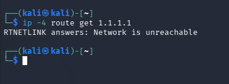

**Kali external-route lookup verified (2026-11-20):** The user ran `ip -4 route get 1.1.1.1` and the screenshot returned `RTNETLINK answers: Network is unreachable`. This is a read-only kernel lookup, with no packets sent, showing there was no usable route to this external IPv4 address. Together with the prior IPv4/IPv6 route tables, the result corroborates Kali's intended local-only networking configuration, **not complete hypervisor/host isolation**.

**VMware adapter audit (user-confirmed, 2026-11-20):** User reported checking all four guests in VMware Workstation and confirmed each has a single Network Adapter set to LAN Segment `PEH-AD-Isolated`, without additional NAT, bridged or host-only adapters. No new VMware screenshots were supplied, so do not label this an independently verified adapter audit.

**Network scope:** HYDRA-DC `.128`, SPIDERMAN `.129`, THEPUNISHER `.130`, Kali `.131` on `192.168.158.0/24`. Previously verified no-default-route Kali state, successful local ICMP/TCP 389 tests and AD DNS/DC Locator strongly support the intended contained topology. SPIDERMAN's existing secure-channel issue remains independent.

**Next phase:** Begin PEH name-resolution-poisoning study by first checking the installed Responder tool's help, then passive monitoring, before any controlled active demonstration. Do not connect poisoning tools to NAT or bridged networks.

**Evidence:** GitHub PNG `2026-11-20_34-spiderman-isolated-ipconfig.png` is uploaded and embedded in the SPIDERMAN migration section.

## Remaining checks — current as of 21 November 2026

1. Confirm the installed OS editions, any additional services, and each VM's role beyond the captured evidence.
2. Verify authenticated AD operations independently; a TCP 389 connection or DNS/DC Locator response does **not** establish an authenticated bind or logon.
3. Investigate SPIDERMAN's repeated `Test-ComputerSecureChannel=False` and keep [issue #1](https://github.com/ObitoX86/PEH-active-directory-lab/issues/1) open until resolved.
4. Where needed before active network-poisoning tests, independently corroborate VMware adapter selection and host isolation on all VMs. Four-guest single-NIC LAN attachment is currently **user-confirmed**, not screenshot-verified for every machine.
5. Review the 40 screenshots and the repository's public visibility for sensitive information.
6. Extend the **current** diagram only when additional network or authenticated service paths are tested.

The original NAT network is no longer the reported attachment for these guests. Do not treat the NAT-baseline connectivity statements elsewhere in this file as tests of the present isolated segment.
