# Assessment Journal

**VM inventory screenshot:**

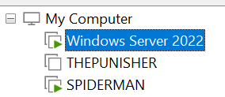

All 14 screenshot files are listed in the [evidence register](../evidence/INDEX.md).

This log captures **observed** work, not just planned tutorials. Dates should reflect actual lab work when known.

## Prior activity — date to confirm

**Task:** Troubleshoot Windows file-sharing visibility from Punisher to the lab server.

**Observation:** Browsing through File Explorer's Network section did not initially show the expected server. Opening a direct UNC network path to the server's private IP succeeded.

**Interpretation:** Reachability via the direct server path was working even though network browsing/discovery did not initially expose the server as expected.

**Limits:** The share name, effective user permissions and final discovery configuration are not recorded here. Do not infer access beyond what was observed.

**Evidence:** Pending redacted screenshot or notes.

---

## 2026-11-20 — Server network configuration baseline

**Screenshot evidence:**

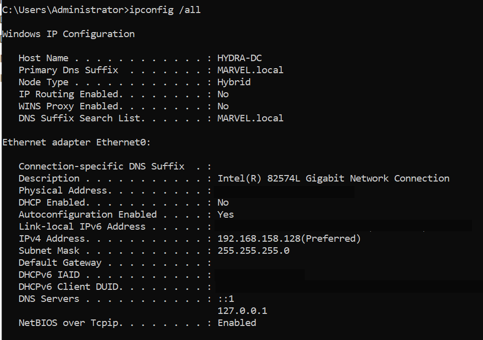

**Task:** Record the Windows Server network configuration using `ipconfig /all` in the existing VMware lab.

**Evidence:** Linked screenshot above.

**Observed result:** Server reports host name `HYDRA-DC`, primary DNS suffix `MARVEL.local`, IPv4 `192.168.158.128`, subnet mask `255.255.255.0`, DHCP disabled, no configured default gateway, and DNS servers `::1` and `127.0.0.1`.

**Analysis:** This establishes a network-configuration baseline for the server VM and suggests local DNS resolution is intended. It does not establish the operational status of Active Directory Domain Services.

**Follow-up:** Domain controller identity verified in the next entry; client machines' IP/DNS settings remain to be collected.

---

## 2026-11-20 — Domain controller identity and Global Catalog verification

**Screenshot evidence:**

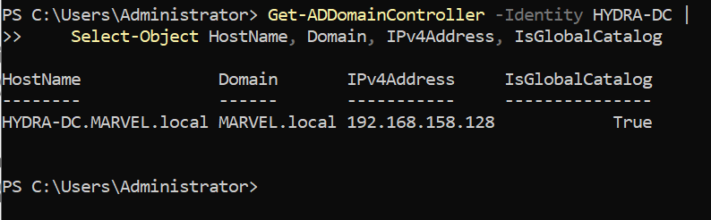

**Task:** Verify the server's domain controller identity from Windows PowerShell.

**Command:**

```powershell
Get-ADDomainController -Identity HYDRA-DC |
    Select-Object HostName, Domain, IPv4Address, IsGlobalCatalog
```

**Evidence:** Screenshot linked above.

**Observed result:**

```text
HostName               Domain        IPv4Address       IsGlobalCatalog
HYDRA-DC.MARVEL.local   MARVEL.local  192.168.158.128    True
```

**Analysis:** Active Directory identified HYDRA-DC as a domain controller in `MARVEL.local`; Global Catalog flag is enabled. The IPv4 value agrees with the prior `ipconfig /all` screenshot. Individual DNS/Kerberos services, client domain membership and connectivity have not yet been independently verified.

**Follow-up:** Inventory network and domain configuration on THEPUNISHER and SPIDERMAN.

---

## 2026-11-20 — THEPUNISHER network configuration baseline

**Screenshot evidence:**

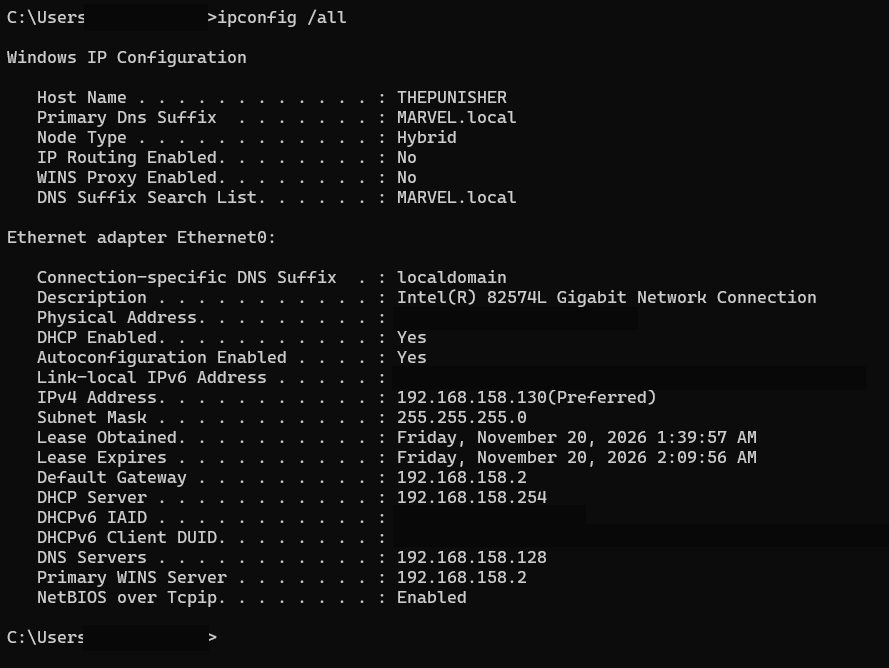

**Task:** Review `ipconfig /all` output from the THEPUNISHER Windows VM.

**Evidence:** Screenshot supplied in the chat on 2026-11-20; redacted copy has not been uploaded to GitHub. The local user profile path and hardware identifiers are deliberately omitted from this journal entry.

**Observed result:** Hostname `THEPUNISHER`; primary DNS suffix `MARVEL.local`; Ethernet IPv4 `192.168.158.130` with `255.255.255.0` mask; DHCP enabled; gateway `192.168.158.2`; DHCP server `192.168.158.254`; DNS server `192.168.158.128`; connection-specific DNS suffix `localdomain`.

**Analysis:** THEPUNISHER and HYDRA-DC (`192.168.158.128/24`) have IPv4 settings in the same subnet, and THEPUNISHER is configured to query HYDRA-DC for DNS. This is consistent with an Active Directory lab client but does not prove domain membership, DNS availability or successful domain authentication. The DHCP server is distinct from the DC.

**Follow-up:** THEPUNISHER domain membership was verified in the next entry; SPIDERMAN network configuration remains to collect.

---

## 2026-11-20 — THEPUNISHER domain membership verification

**Screenshot evidence:**

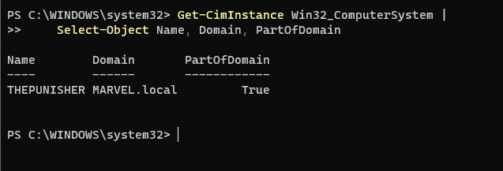

**Task:** Confirm whether the Windows client is joined to the Active Directory domain.

**Command:**

```powershell
Get-CimInstance Win32_ComputerSystem |
    Select-Object Name, Domain, PartOfDomain
```

**Evidence:** PowerShell screenshot supplied in the chat on 2026-11-20; repository image upload pending redaction.

**Observed result:**

```text
Name          Domain        PartOfDomain
THEPUNISHER   MARVEL.local  True
```

**Analysis:** Local Windows CIM data reports THEPUNISHER belongs to the `MARVEL.local` domain. This verifies domain membership configuration, but this command alone does not demonstrate live domain controller connectivity or successful domain authentication.

**Follow-up:** SPIDERMAN's network settings were collected in the following entry; verify its domain membership next.

---

## 2026-11-20 — SPIDERMAN network configuration baseline

**Screenshot evidence:**


**Task:** Record the third VM's `ipconfig /all` settings and compare them with the two existing lab machines.

**Evidence:** Screenshot supplied in the chat on 2026-11-20; a redacted copy is linked above. Local user-profile path, interface MAC, and DHCP client identifiers are not reproduced here.

**Observed result:** Host name `SPIDERMAN`; primary DNS suffix `MARVEL.local`; IPv4 `192.168.158.129` with mask `255.255.255.0`; DHCP enabled with server `192.168.158.254`; default gateway `192.168.158.2`; DNS server `192.168.158.128`; connection-specific DNS suffix `localdomain`.

**Analysis:** All three VMs have IP settings in the `192.168.158.0/24` subnet. The two Windows clients are configured to use HYDRA-DC for DNS and receive their IP configurations from a separate DHCP server. Domain suffix configuration does not by itself prove that SPIDERMAN is domain-joined or that connectivity is functioning.

**Follow-up:** SPIDERMAN's configured domain membership was verified in the next journal entry.

---

## 2026-11-20 — SPIDERMAN domain membership verification

**Screenshot evidence:**

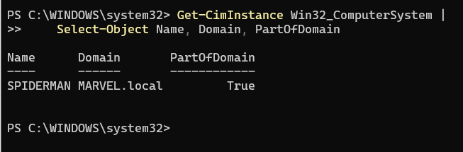

**Task:** Verify whether the SPIDERMAN Windows client reports membership of the Active Directory domain.

**Command:**

```powershell
Get-CimInstance Win32_ComputerSystem |
    Select-Object Name, Domain, PartOfDomain
```

**Evidence:** User-supplied PowerShell screenshot in the chat on 2026-11-20; image linked above.

**Observed result:**

```text
Name        Domain        PartOfDomain
SPIDERMAN   MARVEL.local  True
```

**Analysis:** Local CIM results identify SPIDERMAN as a domain-joined computer in `MARVEL.local`. Together with the previous results for THEPUNISHER and HYDRA-DC, this completes verification of the intended domain roles and configured membership of the two clients. Live service availability, client-to-controller authentication, name resolution and VMware network-mode mapping remain untested.

**Follow-up:** HYDRA-DC's adapter mode was verified as NAT in the next entry; verify client adapter modes, then test DNS/domain controller discovery.

---

## 2026-11-20 — HYDRA-DC VMware network adapter mode

**Screenshot evidence:**

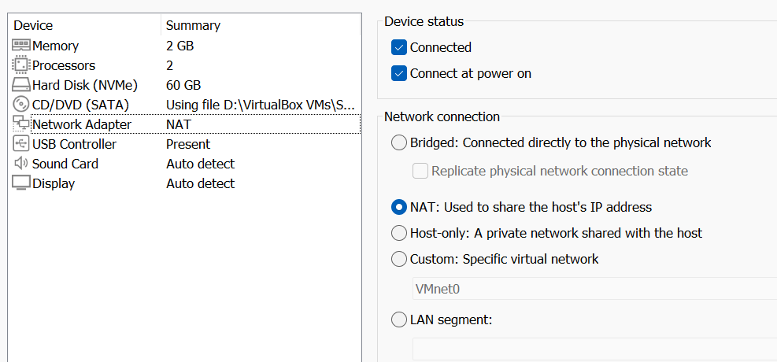

**Task:** Inspect the VMware Workstation VM Settings > Hardware > Network Adapter page for the Windows Server 2022 VM.

**Evidence:** Linked screenshot above.

**Observed result:** `NAT: Used to share the host's IP address` is selected; `Connected` and `Connect at power on` are checked. The VM guest was previously identified as `HYDRA-DC`.

**Analysis:** This records the hypervisor network mode for the server and is consistent with the observed VMware-style NAT gateway/DHCP subnet. NAT can allow outbound connectivity through the host; it does not prove a fully isolated lab. The corresponding VMware settings for both Windows client VMs have not yet been verified.

**Follow-up:** The user subsequently confirmed both clients use NAT. Validate DNS resolution and inter-VM communication before further security exercises.

---

## 2026-11-20 — NAT settings confirmed for both Windows clients

**Task:** Establish hypervisor network mode across all three visible Active Directory lab VMs.

**Evidence:** User explicitly confirmed in the project conversation that all three VMs use NAT; the server's NAT selection was independently screenshot-verified earlier. Separate client VMware Settings screenshots were not supplied.

**Observed / reported result:** HYDRA-DC, THEPUNISHER and SPIDERMAN are all configured for NAT according to the user. HYDRA-DC screenshot also confirms its adapter was connected and set to connect at power-on; equivalent client checkboxes have not been checked.

**Analysis:** The reported modes are consistent with the machines' `192.168.158.0/24` address settings. NAT is not proof of full containment, and the hypervisor's specific virtual switch and live packet connectivity have not yet been verified. Do not mark outbound access or inter-VM connectivity as tested.

**Follow-up:** The targeted DNS lookup succeeded in the next entry; test TCP connectivity to the domain controller next.

---

## 2026-11-20 — THEPUNISHER resolves domain controller hostname

**Screenshot evidence:**


**Task:** Validate DNS name resolution from a domain-joined Windows client.

**Command (THEPUNISHER):**

```powershell
Resolve-DnsName HYDRA-DC.MARVEL.local
```

**Evidence:** User-supplied screenshot in the project conversation on 2026-11-20; screenshot linked above.

**Observed result:**

```text
Name                    Type  TTL   Section  IPAddress
HYDRA-DC.MARVEL.local   A     3600  Answer   192.168.158.128
```

**Analysis:** THEPUNISHER successfully resolved the domain controller hostname to its independently verified IPv4 address. Its earlier network configuration named `192.168.158.128` as the DNS server. This tests hostname resolution, not successful LDAP/Kerberos connectivity or live domain authentication.

**Follow-up:** On THEPUNISHER, run `Test-NetConnection HYDRA-DC.MARVEL.local -Port 389` to test TCP reachability to the LDAP service port; interpret the output without treating port connectivity as authentication.

---

## 2026-11-20 — THEPUNISHER TCP connectivity to domain controller LDAP port

**Screenshot evidence:**

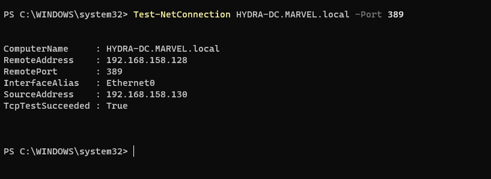

**Task:** Determine whether a domain-joined Windows client can open a TCP connection to the domain controller on the usual LDAP port (389).

**Command (on THEPUNISHER):**

```powershell
Test-NetConnection HYDRA-DC.MARVEL.local -Port 389
```

**Evidence:** User-provided PowerShell screenshot in the conversation on 2026-11-20; screenshot linked above.

**Observed result:**

```text
ComputerName     : HYDRA-DC.MARVEL.local
RemoteAddress    : 192.168.158.128
RemotePort       : 389
InterfaceAlias   : Ethernet0
SourceAddress    : 192.168.158.130
TcpTestSucceeded : True
```

**Analysis:** The successful TCP connection demonstrates network reachability from THEPUNISHER to a listener on HYDRA-DC port 389. It supports the network baseline but is **not** proof of a valid LDAP bind, AD authentication, or complete directory-service health.

**Follow-up:** The matching SPIDERMAN TCP test was successful, as documented in the next entry.

---

## 2026-11-20 — SPIDERMAN TCP connectivity to domain controller LDAP port

**Screenshot evidence:**

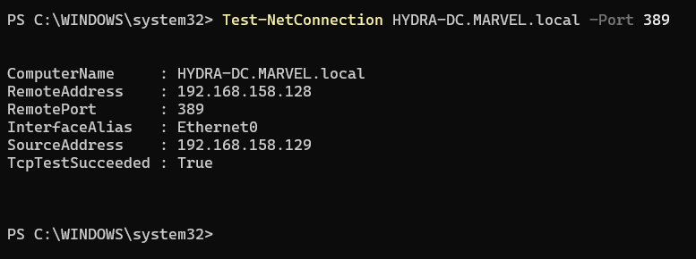

**Task:** Confirm SPIDERMAN can reach the same domain controller LDAP TCP port as THEPUNISHER.

**Command (SPIDERMAN):**

```powershell
Test-NetConnection HYDRA-DC.MARVEL.local -Port 389
```

**Evidence:** User-provided PowerShell screenshot in the conversation on 2026-11-20; image linked above.

**Observed result:**

```text
ComputerName     : HYDRA-DC.MARVEL.local
RemoteAddress    : 192.168.158.128
RemotePort       : 389
InterfaceAlias   : Ethernet0
SourceAddress    : 192.168.158.129
TcpTestSucceeded : True
```

**Analysis:** A TCP handshake to port 389 on HYDRA-DC succeeded from SPIDERMAN. Both domain-joined clients now have demonstrated transport connectivity to this port. This does not independently verify LDAP binding, Kerberos authentication, Group Policy or service health.

**Follow-up:** SPIDERMAN domain controller discovery succeeded in the next entry. Test its domain secure channel separately.

---

## 2026-11-20 — SPIDERMAN domain controller discovery

**Screenshot evidence:**

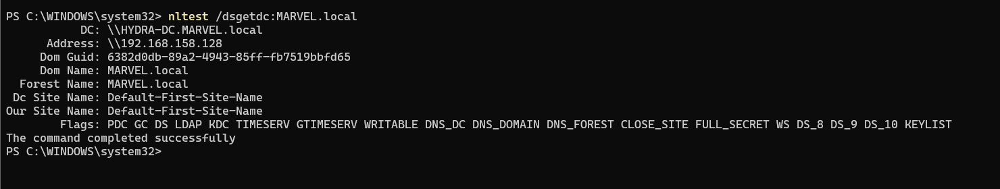

**Task:** Locate an Active Directory domain controller for `MARVEL.local` from SPIDERMAN using the Windows `nltest` utility.

**Command:**

```powershell
nltest /dsgetdc:MARVEL.local
```

**Evidence:** Screenshot linked above.

**Observed result:** The command completed successfully, showing `\\\\HYDRA-DC.MARVEL.local` at `192.168.158.128`; the domain and forest names were `MARVEL.local`, both sites were `Default-First-Site-Name`, and flags included `PDC`, `GC`, `LDAP`, `KDC`, `WRITABLE`, and `DNS_DC`.

**Analysis:** Windows on SPIDERMAN successfully discovered the expected Active Directory domain controller. Advertised capability flags do not establish successful authenticated user access or secure-channel health. The domain GUID was intentionally not reproduced in this journal entry.

**Follow-up:** The secure-channel test on SPIDERMAN returned `False` (next entry). Diagnose before making repairs.

---

## 2026-11-20 — SPIDERMAN secure-channel test reports failure

**Screenshot evidence:**

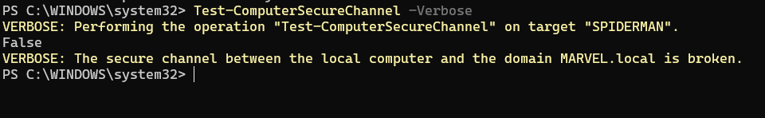

**Task:** Check whether SPIDERMAN's computer account secure channel to the `MARVEL.local` domain is healthy.

**Command run on SPIDERMAN:**

```powershell
Test-ComputerSecureChannel -Verbose
```

**Evidence:** User-supplied PowerShell screenshot in the conversation on 2026-11-20; image linked above.

**Observed result:**

```text
VERBOSE: Performing the operation "Test-ComputerSecureChannel" on target "SPIDERMAN".
False
VERBOSE: The secure channel between the local computer and the domain MARVEL.local is broken.
```

**Interpretation:** The command reported a failed computer-domain secure-channel check despite previously successful domain controller discovery and TCP connectivity to `192.168.158.128:389`. This is an unresolved authentication/trust diagnostic observation, **not evidence of the underlying cause**, exploitation or a confirmed vulnerability. Administrative elevation was not established from the screenshot.

**Decision:** No repair, machine account reset, unjoin/rejoin, or password change has been performed.

**Next action:** `nltest /sc_query` has now returned `NERR_Success` (see next entry), but it describes a last-used channel status. Re-run the direct secure-channel test with an explicitly elevated PowerShell session before attempting any repair.

---

## 2026-11-20 — SPIDERMAN Netlogon secure-channel status query

**Screenshot evidence:**

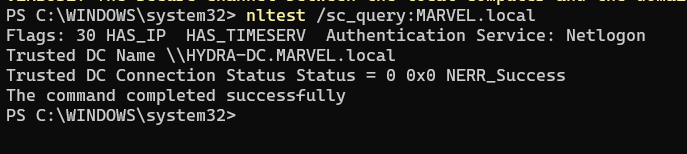

**Task:** Inspect the secure channel's last-used state after `Test-ComputerSecureChannel` returned `False`.

**Command (SPIDERMAN):**

```powershell
nltest /sc_query:MARVEL.local
```

**Evidence:** User-supplied screenshot in the conversation on 2026-11-20; screenshot linked above.

**Observed output:**

```text
Flags: 30 HAS_IP  HAS_TIMESERV Authentication Service: Netlogon
Trusted DC Name \\HYDRA-DC.MARVEL.local
Trusted DC Connection Status Status = 0 0x0 NERR_Success
The command completed successfully
```

**Analysis:** The Netlogon query shows a successful last-used secure-channel status for the expected domain controller. This is a different diagnostic observation from the prior `Test-ComputerSecureChannel -Verbose` result of `False`. `nltest /sc_query` does not necessarily revalidate the channel at the time of execution; the apparent discrepancy remains unresolved. Administrative elevation during either command has not been independently shown.

**Action taken:** No repair, rejoin or reset performed.

**Follow-up:** User reran `Test-ComputerSecureChannel -Verbose` as Administrator and reported `False` again (see next entry). User chose to defer repair and proceed with the PEH lab.

---

## 2026-11-20 — SPIDERMAN repeated elevated secure-channel check

**Task:** Rule out a non-elevated PowerShell session as the explanation for the earlier failure.

**Action:** User explicitly confirmed rerunning `Test-ComputerSecureChannel -Verbose` in an elevated administrator session on SPIDERMAN.

**Reported result:** `False` again. No new screenshot of the elevated repetition was supplied; this result is based on user confirmation.

**Interpretation:** The earlier failure persists despite elevation; normal domain membership, controller discovery, TCP/389 reachability and the prior successful last-used `nltest /sc_query` status do not establish secure-channel health. Root cause remains unknown.

**Decision:** User elected to move on to the PEH Active Directory exercises. Do **not** describe the trust as repaired or healthy, and do not treat this as a proven exploit. Revisit before an exercise dependent on SPIDERMAN's computer trust, domain logon or Group Policy. No repair, reset or domain rejoin performed.

**Tracking issue:** [Investigate SPIDERMAN computer secure channel](https://github.com/ObitoX86/PEH-active-directory-lab/issues/1).

---

## New entry template

**Date:** YYYY-MM-DD  
**Exercise:**  
**Target / authorised scope:**  
**Objective:**  
**Tools / commands:**  
**Evidence:**  
**Observed result:**  
**Analysis / limitations:**  
**Defensive mitigation:**  
**Follow-up:**
