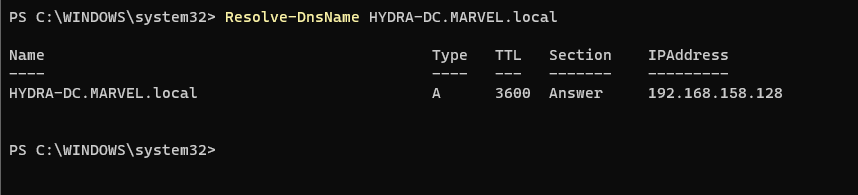

# Assessment Journal

**VM inventory screenshot:**


All 14 screenshot files are listed in the [evidence register](../evidence/INDEX.md).

This log captures **observed** work, not just planned tutorials. Dates should reflect actual lab work when known.

## Prior activity — date to confirm

**Task:** Troubleshoot Windows file-sharing visibility from Punisher to the lab server.

**Observation:** Browsing through File Explorer's Network section did not initially show the expected server. Opening a direct UNC network path to the server's private IP succeeded.

**Interpretation:** Reachability via the direct server path was working even though network browsing/discovery did not initially expose the server as expected.

**Limits:** The share name, effective user permissions and final discovery configuration are not recorded here. Do not infer access beyond what was observed.

**Evidence:** Pending redacted screenshot or notes.

---

## 2026-11-20 — Server network configuration baseline

**Screenshot evidence:**


**Task:** Record the Windows Server network configuration using `ipconfig /all` in the existing VMware lab.

**Evidence:** Linked screenshot above.

**Observed result:** Server reports host name `HYDRA-DC`, primary DNS suffix `MARVEL.local`, IPv4 `192.168.158.128`, subnet mask `255.255.255.0`, DHCP disabled, no configured default gateway, and DNS servers `::1` and `127.0.0.1`.

**Analysis:** This establishes a network-configuration baseline for the server VM and suggests local DNS resolution is intended. It does not establish the operational status of Active Directory Domain Services.

**Follow-up:** Domain controller identity verified in the next entry; client machines' IP/DNS settings remain to be collected.

---

## 2026-11-20 — Domain controller identity and Global Catalog verification

**Screenshot evidence:**


**Task:** Verify the server's domain controller identity from Windows PowerShell.

**Command:**

```powershell
Get-ADDomainController -Identity HYDRA-DC |
    Select-Object HostName, Domain, IPv4Address, IsGlobalCatalog
```

**Evidence:** Screenshot linked above.

**Observed result:**

```text
HostName               Domain        IPv4Address       IsGlobalCatalog
HYDRA-DC.MARVEL.local   MARVEL.local  192.168.158.128    True
```

**Analysis:** Active Directory identified HYDRA-DC as a domain controller in `MARVEL.local`; Global Catalog flag is enabled. The IPv4 value agrees with the prior `ipconfig /all` screenshot. Individual DNS/Kerberos services, client domain membership and connectivity have not yet been independently verified.

**Follow-up:** Inventory network and domain configuration on THEPUNISHER and SPIDERMAN.

---

## 2026-11-20 — THEPUNISHER network configuration baseline

**Screenshot evidence:**


**Task:** Review `ipconfig /all` output from the THEPUNISHER Windows VM.

**Evidence:** Screenshot supplied in the chat on 2026-11-20; redacted copy has not been uploaded to GitHub. The local user profile path and hardware identifiers are deliberately omitted from this journal entry.

**Observed result:** Hostname `THEPUNISHER`; primary DNS suffix `MARVEL.local`; Ethernet IPv4 `192.168.158.130` with `255.255.255.0` mask; DHCP enabled; gateway `192.168.158.2`; DHCP server `192.168.158.254`; DNS server `192.168.158.128`; connection-specific DNS suffix `localdomain`.

**Analysis:** THEPUNISHER and HYDRA-DC (`192.168.158.128/24`) have IPv4 settings in the same subnet, and THEPUNISHER is configured to query HYDRA-DC for DNS. This is consistent with an Active Directory lab client but does not prove domain membership, DNS availability or successful domain authentication. The DHCP server is distinct from the DC.

**Follow-up:** THEPUNISHER domain membership was verified in the next entry; SPIDERMAN network configuration remains to collect.

---

## 2026-11-20 — THEPUNISHER domain membership verification

**Screenshot evidence:**


**Task:** Confirm whether the Windows client is joined to the Active Directory domain.

**Command:**

```powershell
Get-CimInstance Win32_ComputerSystem |
    Select-Object Name, Domain, PartOfDomain
```

**Evidence:** PowerShell screenshot supplied in the chat on 2026-11-20; repository image upload pending redaction.

**Observed result:**

```text
Name          Domain        PartOfDomain
THEPUNISHER   MARVEL.local  True
```

**Analysis:** Local Windows CIM data reports THEPUNISHER belongs to the `MARVEL.local` domain. This verifies domain membership configuration, but this command alone does not demonstrate live domain controller connectivity or successful domain authentication.

**Follow-up:** SPIDERMAN's network settings were collected in the following entry; verify its domain membership next.

---

## 2026-11-20 — SPIDERMAN network configuration baseline

**Screenshot evidence:**


**Task:** Record the third VM's `ipconfig /all` settings and compare them with the two existing lab machines.

**Evidence:** Screenshot supplied in the chat on 2026-11-20; a redacted copy is linked above. Local user-profile path, interface MAC, and DHCP client identifiers are not reproduced here.

**Observed result:** Host name `SPIDERMAN`; primary DNS suffix `MARVEL.local`; IPv4 `192.168.158.129` with mask `255.255.255.0`; DHCP enabled with server `192.168.158.254`; default gateway `192.168.158.2`; DNS server `192.168.158.128`; connection-specific DNS suffix `localdomain`.

**Analysis:** All three VMs have IP settings in the `192.168.158.0/24` subnet. The two Windows clients are configured to use HYDRA-DC for DNS and receive their IP configurations from a separate DHCP server. Domain suffix configuration does not by itself prove that SPIDERMAN is domain-joined or that connectivity is functioning.

**Follow-up:** SPIDERMAN's configured domain membership was verified in the next journal entry.

---

## 2026-11-20 — SPIDERMAN domain membership verification

**Screenshot evidence:**


**Task:** Verify whether the SPIDERMAN Windows client reports membership of the Active Directory domain.

**Command:**

```powershell
Get-CimInstance Win32_ComputerSystem |
    Select-Object Name, Domain, PartOfDomain
```

**Evidence:** User-supplied PowerShell screenshot in the chat on 2026-11-20; image linked above.

**Observed result:**

```text
Name        Domain        PartOfDomain
SPIDERMAN   MARVEL.local  True
```

**Analysis:** Local CIM results identify SPIDERMAN as a domain-joined computer in `MARVEL.local`. Together with the previous results for THEPUNISHER and HYDRA-DC, this completes verification of the intended domain roles and configured membership of the two clients. Live service availability, client-to-controller authentication, name resolution and VMware network-mode mapping remain untested.

**Follow-up:** HYDRA-DC's adapter mode was verified as NAT in the next entry; verify client adapter modes, then test DNS/domain controller discovery.

---

## 2026-11-20 — HYDRA-DC VMware network adapter mode

**Screenshot evidence:**


**Task:** Inspect the VMware Workstation VM Settings > Hardware > Network Adapter page for the Windows Server 2022 VM.

**Evidence:** Linked screenshot above.

**Observed result:** `NAT: Used to share the host's IP address` is selected; `Connected` and `Connect at power on` are checked. The VM guest was previously identified as `HYDRA-DC`.

**Analysis:** This records the hypervisor network mode for the server and is consistent with the observed VMware-style NAT gateway/DHCP subnet. NAT can allow outbound connectivity through the host; it does not prove a fully isolated lab. The corresponding VMware settings for both Windows client VMs have not yet been verified.

**Follow-up:** The user subsequently confirmed both clients use NAT. Validate DNS resolution and inter-VM communication before further security exercises.

---

## 2026-11-20 — NAT settings confirmed for both Windows clients

**Task:** Establish hypervisor network mode across all three visible Active Directory lab VMs.

**Evidence:** User explicitly confirmed in the project conversation that all three VMs use NAT; the server's NAT selection was independently screenshot-verified earlier. Separate client VMware Settings screenshots were not supplied.

**Observed / reported result:** HYDRA-DC, THEPUNISHER and SPIDERMAN are all configured for NAT according to the user. HYDRA-DC screenshot also confirms its adapter was connected and set to connect at power-on; equivalent client checkboxes have not been checked.

**Analysis:** The reported modes are consistent with the machines' `192.168.158.0/24` address settings. NAT is not proof of full containment, and the hypervisor's specific virtual switch and live packet connectivity have not yet been verified. Do not mark outbound access or inter-VM connectivity as tested.

**Follow-up:** The targeted DNS lookup succeeded in the next entry; test TCP connectivity to the domain controller next.

---

## 2026-11-20 — THEPUNISHER resolves domain controller hostname

**Screenshot evidence:**



**Task:** Validate DNS name resolution from a domain-joined Windows client.

**Command (THEPUNISHER):**

```powershell
Resolve-DnsName HYDRA-DC.MARVEL.local
```

**Evidence:** User-supplied screenshot in the project conversation on 2026-11-20; screenshot linked above.

**Observed result:**

```text
Name                    Type  TTL   Section  IPAddress
HYDRA-DC.MARVEL.local   A     3600  Answer   192.168.158.128
```

**Analysis:** THEPUNISHER successfully resolved the domain controller hostname to its independently verified IPv4 address. Its earlier network configuration named `192.168.158.128` as the DNS server. This tests hostname resolution, not successful LDAP/Kerberos connectivity or live domain authentication.

**Follow-up:** On THEPUNISHER, run `Test-NetConnection HYDRA-DC.MARVEL.local -Port 389` to test TCP reachability to the LDAP service port; interpret the output without treating port connectivity as authentication.

---

## 2026-11-20 — THEPUNISHER TCP connectivity to domain controller LDAP port

**Screenshot evidence:**


**Task:** Determine whether a domain-joined Windows client can open a TCP connection to the domain controller on the usual LDAP port (389).

**Command (on THEPUNISHER):**

```powershell
Test-NetConnection HYDRA-DC.MARVEL.local -Port 389
```

**Evidence:** User-provided PowerShell screenshot in the conversation on 2026-11-20; screenshot linked above.

**Observed result:**

```text
ComputerName     : HYDRA-DC.MARVEL.local
RemoteAddress    : 192.168.158.128
RemotePort       : 389
InterfaceAlias   : Ethernet0
SourceAddress    : 192.168.158.130
TcpTestSucceeded : True
```

**Analysis:** The successful TCP connection demonstrates network reachability from THEPUNISHER to a listener on HYDRA-DC port 389. It supports the network baseline but is **not** proof of a valid LDAP bind, AD authentication, or complete directory-service health.

**Follow-up:** The matching SPIDERMAN TCP test was successful, as documented in the next entry.

---

## 2026-11-20 — SPIDERMAN TCP connectivity to domain controller LDAP port

**Screenshot evidence:**


**Task:** Confirm SPIDERMAN can reach the same domain controller LDAP TCP port as THEPUNISHER.

**Command (SPIDERMAN):**

```powershell
Test-NetConnection HYDRA-DC.MARVEL.local -Port 389
```

**Evidence:** User-provided PowerShell screenshot in the conversation on 2026-11-20; image linked above.

**Observed result:**

```text
ComputerName     : HYDRA-DC.MARVEL.local
RemoteAddress    : 192.168.158.128
RemotePort       : 389
InterfaceAlias   : Ethernet0
SourceAddress    : 192.168.158.129
TcpTestSucceeded : True
```

**Analysis:** A TCP handshake to port 389 on HYDRA-DC succeeded from SPIDERMAN. Both domain-joined clients now have demonstrated transport connectivity to this port. This does not independently verify LDAP binding, Kerberos authentication, Group Policy or service health.

**Follow-up:** SPIDERMAN domain controller discovery succeeded in the next entry. Test its domain secure channel separately.

---

## 2026-11-20 — SPIDERMAN domain controller discovery

**Screenshot evidence:**


**Task:** Locate an Active Directory domain controller for `MARVEL.local` from SPIDERMAN using the Windows `nltest` utility.

**Command:**

```powershell
nltest /dsgetdc:MARVEL.local
```

**Evidence:** Screenshot linked above.

**Observed result:** The command completed successfully, showing `\\\\HYDRA-DC.MARVEL.local` at `192.168.158.128`; the domain and forest names were `MARVEL.local`, both sites were `Default-First-Site-Name`, and flags included `PDC`, `GC`, `LDAP`, `KDC`, `WRITABLE`, and `DNS_DC`.

**Analysis:** Windows on SPIDERMAN successfully discovered the expected Active Directory domain controller. Advertised capability flags do not establish successful authenticated user access or secure-channel health. The domain GUID was intentionally not reproduced in this journal entry.

**Follow-up:** The secure-channel test on SPIDERMAN returned `False` (next entry). Diagnose before making repairs.

---

## 2026-11-20 — SPIDERMAN secure-channel test reports failure

**Screenshot evidence:**


**Task:** Check whether SPIDERMAN's computer account secure channel to the `MARVEL.local` domain is healthy.

**Command run on SPIDERMAN:**

```powershell
Test-ComputerSecureChannel -Verbose
```

**Evidence:** User-supplied PowerShell screenshot in the conversation on 2026-11-20; image linked above.

**Observed result:**

```text
VERBOSE: Performing the operation "Test-ComputerSecureChannel" on target "SPIDERMAN".
False
VERBOSE: The secure channel between the local computer and the domain MARVEL.local is broken.
```

**Interpretation:** The command reported a failed computer-domain secure-channel check despite previously successful domain controller discovery and TCP connectivity to `192.168.158.128:389`. This is an unresolved authentication/trust diagnostic observation, **not evidence of the underlying cause**, exploitation or a confirmed vulnerability. Administrative elevation was not established from the screenshot.

**Decision:** No repair, machine account reset, unjoin/rejoin, or password change has been performed.

**Next action:** `nltest /sc_query` has now returned `NERR_Success` (see next entry), but it describes a last-used channel status. Re-run the direct secure-channel test with an explicitly elevated PowerShell session before attempting any repair.

---

## 2026-11-20 — SPIDERMAN Netlogon secure-channel status query

**Screenshot evidence:**


**Task:** Inspect the secure channel's last-used state after `Test-ComputerSecureChannel` returned `False`.

**Command (SPIDERMAN):**

```powershell
nltest /sc_query:MARVEL.local
```

**Evidence:** User-supplied screenshot in the conversation on 2026-11-20; screenshot linked above.

**Observed output:**

```text
Flags: 30 HAS_IP  HAS_TIMESERV Authentication Service: Netlogon
Trusted DC Name \\HYDRA-DC.MARVEL.local
Trusted DC Connection Status Status = 0 0x0 NERR_Success
The command completed successfully
```

**Analysis:** The Netlogon query shows a successful last-used secure-channel status for the expected domain controller. This is a different diagnostic observation from the prior `Test-ComputerSecureChannel -Verbose` result of `False`. `nltest /sc_query` does not necessarily revalidate the channel at the time of execution; the apparent discrepancy remains unresolved. Administrative elevation during either command has not been independently shown.

**Action taken:** No repair, rejoin or reset performed.

**Follow-up:** User reran `Test-ComputerSecureChannel -Verbose` as Administrator and reported `False` again (see next entry). User chose to defer repair and proceed with the PEH lab.

---

## 2026-11-20 — SPIDERMAN repeated elevated secure-channel check

**Task:** Rule out a non-elevated PowerShell session as the explanation for the earlier failure.

**Action:** User explicitly confirmed rerunning `Test-ComputerSecureChannel -Verbose` in an elevated administrator session on SPIDERMAN.

**Reported result:** `False` again. No new screenshot of the elevated repetition was supplied; this result is based on user confirmation.

**Interpretation:** The earlier failure persists despite elevation; normal domain membership, controller discovery, TCP/389 reachability and the prior successful last-used `nltest /sc_query` status do not establish secure-channel health. Root cause remains unknown.

**Decision:** User elected to move on to the PEH Active Directory exercises. Do **not** describe the trust as repaired or healthy, and do not treat this as a proven exploit. Revisit before an exercise dependent on SPIDERMAN's computer trust, domain logon or Group Policy. No repair, reset or domain rejoin performed.

**Tracking issue:** [Investigate SPIDERMAN computer secure channel](https://github.com/ObitoX86/PEH-active-directory-lab/issues/1).

---

## 2026-11-20 — MARVEL.local organisational unit inventory

**Task:** Enumerate Active Directory organisational units from HYDRA-DC.

**Command:**

```powershell
Get-ADOrganizationalUnit -Filter * |
    Select-Object Name, DistinguishedName
```

**Observed result:**

```text
Domain Controllers   OU=Domain Controllers,DC=MARVEL,DC=local
Groups               OU=Groups,DC=MARVEL,DC=local
```

**Analysis:** Two OUs were returned. The `Domain Controllers` OU is the conventional location for domain controller computer objects. The existence of an OU called `Groups` does not prove it contains security groups. Other AD containers were not enumerated by this OU-only query. No GPO link, permission or delegation information has yet been collected.

**Evidence:** PowerShell screenshot supplied in the conversation on 2026-11-20. A redacted screenshot has not yet been committed to GitHub.

**Documentation:** [Active Directory directory structure](06-active-directory-structure.md).

**Next step:** Inspect the immediate contents of the `Groups` OU with a read-only AD object query.

---

## 2026-11-20 — Group objects directly within OU=Groups

**Task:** Determine which objects exist directly inside `OU=Groups,DC=MARVEL,DC=local`.

**Command:**

```powershell
Get-ADObject -SearchBase "OU=Groups,DC=MARVEL,DC=local" -SearchScope OneLevel -Filter * |
    Select-Object Name, ObjectClass
```

**Observed result:** 20 immediate child objects were listed, all with `ObjectClass=group`: Allowed RODC Password Replication Group, Cert Publishers, Cloneable Domain Controllers, Denied RODC Password Replication Group, DnsAdmins, DnsUpdateProxy, Domain Admins, Domain Computers, Domain Controllers, Domain Guests, Domain Users, Enterprise Admins, Enterprise Key Admins, Enterprise Read-only Domain Controllers, Group Policy Creator Owners, Key Admins, Protected Users, RAS and IAS Servers, Read-only Domain Controllers, Schema Admins.

**Analysis:** The result establishes the presence of the listed group objects. It does not show any members, access control settings, group type, or proof of exploitation. The `OneLevel` scope does not cover objects in other containers or nested OUs.

**Evidence:** PowerShell screenshot supplied in the conversation on 2026-11-20; redacted image not yet added to GitHub.

**Detailed inventory:** [Active Directory directory structure](06-active-directory-structure.md).

**Next step:** Query direct membership of the `Domain Admins` group.

---

## 2026-11-20 — Domain Admins direct membership inventory

**Task:** List the direct members of the `Domain Admins` group in the `MARVEL.local` lab.

**Command:**

```powershell
Get-ADGroupMember -Identity "Domain Admins" |
    Select-Object Name, ObjectClass
```

**Observed result:**

```text
Name          ObjectClass
Administrator user
Tony Stark    user
SQL Service   user
```

**Analysis:** Three user objects were confirmed as direct members of a privileged group. The account called `SQL Service` warrants a least-privilege review, but its name alone does not prove it is used as a service identity. No account compromise, SPN or Kerberoasting precondition has been verified.

**Evidence:** Screenshot supplied in the conversation on 2026-11-20; screenshot not yet committed to `evidence/`.

**Next step:** The account's SamAccountName and SPN were verified in the next journal entry. 

---

## 2026-11-20 — SQL Service SPN and intentional privileged-account configuration

**Task:** Inspect the `SQL Service` user account for a registered Service Principal Name.

**Command:**

```powershell
Get-ADUser -Filter 'Name -eq "SQL Service"' -Properties ServicePrincipalName |
    Select-Object Name, SamAccountName, ServicePrincipalName
```

**Observed result:** `Name=SQL Service`; `SamAccountName=SQLService`; `ServicePrincipalName={HYDRA-DC/SQLService.MARVEL.local:60111}`.

**Context from lab owner:** This account was deliberately configured for attack practice in the TCM Security PEH Active Directory lab.

**Analysis:** The user account has an SPN and was previously verified to be a direct member of `Domain Admins`. This combination establishes an intentionally risky Kerberoasting-related lab configuration. It does not demonstrate an actual Kerberos ticket request, cracked password, domain compromise, or a running Microsoft SQL Server service. The custom SPN is not in the standard `MSSQLSvc/` format.

**Evidence:** PowerShell screenshot supplied in the conversation on 2026-11-20. An individual PNG has not yet been committed to `evidence/`.

**Next step:** Document the authorised Kali test machine and isolate the environment before proceeding to the offensive exercises. No attack or repair was performed during this step.

---

## 2026-11-20 — Kali Linux testing machine IP baseline

**Task:** Identify the Linux tester's active network interface and IPv4 configuration before running any Active Directory exercises.

**Command:**

```bash
ip -br addr
```

**Observed result:**

```text
lo     UNKNOWN  127.0.0.1/8  ::1/128
eth0   UP       192.168.158.131/24  fe80::5e29:65cd:2a93:70b9/64
```

**Analysis:** `eth0` is UP with `192.168.158.131/24`, matching the `192.168.158.0/24` address range used by the three Windows lab systems. This confirms address configuration, not Kali's VMware adapter mode, reachability, internet exposure, or isolation.

**Evidence:** Kali terminal screenshot supplied in the conversation on 2026-11-20. Not yet uploaded as a redacted PNG to GitHub.

**Next action:** Kali's Network Adapter screenshot subsequently confirmed NAT (see next entry). Inspect the VMware virtual network editor to determine NAT segment identity and boundaries.

---

## 2026-11-20 — Kali VMware NAT adapter verification

**Task:** Verify the Linux tester's VMware Workstation network connection mode and adapter status.

**Evidence:** Screenshot supplied in the conversation on 2026-11-20; image not yet committed to GitHub.

**Observed result:** `NAT: Used to share the host's IP address` selected; `Connected` checked; `Connect at power on` checked. Screenshot also shows 8 GB memory and 4 processors allocated to the VM.

**Analysis:** Kali is configured for NAT and `eth0` was previously observed at `192.168.158.131/24`. The other three Windows guests are also set to NAT (server screenshot; two clients user-confirmed). These settings do not establish that every VM shares the exact same VMnet or that LLMNR/NBT-NS traffic stays contained. NAT can allow outbound access. No tests, attacks or VM network setting changes were performed.

**Next step:** Review the VMware Virtual Network Editor for the actual NAT virtual network and verify boundaries before setting up a segregated offensive-testing segment or running Responder. Preserve VM snapshots first.

---

## 2026-11-20 — VMware VMnet8 NAT and VMnet1 host-only networks identified

**Task:** Inspect VMware Virtual Network Editor after verifying the Kali NAT adapter mode.

**Evidence:** Screenshot supplied in the conversation on 2026-11-20; image not yet committed to GitHub.

**Observed result:** Editor lists `VMnet8` as **NAT** with subnet address `192.168.158.0`, host Connected and DHCP Enabled; `VMnet1` as **Host-only** with subnet address `192.168.125.0`, host Connected and DHCP Enabled. The selected row in the editor is VMnet1, so the detailed subnet mask field shown underneath belongs to VMnet1. The `/24` for the guest address range is supported by the separate VM `ipconfig` and `ip` outputs.

**Analysis:** The VMware NAT subnet corresponds with the four guests' `192.168.158.x` addresses and their NAT adapter settings. This does not establish full isolation, demonstrate active Kali-to-guest connectivity, or identify other VMs potentially attached to the NAT network. NAT may enable outbound traffic. A move to the existing host-only VMnet1 network would require advance planning for domain-controller static IP, DHCP, client DNS and other dependencies.

**Safety decision:** No virtual network reconfiguration, exploitation or poisoned traffic generated. Preserve the working baseline and snapshots. Before Responder, plan a dedicated contained segment and verify all participating systems.

**Follow-up:** Confirm clean, recoverable snapshots for the four VMs; then verify a containment plan before active exercises.

---

## 2026-11-20 — Kali Linux baseline snapshot reported complete

**Task:** Preserve the pre-attack configuration of the Kali Linux test VM in VMware Workstation.

**Requested snapshot name:** `PEH-Kali-Baseline-Before-Attacks`.

**Reported result:** The user confirmed **Done** after the snapshot instructions. The snapshot creation is user-confirmed; it has **not** been independently inspected in VMware Snapshot Manager and no screenshot was supplied.

**Interpretation:** A recovery point is reported for Kali only. This does not establish snapshots for the Windows domain controller or two clients. Snapshots are local recovery aids rather than a replacement for supported Active Directory backups. No network reconfiguration or active test has been performed.

**Next step:** Preserve HYDRA-DC's baseline with a deliberate clean shutdown and VMware snapshot, followed by snapshots of the Windows clients. Plan coherent recovery procedures and do not casually restore an older domain controller snapshot while other domain systems continue running.

---

## 2026-11-20 — HYDRA-DC baseline snapshot user-confirmed

**Task:** Preserve a pre-attack recovery point for the Active Directory domain controller.

**Requested procedure:** Shut down Windows Server cleanly; while the VM is powered off, take a VMware snapshot named `PEH-HYDRA-DC-Baseline-Before-Attacks`.

**Reported result:** User replied **Done** to the procedure. Snapshot creation is confirmed by the user, not independently inspected via Snapshot Manager or screenshot.

**Analysis:** Baseline snapshots are now user-confirmed for Kali and HYDRA-DC. The two domain-joined Windows clients still need recovery points. Domain controller snapshots are not a substitute for supported AD backups; avoid restoring an old DC in isolation while the rest of a functioning domain has continued to change.

**Next step:** User confirmed THEPUNISHER snapshot in the following entry. Preserve SPIDERMAN next.

---

## 2026-11-20 — THEPUNISHER baseline snapshot user-confirmed

**Task:** Preserve a pre-attack recovery point for the Windows domain client THEPUNISHER.

**Requested procedure:** Shut down Windows cleanly; while the VM is powered off, take a VMware Workstation snapshot named `PEH-THEPUNISHER-Baseline-Before-Attacks`.

**Reported result:** User replied **Done** to these steps. Snapshot creation is user-confirmed but has not been independently verified using VMware Snapshot Manager or a screenshot.

**Analysis:** The user has now confirmed baseline snapshots for Kali Linux, HYDRA-DC and THEPUNISHER. SPIDERMAN remains pending. The snapshot captures the client as configured, and separate trust diagnostics found SPIDERMAN's secure-channel status unresolved. Do not treat snapshots as backups of Active Directory.

**Next step:** Create a powered-off baseline snapshot for SPIDERMAN and inspect all four snapshots in Snapshot Manager before configuring a safe testing environment.

---

## 2026-11-20 — SPIDERMAN baseline snapshot user-confirmed

**Task:** Preserve a baseline recovery point for the domain-joined client SPIDERMAN.

**Requested procedure:** Shut down Windows normally, then create a powered-off VMware snapshot named `PEH-SPIDERMAN-Baseline-Before-Attacks`.

**Reported result:** User replied **Done** to the snapshot procedure. This is user-confirmed and has not been independently inspected using Snapshot Manager or screenshots.

**Analysis:** The lab owner has now confirmed baseline snapshots for all four VMs: Kali, HYDRA-DC, THEPUNISHER, and SPIDERMAN. The SPIDERMAN snapshot preserves the known unresolved domain secure-channel issue; it does **not** remediate the trust. Snapshots are local recovery points, not standalone AD backups, and restoring an older domain-controller snapshot independently can produce domain state inconsistencies.

**Next step:** The user subsequently confirmed all four baselines are visible in Snapshot Manager. Prepare a contained training network before active testing.

---

## 2026-11-20 — All four baseline snapshots checked in Snapshot Manager

**Task:** Verify the presence of the pre-attack VMware recovery points.

**Reported result:** User replied **Done** after being asked to inspect each VM's Snapshot Manager for the following snapshots:
- `PEH-Kali-Baseline-Before-Attacks`
- `PEH-HYDRA-DC-Baseline-Before-Attacks`
- `PEH-THEPUNISHER-Baseline-Before-Attacks`
- `PEH-SPIDERMAN-Baseline-Before-Attacks`

**Verification level:** User-confirmed visual check; no Snapshot Manager screenshots or restore tests were provided. No claim is made that backups were verified by performing a restore.

**Security/safety context:** VMnet8 is the current NAT network. A NAT adapter can enable outbound connectivity, so do not conduct name-resolution poisoning or traffic interception before creating a suitably contained testing segment.

**Next planned configuration:** Create a new VMware LAN segment named `PEH-AD-Isolated` **without moving any virtual machines onto it yet**. Unlike VMware NAT and host-only networks, LAN segments do not supply DHCP automatically. Plan guest IPv4 settings, the domain controller's DNS role and all network dependencies before migration. No attack has been run.

---

## 2026-11-20 — Private LAN segment creation user-confirmed

**Task:** Create a separate VMware LAN segment for authorised PEH Active Directory attack practice without disrupting the existing VMnet8 baseline.

**Reported result:** User confirmed creating the VMware LAN segment named `PEH-AD-Isolated`. This is user-reported; no screenshot was supplied and **no VMware guest network adapter change is yet confirmed**.

**Address preservation plan:** Reuse the known `192.168.158.0/24` guest network on the new, separate LAN segment, assuming no guest retains a simultaneous connected NIC on VMnet8 with an overlapping subnet:

| Guest | Planned IPv4 | Planned DNS | IPv4 method |
| --- | --- | --- | --- |
| HYDRA-DC | `192.168.158.128/24` | Loopback as already configured | Existing static |
| SPIDERMAN | `192.168.158.129/24` | `192.168.158.128` | Change from VMware NAT DHCP to static after switching |
| THEPUNISHER | `192.168.158.130/24` | `192.168.158.128` | Change from VMware NAT DHCP to static after switching |
| Kali | `192.168.158.131/24` | `192.168.158.128` as appropriate for AD name resolution | Confirm existing DHCP then switch to static on segment |

**Network safety:** LAN segments do not automatically provide a DHCP service, default gateway or routed internet access. No default gateway is required for this contained lab network. Keeping the original addresses on a distinct network is possible, but all participating guests must be migrated; do not leave simultaneous overlapping `192.168.158.0/24` adapters connected to both NAT and the LAN segment. Current VMnet8 remains the documented working baseline, preserved in snapshots. An actual isolation/connectivity check must follow.

**Next step:** The HYDRA-DC migration and preserved static IP were subsequently user-reported/screenshot-verified in the next entry.

---

## 2026-11-20 — HYDRA-DC moved to isolated LAN; static IP verified

**Task:** Switch the powered-off domain controller from NAT to LAN Segment `PEH-AD-Isolated` while preserving its existing network configuration.

**Reported action:** User followed VMware adapter-switch instructions and started HYDRA-DC. The selected LAN segment in VMware Settings was not separately shown in a screenshot.

**Command:** `ipconfig /all` on HYDRA-DC.

**Observed screenshot output:**

| Field | Value |
| --- | --- |
| Host Name | `HYDRA-DC` |
| Primary DNS Suffix | `MARVEL.local` |
| Ethernet adapter | `Ethernet0` |
| DHCP Enabled | `No` |
| IPv4 Address | `192.168.158.128` (Preferred) |
| Subnet Mask | `255.255.255.0` |
| Default Gateway | Blank |
| DNS Servers | `::1`, `127.0.0.1` |

**Analysis:** HYDRA-DC retains its static IP address, local DNS resolver settings and domain suffix after the user-reported move to the private LAN segment. `ipconfig /all` confirms guest addressing, **not** the VMware virtual network selection or reachability from other guests. Other clients and Kali have not yet been confirmed migrated; temporary domain communication failures across segments are expected. The `Autoconfiguration Enabled: Yes` field does not contradict `DHCP Enabled: No`.

**Evidence:** Terminal screenshot supplied in conversation on 2026-11-20; a redacted PNG has not yet been uploaded to GitHub.

**Next step:** Kali's active NetworkManager profile was identified in the following journal entry.

---

## 2026-11-20 — Kali active NetworkManager profile identified

**Task:** Identify the named connection profile on Kali before preparing persistent static IPv4 for the private PEH LAN segment.

**Command:**

```bash
nmcli -f NAME,DEVICE connection show --active
```

**Observed output:**

```text
NAME                DEVICE
Wired connection 1  eth0
lo                  lo
```

**Analysis:** `Wired connection 1` is the active NetworkManager connection bound to `eth0`. `lo` is the loopback connection and should not be modified. The output confirms the active profile name, but does not establish the current profile's IPv4 method or that static settings are applied. Kali has **not** been confirmed migrated to `PEH-AD-Isolated`.

**Evidence:** Kali terminal screenshot submitted in conversation on 2026-11-20; redacted PNG not yet uploaded to GitHub.

**Next step:** Modify the saved `Wired connection 1` profile to manual IPv4 `192.168.158.131/24`, DNS `192.168.158.128` and no default route; inspect saved settings without immediately activating on the NAT network. Then migrate Kali's powered-off VMware adapter and verify post-boot connectivity.

---

## 2026-11-20 — Kali static IPv4 profile modification user-confirmed

**Task:** Prepare Kali's saved NetworkManager connection for the dedicated LAN segment while leaving the current adapter attachment unchanged.

**Command provided and confirmed executed by user:**

```bash
sudo nmcli connection modify "Wired connection 1" \
  ipv4.method manual \
  ipv4.addresses "192.168.158.131/24" \
  ipv4.gateway "" \
  ipv4.dns "192.168.158.128" \
  ipv4.never-default yes
```

**Reported result:** User replied **Done**. No terminal output, explicit success status or saved-profile readback has yet been supplied, so the command is **user-confirmed as run** rather than independently validated as persisted or applied.

**Intended settings:** manual address `192.168.158.131/24`, DNS `192.168.158.128`, no IPv4 gateway and no default route.

**Analysis:** A `nmcli connection modify` operation changes the stored profile; this step does not establish that the active connection has been reactivated or that Kali was moved onto the isolated VMware LAN segment. No connection, route or DNS test is yet verified.

**Next step:** Query the saved connection profile using `nmcli -f ipv4.method,ipv4.addresses,ipv4.gateway,ipv4.dns,ipv4.never-default connection show "Wired connection 1"`. Do not switch the VM adapter until the settings are checked.

---

## 2026-11-20 — Kali saved static IPv4 profile independently read back

**Task:** Verify the saved NetworkManager settings before changing Kali's VMware network attachment.

**Command:**

```bash
nmcli -f ipv4.method,ipv4.addresses,ipv4.gateway,ipv4.dns,ipv4.never-default connection show "Wired connection 1"
```

**Screenshot-verified result:**

```text
ipv4.method:         manual
ipv4.addresses:      192.168.158.131/24
ipv4.gateway:        --
ipv4.dns:            192.168.158.128
ipv4.never-default:  yes
```

**Analysis:** The stored Kali connection profile is correctly configured for the proposed contained PEH LAN: static IPv4 .131/24, domain controller as DNS, no IPv4 gateway or default route. This does **not** mean the currently active connection has applied those changes or that its VMware adapter has moved. Once Kali is connected solely to the LAN segment and this profile is active, internet access is normally unavailable by design. This improves attack-lab containment but must be checked for any extra NICs or routes.

**Evidence:** Kali terminal screenshot supplied in the conversation on 2026-11-20; PNG not yet committed to `evidence/`.

**Next step:** The user subsequently moved Kali to the LAN segment and provided a live interface/route screenshot; see next entry.

---

## 2026-11-20 — Kali isolated LAN attachment and live IPv4 routing

**Task:** Migrate Kali's VMware network adapter to the already-created `PEH-AD-Isolated` LAN segment and verify post-boot interface addressing and IPv4 routes.

**Observed VMware configuration:** The user showed the VMware Network Adapter settings with `LAN Segment` selected as `PEH-AD-Isolated` and `Connect at power on` checked; the `Connected` checkbox was unchecked/disabled while the VM was off, as expected. The user subsequently booted Kali and supplied a terminal screenshot.

**Command:**

```bash
ip -br addr && ip route
```

**Screenshot-verified result:**

```text
lo       UNKNOWN  127.0.0.1/8  ::1/128
eth0     UP       192.168.158.131/24  fe80::5e29:65cd:2a93:70b9/64
192.168.158.0/24 dev eth0 proto kernel scope link src 192.168.158.131 metric 100
```

**Analysis:** Kali has its intended local IPv4 address and a directly connected route for `192.168.158.0/24`. No IPv4 default route is present in the displayed `ip route` output, consistent with the saved no-gateway profile and LAN segment configuration. This does **not yet establish** successful communication with HYDRA-DC, full isolation or the absence of IPv6 routing/other attached networks. The Windows clients are not yet reported migrated.

**Evidence:** VMware adapter settings and Kali terminal screenshots supplied in the conversation on 2026-11-20. Neither screenshot has yet been uploaded to GitHub.

**Next step:** A subsequent Kali ICMP test succeeded, documented in the following entry. No attack simulation has been performed.

---

## 2026-11-20 — Kali to HYDRA-DC ICMP connectivity on isolated lab segment

**Task:** Verify that the Linux testing guest can reach the lab domain controller after both were moved to the private segment.

**Command executed on Kali:**

```bash
ping -c 4 192.168.158.128
```

**Screenshot-verified output:** Four echo requests transmitted and four echo replies received from `192.168.158.128`; packet loss **0%**. Reply TTL **128**; individual times **0.450, 0.318, 0.280, 0.300 ms**; summary RTT minimum/average/maximum **0.280/0.337/0.450 ms**.

**Interpretation:** ICMP works between Kali (`192.168.158.131/24`) and HYDRA-DC (`192.168.158.128/24`). This strongly corroborates that both VMs are connected to the same reachable lab network. It does **not** establish DNS, Kerberos or LDAP service access, authenticated operation, isolation from the host/external networks, or absence of extra adapters. No attack was performed.

**Evidence:** User-provided Kali terminal screenshot dated 2026-11-20; redacted PNG not yet committed to GitHub.

**Next step:** THEPUNISHER's network interface was identified in the subsequent journal entry. Prepare its static IPv4 migration.

---

## 2026-11-20 — THEPUNISHER network adapter identified

**Task:** Identify THEPUNISHER's connected Windows network interface before replacing its NAT DHCP settings with fixed lab addressing.

**Command executed in PowerShell:**

```powershell
Get-NetAdapter | Select-Object Name, Status, InterfaceDescription
```

**Screenshot-verified output:**

```text
Name       Status  InterfaceDescription
Ethernet0  Up      Intel(R) 82574L Gigabit Network Connection
```

**Analysis:** THEPUNISHER reports its network adapter as `Ethernet0`, with status `Up`, on an Intel 82574L virtual NIC. The command does not establish current IP or DNS settings or prove VMware attachment to the isolated LAN. Earlier evidence separately recorded DHCP address `192.168.158.130/24` and DNS `192.168.158.128` on this machine. The user was instructed to leave the adapter on NAT for this identification step.

**Evidence:** PowerShell screenshot supplied in conversation on 2026-11-20. Redacted PNG not yet in GitHub.

**Next step:** Set `Ethernet0` to static IPv4 `192.168.158.130/24` without a default gateway, then ensure DNS `192.168.158.128` remains configured. Expect interruption to the NAT/internet route until migration is complete.

---

## 2026-11-20 — THEPUNISHER static IP command user-confirmed

**Task:** Convert THEPUNISHER's `Ethernet0` from NAT DHCP to a manually configured address, preserving its existing IP.

**Command requested:**

```powershell
netsh interface ipv4 set address name="Ethernet0" static 192.168.158.130 255.255.255.0 none
```

**Reported result:** User replied **Done**. The command has not yet been verified by a post-change network status screenshot or terminal output.

**Interpretation:** Intended static IPv4 `192.168.158.130/24`, no gateway. The command changes IPv4 address assignment but does not explicitly set the DNS server. Do not assume DNS remains configured as `192.168.158.128`; check it separately. User asked whether to repeat the action on HYDRA-DC: not necessary because an earlier post-migration `ipconfig /all` screenshot verified HYDRA-DC was already static at `192.168.158.128/24`, with no gateway and loopback DNS.

**Next step:** THEPUNISHER's static settings were subsequently verified by screenshot in the next entry.

---

## 2026-11-20 — THEPUNISHER static IPv4 and DNS verified before LAN migration

**Task:** Validate `Ethernet0` after changing THEPUNISHER from NAT-provided DHCP to manual IPv4.

**Command:** `ipconfig /all` on THEPUNISHER.

**Screenshot-verified output:**

| Property | Observed value |
| --- | --- |
| Hostname | `THEPUNISHER` |
| Primary DNS suffix | `MARVEL.local` |
| Network adapter | `Ethernet0` |
| DHCP Enabled | `No` |
| IPv4 address | `192.168.158.130` (Preferred) |
| Subnet mask | `255.255.255.0` |
| Default gateway | Empty |
| DNS server | `192.168.158.128` |

**Interpretation:** THEPUNISHER has correctly retained its original IPv4 and domain-controller DNS while switching to static addressing, without a default gateway. DNS was already correctly configured; no additional DNS command is required. This screenshot does **not** establish that the VMware adapter has been moved onto `PEH-AD-Isolated` or that current Active Directory communication works.

**Evidence:** User-supplied `ipconfig /all` PowerShell screenshot from 2026-11-20. PNG not yet committed to the GitHub evidence folder.

**Next step:** Power off THEPUNISHER normally, change only its VMware adapter from NAT to LAN Segment `PEH-AD-Isolated` with Connect at power on enabled, boot and verify `ipconfig /all` again. Then test connectivity to HYDRA-DC.

---

## 2026-11-20 — THEPUNISHER after isolated LAN migration

**Task:** Change the powered-off THEPUNISHER VMware network adapter from NAT to the private `PEH-AD-Isolated` LAN segment, boot Windows, and verify that the intended static addressing persisted.

**Reported action:** User followed the segment migration instructions and supplied a fresh PowerShell screenshot after boot. The selected VMware LAN segment was not separately verified from an adapter-settings screenshot.

**Command:** `ipconfig /all` on THEPUNISHER.

**Screenshot-verified post-migration output:**

| Property | Observed value |
| --- | --- |
| Hostname | `THEPUNISHER` |
| Primary DNS suffix | `MARVEL.local` |
| Adapter | `Ethernet0` |
| DHCP | `No` |
| IPv4 address | `192.168.158.130` (Preferred) |
| Subnet mask | `255.255.255.0` |
| Default gateway | Empty |
| DNS server | `192.168.158.128` |

**Interpretation:** The guest preserved its static IP, mask, lack of gateway and correct DC DNS after the user-reported LAN change. Along with earlier verified Kali and HYDRA-DC settings, three machines are now reported moved to the isolated segment. However, post-migration reachability or successful domain authentication from THEPUNISHER has **not** yet been demonstrated. SPIDERMAN remains to be migrated.

**Evidence:** Screenshot supplied in conversation 2026-11-20; image not yet uploaded to GitHub.

**Next step:** A later `Test-NetConnection` screenshot verified TCP 389 success (see next entry). Prepare SPIDERMAN as the final Windows client.

---

## 2026-11-20 — THEPUNISHER to HYDRA-DC TCP 389 after isolated LAN migration

**Task:** Confirm the Windows client can establish a TCP connection to the domain controller's LDAP port after migration to the dedicated PEH LAN segment.

**PowerShell command on THEPUNISHER:**

```powershell
Test-NetConnection 192.168.158.128 -Port 389
```

**Screenshot-verified output:**

```text
ComputerName     : 192.168.158.128
RemoteAddress    : 192.168.158.128
RemotePort       : 389
InterfaceAlias   : Ethernet0
SourceAddress    : 192.168.158.130
TcpTestSucceeded : True
```

**Analysis:** The test succeeded using source `192.168.158.130` and destination `192.168.158.128:389`. This demonstrates transport connectivity from THEPUNISHER to the controller's LDAP port after the user-reported isolated-LAN migration. It does **not** prove an LDAP bind, domain authentication, Kerberos availability, group policy processing, or complete network containment. No offensive simulation was run.

**Evidence:** Screenshot uploaded in the conversation on 2026-11-20; redacted PNG is not yet committed to GitHub.

**Next step:** SPIDERMAN's active interface name was verified in the subsequent journal entry. Configure static `.129` and retain DNS `.128` before moving it to the private segment.

---

## 2026-11-20 — SPIDERMAN Windows interface identification before isolated LAN migration

**Task:** Identify the exact Windows adapter to configure before moving SPIDERMAN off NAT DHCP.

**PowerShell command on SPIDERMAN:**

```powershell
Get-NetAdapter | Select-Object Name, Status, InterfaceDescription
```

**Screenshot-verified output:**

```text
Name       Status  InterfaceDescription
Ethernet0  Up      Intel(R) 82574L Gigabit Network Connection
```

**Analysis:** SPIDERMAN's interface is `Ethernet0`, status `Up`. This verifies the adapter name, not current IPv4 settings, domain authentication or trust repair. Earlier `ipconfig /all` evidence showed DHCP-provided `192.168.158.129/24` and DNS `192.168.158.128`. The existing unresolved secure-channel failure must remain tracked separately.

**Evidence:** Screenshot supplied on 2026-11-20; redacted PNG not yet uploaded to GitHub.

**Next step:** From elevated PowerShell, configure `Ethernet0` with static IPv4 `192.168.158.129/24`, no default gateway. Read back `ipconfig /all` and check DNS before switching the powered-off VM's adapter to `PEH-AD-Isolated`.

---

## 2026-11-20 — SPIDERMAN manual IPv4 command user-confirmed

**Task:** Prepare the final Windows client for migration to the PEH isolated LAN while retaining its known IPv4 address.

**Command instructed from elevated PowerShell:**

```powershell
netsh interface ipv4 set address name="Ethernet0" static 192.168.158.129 255.255.255.0 none
```

**Reported result:** The user replied **Done**. The command is user-confirmed as performed; no command output or post-change configuration screenshot has been provided yet.

**Intended result:** Manual IPv4 `192.168.158.129/24`, no default gateway. The command does not explicitly set DNS, so the earlier DNS setting `192.168.158.128` needs separate readback verification. SPIDERMAN's previously reported failed computer secure-channel test remains unresolved and should not be confused with IP configuration.

**Next step:** The post-change configuration was screenshot-verified in the next entry. Move SPIDERMAN's adapter to the isolated segment next.

---

## 2026-11-20 — SPIDERMAN static IPv4 and DNS verified before isolated LAN migration

**Task:** Verify that SPIDERMAN retained its existing IP and domain DNS settings after changing from DHCP to a static IPv4 configuration.

**Command executed:** `ipconfig /all` on SPIDERMAN.

**Screenshot-verified output:**

| Field | Observed value |
| --- | --- |
| Hostname | `SPIDERMAN` |
| Primary DNS suffix | `MARVEL.local` |
| Adapter | `Ethernet0` |
| DHCP Enabled | `No` |
| IPv4 address | `192.168.158.129` (Preferred) |
| Subnet mask | `255.255.255.0` |
| Default gateway | Empty |
| DNS server | `192.168.158.128` |

**Analysis:** SPIDERMAN is configured for manual IPv4 `192.168.158.129/24`, has no default gateway, and retains HYDRA-DC (`192.168.158.128`) as its DNS server. No further IP/DNS configuration is required before changing the VM's network attachment. This output does not show VMware's selected LAN segment or verify connectivity, domain authentication or resolution of the previously observed broken secure channel.

**Evidence:** PowerShell screenshot provided in conversation on 2026-11-20; redacted image has not yet been committed to GitHub.

**Next step:** The user subsequently reported moving SPIDERMAN to the LAN segment and supplied a post-boot `ipconfig /all` screenshot; see the next entry.

---

## 2026-11-20 — SPIDERMAN post-migration static IPv4 and DNS verified

**Task:** Attach the final Windows client to LAN Segment `PEH-AD-Isolated`, start the guest and verify the static IPv4 configuration persisted.

**Reported action:** User followed instructions to move SPIDERMAN's powered-off VMware Network Adapter from NAT to `PEH-AD-Isolated`, then booted Windows. No post-migration VMware adapter-settings screenshot was provided; the LAN segment selection remains user-reported.

**PowerShell command:** `ipconfig /all` on SPIDERMAN.

**Screenshot-verified post-boot output:**

| Field | Observed value |
| --- | --- |
| Hostname | `SPIDERMAN` |
| Primary DNS suffix | `MARVEL.local` |
| Adapter | `Ethernet0` |
| DHCP Enabled | `No` |
| IPv4 address | `192.168.158.129` (Preferred) |
| Subnet mask | `255.255.255.0` |
| Default gateway | Empty |
| DNS server | `192.168.158.128` |

**Interpretation:** After the user-reported migration, SPIDERMAN retained its expected static IP, mask and domain-controller DNS settings. The user has now reported moving all four intended lab VMs, preserving addresses `.128` through `.131`. This **does not establish SPIDERMAN-to-DC reachability, directory authentication, healthy computer secure channel, or complete isolation**. Its earlier `Test-ComputerSecureChannel` failure remains open in issue #1.

**Evidence:** PowerShell screenshot supplied on 2026-11-20; the redacted image has not yet been committed to GitHub.

**Next step:** The user subsequently verified TCP 389 connectivity from SPIDERMAN to HYDRA-DC; see following entry. Continue with DNS and isolation checks before any offensive tests.

---

## 2026-11-20 — SPIDERMAN to HYDRA-DC TCP 389 after isolated LAN migration

**Task:** Verify SPIDERMAN can establish a TCP connection to the domain controller's LDAP port following the user-reported LAN segment migration.

**PowerShell command:**

```powershell
Test-NetConnection 192.168.158.128 -Port 389
```

**Screenshot-verified result:**

```text
ComputerName     : 192.168.158.128
RemoteAddress    : 192.168.158.128
RemotePort       : 389
InterfaceAlias   : Ethernet0
SourceAddress    : 192.168.158.129
TcpTestSucceeded : True
```

**Analysis:** The Windows client `SPIDERMAN` (`192.168.158.129`) successfully reached HYDRA-DC (`192.168.158.128`) over TCP 389 using `Ethernet0`. Together with prior tests, both Windows clients reached the domain controller's LDAP TCP port and Kali reached it by ICMP after migrating to the user-reported isolated network. A successful TCP handshake **does not verify LDAP authentication, domain trust, Kerberos, DNS, Group Policy or full network isolation**. SPIDERMAN's failed secure-channel diagnostic remains unresolved in issue #1.

**Evidence:** User-provided PowerShell screenshot on 2026-11-20; screenshot is not yet uploaded as a redacted PNG in the repository.

**Next step:** On SPIDERMAN, test resolution of the domain controller's A record directly through the intended DNS server:

```powershell
Resolve-DnsName HYDRA-DC.MARVEL.local -Server 192.168.158.128 -Type A
```

Then verify scope/isolation and relevant authenticated services before offensive exercises.

---

## New entry template

**Date:** YYYY-MM-DD  
**Exercise:**  
**Target / authorised scope:**  
**Objective:**  
**Tools / commands:**  
**Evidence:**  
**Observed result:**  
**Analysis / limitations:**  
**Defensive mitigation:**  
**Follow-up:**
