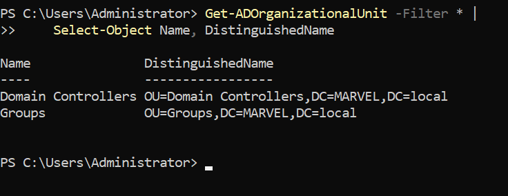
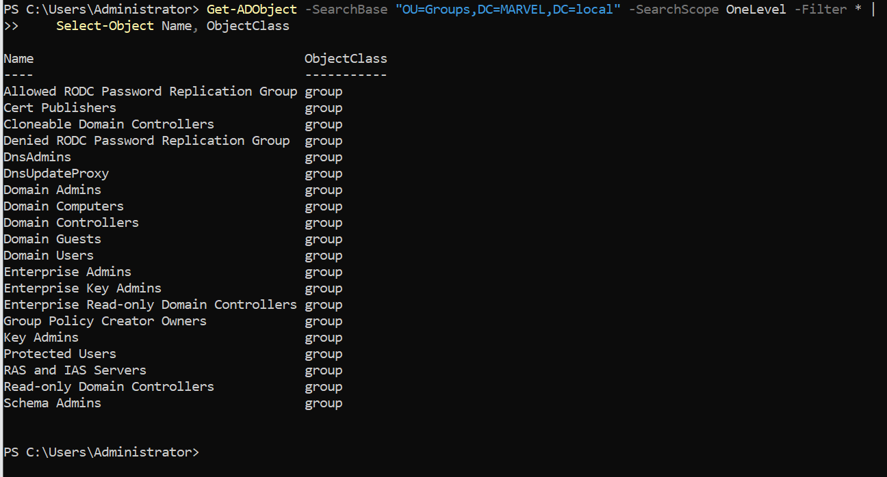
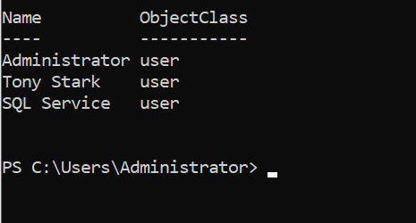
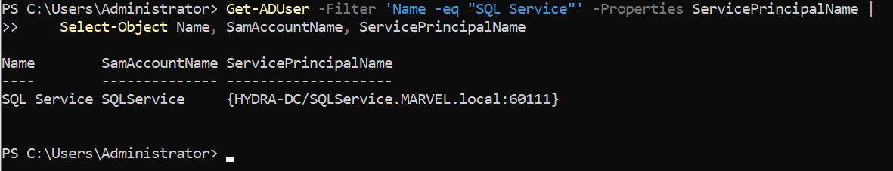

# Active Directory Directory Structure

## Scope and evidence

The following organisational units were listed by the Active Directory PowerShell module on **HYDRA-DC** in the `MARVEL.local` domain, on **20 November 2026**.

```powershell
Get-ADOrganizationalUnit -Filter * |
    Select-Object Name, DistinguishedName
```

**Observed output:**

```text
Name                DistinguishedName
----                -----------------
Domain Controllers  OU=Domain Controllers,DC=MARVEL,DC=local
Groups              OU=Groups,DC=MARVEL,DC=local
```

## Directory structure observed



```text
MARVEL.local
├── OU=Domain Controllers
└── OU=Groups
```

The tree above shows **only organisational units returned by this command**. It is not a complete directory tree. Active Directory also contains other object classes and built-in containers (for example `CN=Users` and `CN=Computers`) that are **not included** in an `Get-ADOrganizationalUnit` listing.

| OU | Distinguished name | Interpretation |
| --- | --- | --- |
| Domain Controllers | `OU=Domain Controllers,DC=MARVEL,DC=local` | Standard OU commonly used to hold domain controller computer objects; membership not separately queried yet |
| Groups | `OU=Groups,DC=MARVEL,DC=local` | OU with 20 immediate child objects returned with `ObjectClass=group` |

### Notes for security analysis

- An **OU** is a directory container and is not itself a security group.
- A **distinguished name (DN)** identifies an object or container within the LDAP directory hierarchy.
- OUs can be targets of Group Policy links and delegated administration, but this output does not verify any GPO links or delegated permissions.
- The OU enumeration does not establish group memberships, permissions or privileges. A subsequent read-only query enumerates 20 group objects, but not their members or permissions.

## Groups OU — direct child objects verified on 2026-11-20



Command executed on HYDRA-DC:

```powershell
Get-ADObject -SearchBase "OU=Groups,DC=MARVEL,DC=local" -SearchScope OneLevel -Filter * |
    Select-Object Name, ObjectClass
```

**Observed output: 20 objects, each with `ObjectClass=group`.**

| # | Name | ObjectClass |
| ---: | --- | --- |
| 1 | Allowed RODC Password Replication Group | `group` |
| 2 | Cert Publishers | `group` |
| 3 | Cloneable Domain Controllers | `group` |
| 4 | Denied RODC Password Replication Group | `group` |
| 5 | DnsAdmins | `group` |
| 6 | DnsUpdateProxy | `group` |
| 7 | Domain Admins | `group` |
| 8 | Domain Computers | `group` |
| 9 | Domain Controllers | `group` |
| 10 | Domain Guests | `group` |
| 11 | Domain Users | `group` |
| 12 | Enterprise Admins | `group` |
| 13 | Enterprise Key Admins | `group` |
| 14 | Enterprise Read-only Domain Controllers | `group` |
| 15 | Group Policy Creator Owners | `group` |
| 16 | Key Admins | `group` |
| 17 | Protected Users | `group` |
| 18 | RAS and IAS Servers | `group` |
| 19 | Read-only Domain Controllers | `group` |
| 20 | Schema Admins | `group` |

**Interpretation:** All 20 are immediate child group objects in this OU. Their names include well-known privilege-relevant groups such as `Domain Admins`, `Enterprise Admins`, `Schema Admins` and `DnsAdmins`. The command doesn't establish group membership, permissions, GroupScope, GroupCategory or vulnerabilities. Built-in AD objects in other containers are outside this query's scope.

**Evidence:** Screenshot submitted in the conversation on 2026-11-20; redacted PNG not yet committed to the GitHub evidence folder.

## Domain Admins — verified direct membership (2026-11-20)



**Command executed on HYDRA-DC:**

```powershell
Get-ADGroupMember -Identity "Domain Admins" |
    Select-Object Name, ObjectClass
```

**Observed result: 3 direct members, all `user` objects.**

| Name | ObjectClass |
| --- | --- |
| `Administrator` | `user` |
| `Tony Stark` | `user` |
| `SQL Service` | `user` |

**Interpretation:** The named accounts are direct members of `Domain Admins`, a highly privileged AD group. This result does **not** show the accounts' `SamAccountName` values, their actual usage, whether they are enabled, group nesting elsewhere, active logons, or any service principal names (SPNs).

**Security observation — intentional lab configuration:** The account named `SQL Service` is a direct member of `Domain Admins`. The user confirmed this was **deliberately configured for PEH attack practice**, rather than an accidental production misconfiguration. The separate SPN query below establishes that an SPN is registered; neither the name nor SPN establishes that an actual SQL Server service is running. No attack has been performed or proven successful.

**Evidence:** PowerShell screenshot supplied in the PEH project conversation on 2026-11-20; a redacted image copy is not yet in GitHub.

## SQL Service account — SPN registration verified (2026-11-20)



**Command run on HYDRA-DC:**

```powershell
Get-ADUser -Filter 'Name -eq "SQL Service"' -Properties ServicePrincipalName |
    Select-Object Name, SamAccountName, ServicePrincipalName
```

**Observed output:**

| Attribute | Value |
| --- | --- |
| Name | `SQL Service` |
| SamAccountName | `SQLService` |
| ServicePrincipalName | `HYDRA-DC/SQLService.MARVEL.local:60111` |

**Interpretation:** The account has an SPN, which associates a service identifier with an account for Kerberos service ticket requests. This is a lab **Kerberoasting setup condition** because a conventional domain user with a registered SPN can be targeted for a Kerberos service ticket request. With this account's membership of `Domain Admins`, successful credential compromise could have serious domain impact.

The SPN string is not the usual `MSSQLSvc/` format; **it does not prove Microsoft SQL Server is running**. We have not verified a service process, enabled status, password strength, ticket-request success, or credential recovery. No Kerberoasting attack has been conducted yet.

**Intent and classification:** The user deliberately configured this account for the TCM Security PEH practice lab. Record as an **intentional high-impact lab weakness / attack prerequisite**, not as an unintentional discovered vulnerability or a completed compromise.

**General defensive lesson:** Service accounts should not be domain administrators without an exceptional documented requirement. Prefer least-privileged accounts or gMSAs where supported and monitor inappropriate SPN/service-account privilege combinations.

**Evidence:** Screenshot supplied in the PEH project conversation on 2026-11-20. A redacted PNG has not yet been committed.

## Screenshot evidence

The four corresponding PowerShell screenshots were supplied during the PEH project conversation and have now been uploaded to GitHub as evidence files 15–18. They are embedded in the relevant sections above. The screenshot evidence supports only the displayed inventories, memberships and SPN attributes; no exploitation is claimed.
