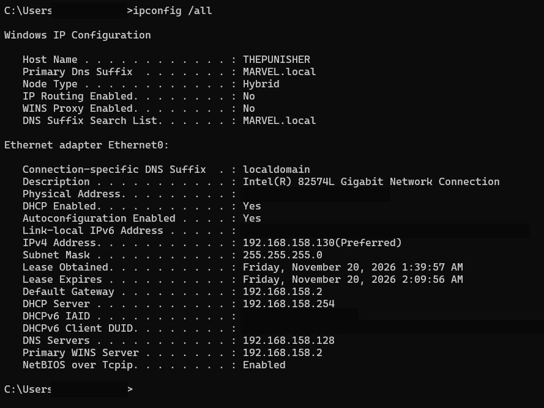
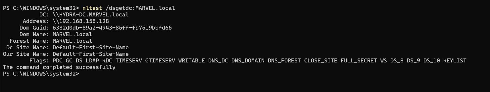

# Screenshot Evidence Register — 20 November 2026

**Status: 14 original PNG images confirmed present in the GitHub `evidence/` directory.** An additional 26 screenshots from the same day have been organised and numbered 15–40 but are **pending upload**; see [batch 2 upload plan](UPLOAD-PLAN-2026-11-20.md). Do not interpret the pending files as already present. The files were prepared from the project's supplied screenshots and uploaded on 2026-11-20. The technical outcomes are separately documented in [the assessment journal](../docs/03-assessment-journal.md) and [the network architecture document](../docs/02-network-architecture.md).

| File | Evidence of |
| --- | --- |
| [2026-11-20_01-vmware-inventory.png](2026-11-20_01-vmware-inventory.png) | Three VMware lab machines |
| [2026-11-20_02-hydra-dc-ipconfig.png](2026-11-20_02-hydra-dc-ipconfig.png) | HYDRA-DC IPv4, subnet and DNS configuration |
| [2026-11-20_03-hydra-dc-ad-identity.png](2026-11-20_03-hydra-dc-ad-identity.png) | Domain controller / Global Catalog PowerShell lookup |
| [2026-11-20_04-thepunisher-ipconfig.png](2026-11-20_04-thepunisher-ipconfig.png) | THEPUNISHER IP and DNS configuration |
| [2026-11-20_05-thepunisher-domain-membership.png](2026-11-20_05-thepunisher-domain-membership.png) | THEPUNISHER configured domain membership |
| [2026-11-20_06-spiderman-ipconfig.png](2026-11-20_06-spiderman-ipconfig.png) | SPIDERMAN IP and DNS configuration |
| [2026-11-20_07-spiderman-domain-membership.png](2026-11-20_07-spiderman-domain-membership.png) | SPIDERMAN configured domain membership |
| [2026-11-20_08-hydra-dc-vmware-nat.png](2026-11-20_08-hydra-dc-vmware-nat.png) | HYDRA-DC VMware NAT adapter selection |
| [2026-11-20_09-thepunisher-dns-lookup.png](2026-11-20_09-thepunisher-dns-lookup.png) | HYDRA-DC A-record resolution from THEPUNISHER |
| [2026-11-20_10-thepunisher-ldap-tcp389.png](2026-11-20_10-thepunisher-ldap-tcp389.png) | THEPUNISHER TCP port 389 connectivity |
| [2026-11-20_11-spiderman-ldap-tcp389.png](2026-11-20_11-spiderman-ldap-tcp389.png) | SPIDERMAN TCP port 389 connectivity |
| [2026-11-20_12-spiderman-dc-discovery.png](2026-11-20_12-spiderman-dc-discovery.png) | SPIDERMAN `nltest /dsgetdc` result |
| [2026-11-20_13-spiderman-secure-channel-failure.png](2026-11-20_13-spiderman-secure-channel-failure.png) | SPIDERMAN initial `Test-ComputerSecureChannel=False` |
| [2026-11-20_14-spiderman-netlogon-sc-query.png](2026-11-20_14-spiderman-netlogon-sc-query.png) | SPIDERMAN `nltest /sc_query` last-used Netlogon success status |

These screenshots support the particular displayed facts, **not** unsupported conclusions about live authentication, trust health, or exploitation. The repeat elevated `False` secure-channel result was confirmed in chat but has no separate screenshot.

## Verification and limits

All 14 images listed above were confirmed as individual PNG files in the `evidence/` directory on GitHub. Their filenames and relative links have been checked against GitHub's directory listing. Before changing repository visibility, review the screenshots again for confidential information and verify all redactions are sufficient.

## Inline screenshot gallery

The images below render directly on this GitHub page; no need to open each PNG individually.

### VMware inventory showing three virtual machines

### HYDRA-DC network configuration

### HYDRA-DC domain controller identity and Global Catalog

### THEPUNISHER network configuration

### THEPUNISHER domain membership

### SPIDERMAN network configuration

### SPIDERMAN domain membership

### HYDRA-DC VMware NAT settings

### THEPUNISHER DNS resolution of HYDRA-DC

### THEPUNISHER TCP connectivity to LDAP port 389

### SPIDERMAN TCP connectivity to LDAP port 389

### SPIDERMAN domain controller discovery

### SPIDERMAN failed secure-channel check

### SPIDERMAN Netlogon last-used secure-channel status

