# Screenshot Evidence Register — 20 November 2026

**Status: 40/40 PNG screenshots confirmed present in GitHub `evidence/` as of 2026-11-20.** The initial batch (01–14) and subsequent batch (15–40) are uploaded; each numbered file was checked against the GitHub directory listing. The files were prepared from the project's supplied screenshots and uploaded on 2026-11-20. The technical outcomes are separately documented in [the assessment journal](../docs/03-assessment-journal.md) and [the network architecture document](../docs/02-network-architecture.md).

| File | Evidence of |
| --- | --- |
| [2026-11-20_01-vmware-inventory.png](2026-11-20_01-vmware-inventory.png) | Three VMware lab machines |
| [2026-11-20_02-hydra-dc-ipconfig.png](2026-11-20_02-hydra-dc-ipconfig.png) | HYDRA-DC IPv4, subnet and DNS configuration |
| [2026-11-20_03-hydra-dc-ad-identity.png](2026-11-20_03-hydra-dc-ad-identity.png) | Domain controller / Global Catalog PowerShell lookup |
| [2026-11-20_04-thepunisher-ipconfig.png](2026-11-20_04-thepunisher-ipconfig.png) | THEPUNISHER IP and DNS configuration |
| [2026-11-20_05-thepunisher-domain-membership.png](2026-11-20_05-thepunisher-domain-membership.png) | THEPUNISHER configured domain membership |
| [2026-11-20_06-spiderman-ipconfig.png](2026-11-20_06-spiderman-ipconfig.png) | SPIDERMAN IP and DNS configuration |
| [2026-11-20_07-spiderman-domain-membership.png](2026-11-20_07-spiderman-domain-membership.png) | SPIDERMAN configured domain membership |
| [2026-11-20_08-hydra-dc-vmware-nat.png](2026-11-20_08-hydra-dc-vmware-nat.png) | HYDRA-DC VMware NAT adapter selection |
| [2026-11-20_09-thepunisher-dns-lookup.png](2026-11-20_09-thepunisher-dns-lookup.png) | HYDRA-DC A-record resolution from THEPUNISHER |
| [2026-11-20_10-thepunisher-ldap-tcp389.png](2026-11-20_10-thepunisher-ldap-tcp389.png) | THEPUNISHER TCP port 389 connectivity |
| [2026-11-20_11-spiderman-ldap-tcp389.png](2026-11-20_11-spiderman-ldap-tcp389.png) | SPIDERMAN TCP port 389 connectivity |
| [2026-11-20_12-spiderman-dc-discovery.png](2026-11-20_12-spiderman-dc-discovery.png) | SPIDERMAN `nltest /dsgetdc` result |
| [2026-11-20_13-spiderman-secure-channel-failure.png](2026-11-20_13-spiderman-secure-channel-failure.png) | SPIDERMAN initial `Test-ComputerSecureChannel=False` |
| [2026-11-20_14-spiderman-netlogon-sc-query.png](2026-11-20_14-spiderman-netlogon-sc-query.png) | SPIDERMAN `nltest /sc_query` last-used Netlogon success status |
| [2026-11-20_15-ad-organizational-units.png](2026-11-20_15-ad-organizational-units.png) | AD organisational unit inventory |
| [2026-11-20_16-ad-group-inventory.png](2026-11-20_16-ad-group-inventory.png) | 20 groups in the Groups OU |
| [2026-11-20_17-domain-admins-members.png](2026-11-20_17-domain-admins-members.png) | Domain Admins direct members |
| [2026-11-20_18-sqlservice-spn.png](2026-11-20_18-sqlservice-spn.png) | SQL Service account SPN |
| [2026-11-20_19-kali-initial-ip.png](2026-11-20_19-kali-initial-ip.png) | Kali initial IP configuration |
| [2026-11-20_20-kali-nat-adapter.png](2026-11-20_20-kali-nat-adapter.png) | Kali VMware NAT adapter settings |
| [2026-11-20_21-vmware-virtual-network-editor.png](2026-11-20_21-vmware-virtual-network-editor.png) | VMware virtual network editor |
| [2026-11-20_22-hydra-dc-isolated-ipconfig.png](2026-11-20_22-hydra-dc-isolated-ipconfig.png) | HYDRA-DC post-isolation IPv4 configuration |
| [2026-11-20_23-kali-nmcli-active-profile.png](2026-11-20_23-kali-nmcli-active-profile.png) | Kali active NetworkManager profile |
| [2026-11-20_24-kali-nmcli-static-profile.png](2026-11-20_24-kali-nmcli-static-profile.png) | Kali saved static IPv4 NetworkManager profile |
| [2026-11-20_25-kali-isolated-vmware-adapter.png](2026-11-20_25-kali-isolated-vmware-adapter.png) | Kali isolated LAN segment adapter |
| [2026-11-20_26-kali-isolated-ip-and-route.png](2026-11-20_26-kali-isolated-ip-and-route.png) | Kali post-migration IP and route |
| [2026-11-20_27-kali-to-hydra-dc-ping.png](2026-11-20_27-kali-to-hydra-dc-ping.png) | Kali to HYDRA-DC ICMP connectivity |
| [2026-11-20_28-thepunisher-adapter-name.png](2026-11-20_28-thepunisher-adapter-name.png) | THEPUNISHER adapter identification |
| [2026-11-20_29-thepunisher-static-ip-before-move.png](2026-11-20_29-thepunisher-static-ip-before-move.png) | THEPUNISHER pre-migration static IPv4 |
| [2026-11-20_30-thepunisher-isolated-ipconfig.png](2026-11-20_30-thepunisher-isolated-ipconfig.png) | THEPUNISHER post-migration IPv4 |
| [2026-11-20_31-thepunisher-isolated-tcp389.png](2026-11-20_31-thepunisher-isolated-tcp389.png) | THEPUNISHER post-migration TCP 389 |
| [2026-11-20_32-spiderman-adapter-name.png](2026-11-20_32-spiderman-adapter-name.png) | SPIDERMAN adapter identification |
| [2026-11-20_33-spiderman-static-ip-before-move.png](2026-11-20_33-spiderman-static-ip-before-move.png) | SPIDERMAN pre-migration static IPv4 |
| [2026-11-20_34-spiderman-isolated-ipconfig.png](2026-11-20_34-spiderman-isolated-ipconfig.png) | SPIDERMAN post-migration IPv4 |
| [2026-11-20_35-spiderman-isolated-tcp389.png](2026-11-20_35-spiderman-isolated-tcp389.png) | SPIDERMAN post-migration TCP 389 |
| [2026-11-20_36-spiderman-isolated-dns-a.png](2026-11-20_36-spiderman-isolated-dns-a.png) | SPIDERMAN AD host DNS A record |
| [2026-11-20_37-spiderman-isolated-dns-srv.png](2026-11-20_37-spiderman-isolated-dns-srv.png) | SPIDERMAN AD LDAP DNS SRV record |
| [2026-11-20_38-spiderman-isolated-dc-locator.png](2026-11-20_38-spiderman-isolated-dc-locator.png) | SPIDERMAN forced DC Locator |
| [2026-11-20_39-kali-isolated-ipv4-ipv6-routes.png](2026-11-20_39-kali-isolated-ipv4-ipv6-routes.png) | Kali post-migration IPv4/IPv6 routes |
| [2026-11-20_40-kali-no-external-ipv4-route.png](2026-11-20_40-kali-no-external-ipv4-route.png) | Kali unreachable external IPv4 route |

These screenshots support the particular displayed facts, **not** unsupported conclusions about live authentication, trust health, or exploitation. The repeat elevated `False` secure-channel result was confirmed in chat but has no separate screenshot.

## Verification and limits

All 40 images listed above were confirmed as individual PNG files in the `evidence/` directory on GitHub. Their filenames and relative links have been checked against GitHub's directory listing. Before changing repository visibility, review the screenshots again for confidential information and verify all redactions are sufficient.

## Inline screenshot gallery

The images below render directly on this GitHub page; no need to open each PNG individually.

### VMware inventory showing three virtual machines

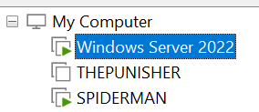

### HYDRA-DC network configuration

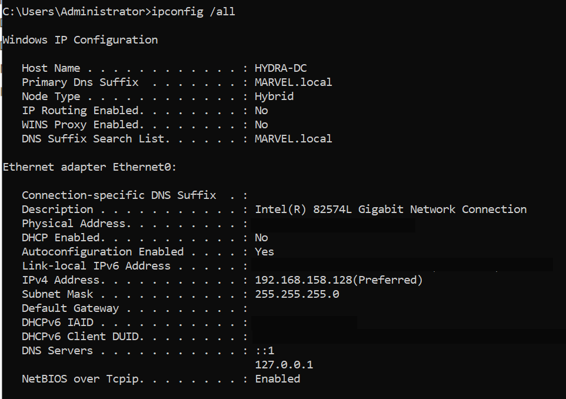

### HYDRA-DC domain controller identity and Global Catalog

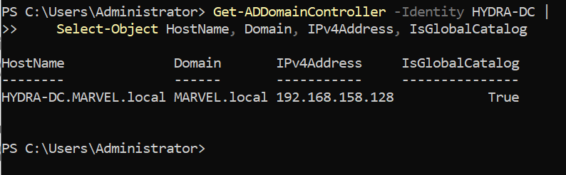

### THEPUNISHER network configuration

### THEPUNISHER domain membership

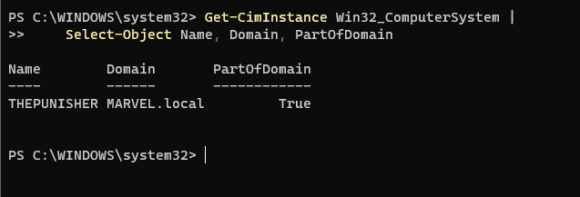

### SPIDERMAN network configuration

### SPIDERMAN domain membership

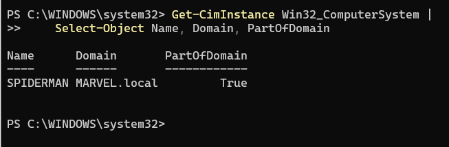

### HYDRA-DC VMware NAT settings

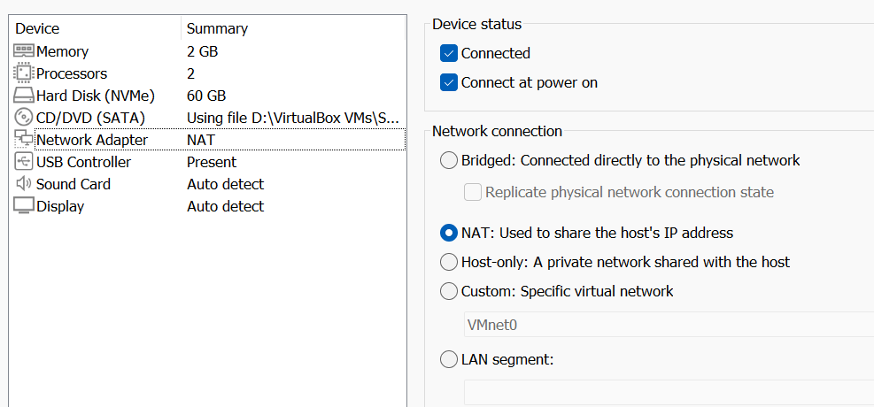

### THEPUNISHER DNS resolution of HYDRA-DC

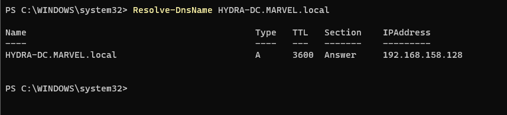

### THEPUNISHER TCP connectivity to LDAP port 389

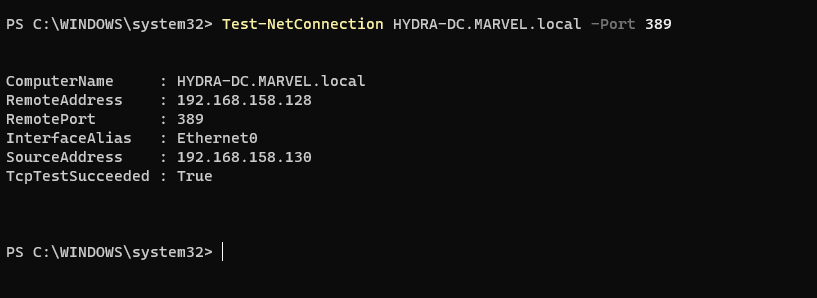

### SPIDERMAN TCP connectivity to LDAP port 389

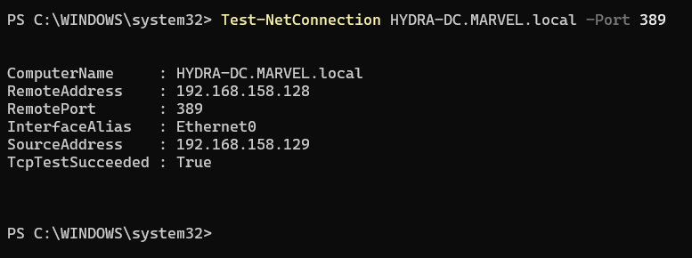

### SPIDERMAN domain controller discovery

### SPIDERMAN failed secure-channel check

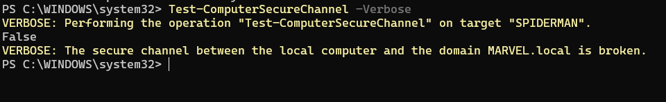

### SPIDERMAN Netlogon last-used secure-channel status

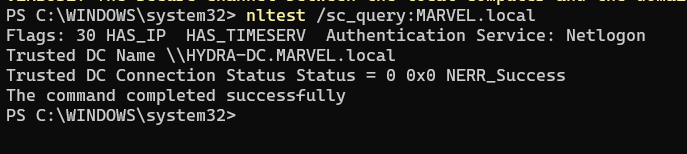

## Inline screenshots 15–40 — AD inventory and isolated lab migration

### AD organisational unit inventory

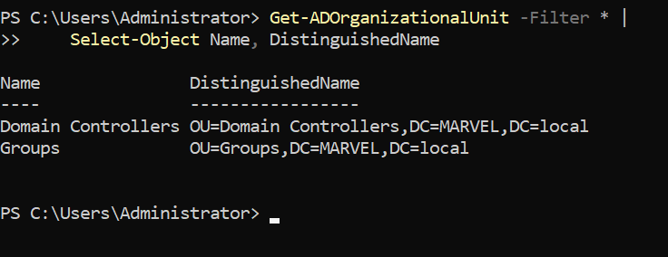

### 20 groups in the Groups OU

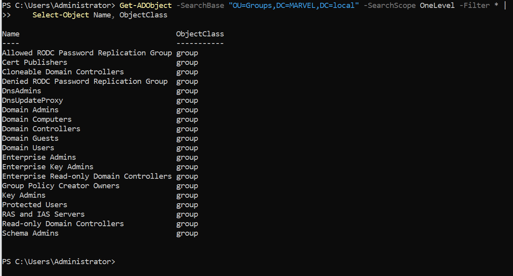

### Domain Admins direct members

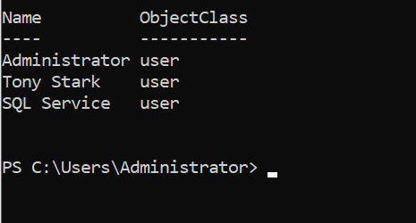

### SQL Service account SPN

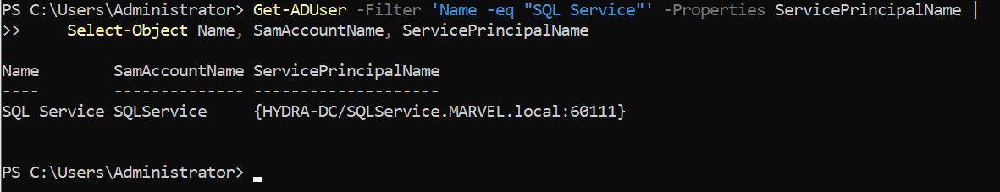

### Kali initial IP configuration

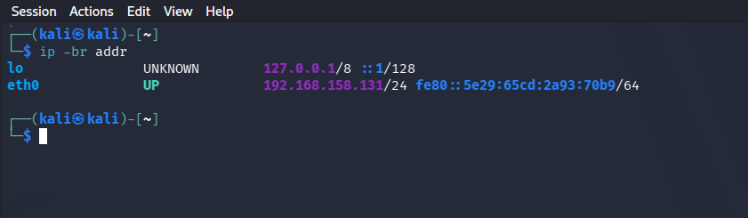

### Kali VMware NAT adapter settings

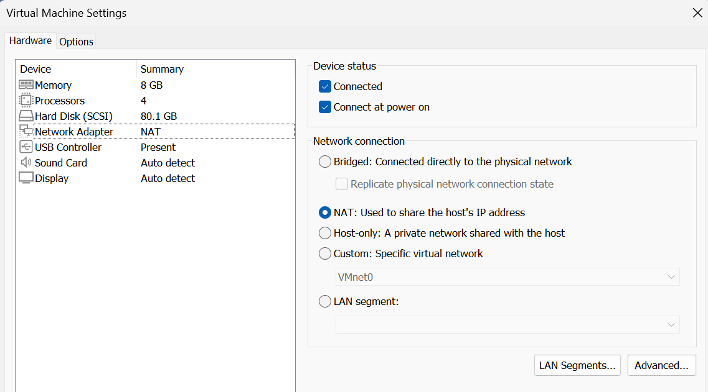

### VMware virtual network editor

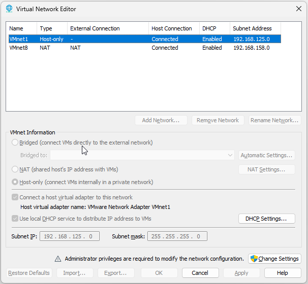

### HYDRA-DC post-isolation IPv4 configuration

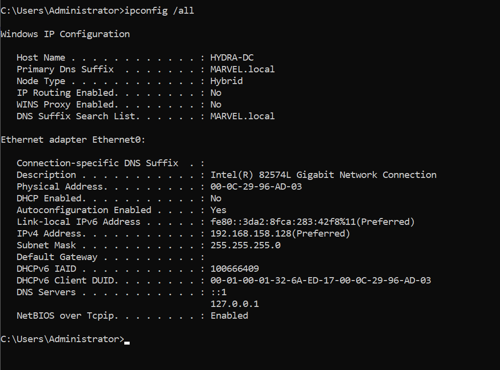

### Kali active NetworkManager profile

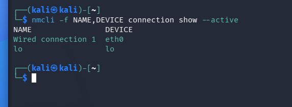

### Kali saved static IPv4 NetworkManager profile

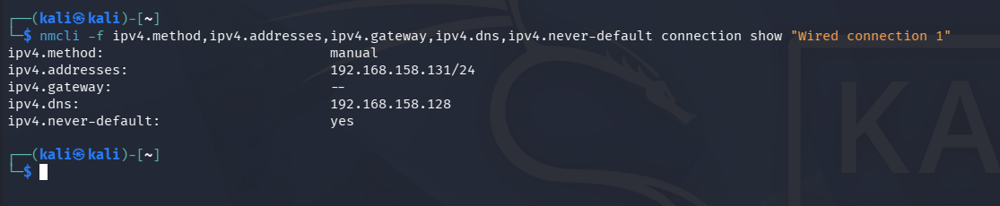

### Kali isolated LAN segment adapter

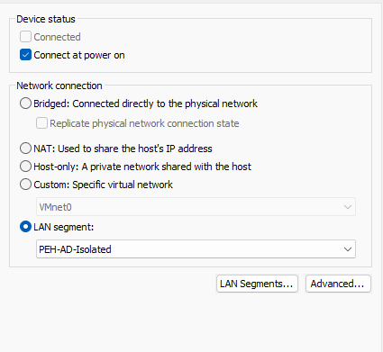

### Kali post-migration IP and route

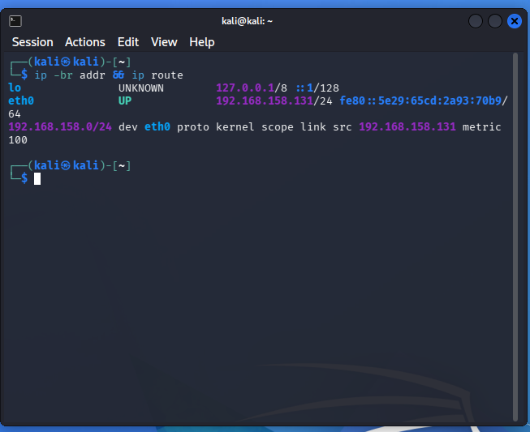

### Kali to HYDRA-DC ICMP connectivity

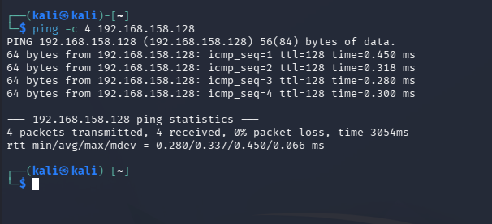

### THEPUNISHER adapter identification

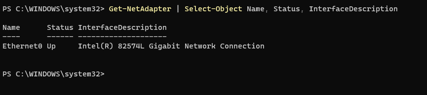

### THEPUNISHER pre-migration static IPv4

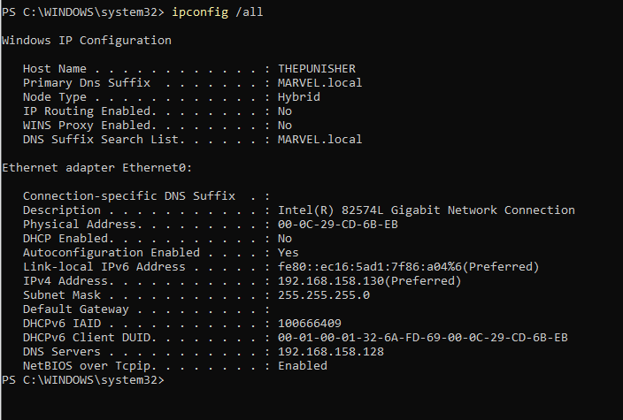

### THEPUNISHER post-migration IPv4

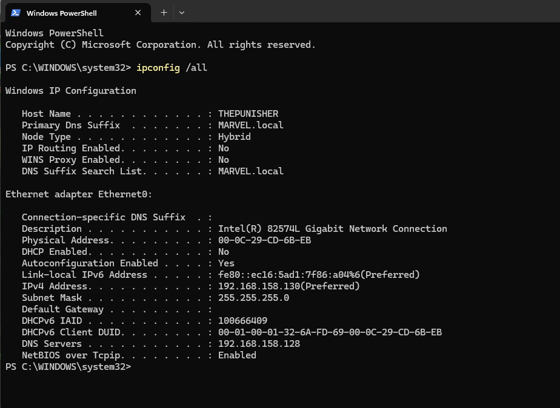

### THEPUNISHER post-migration TCP 389

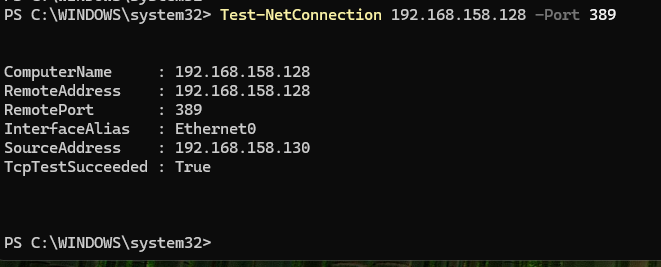

### SPIDERMAN adapter identification

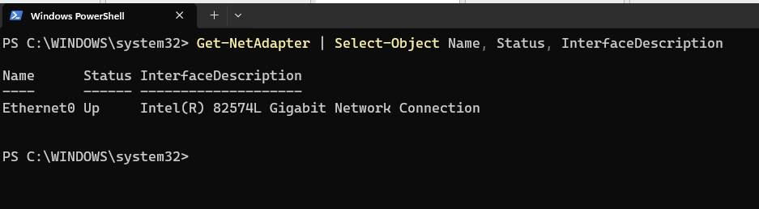

### SPIDERMAN pre-migration static IPv4

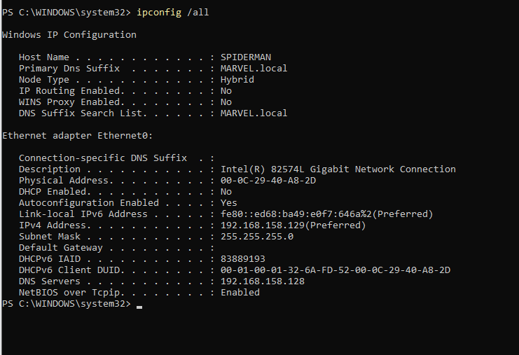

### SPIDERMAN post-migration IPv4

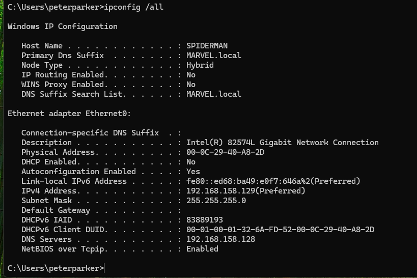

### SPIDERMAN post-migration TCP 389

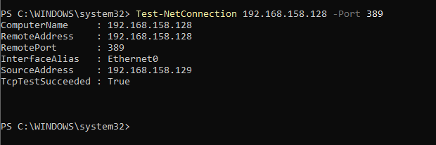

### SPIDERMAN AD host DNS A record

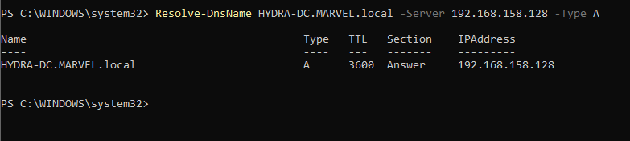

### SPIDERMAN AD LDAP DNS SRV record

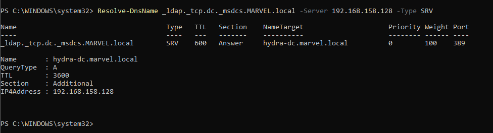

### SPIDERMAN forced DC Locator

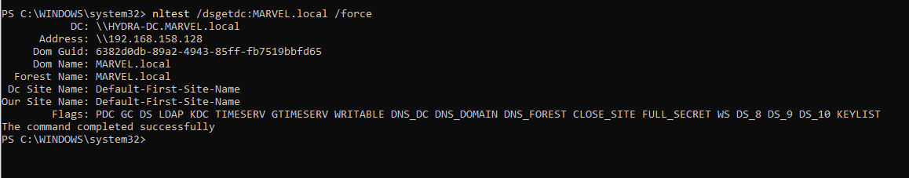

### Kali post-migration IPv4/IPv6 routes

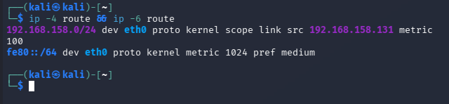

### Kali unreachable external IPv4 route

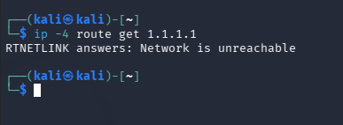
